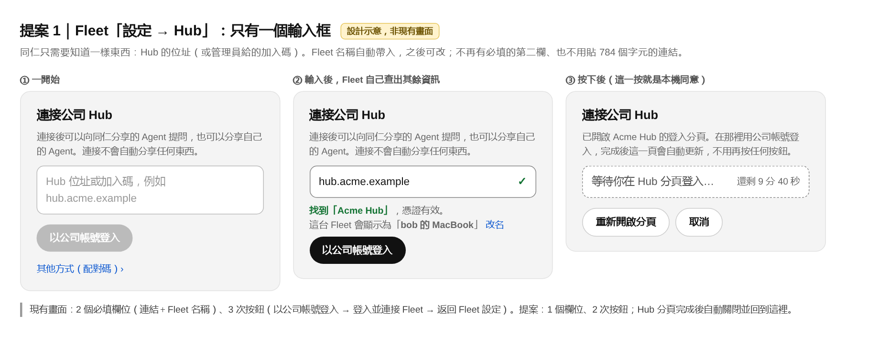
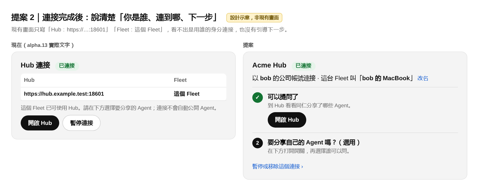
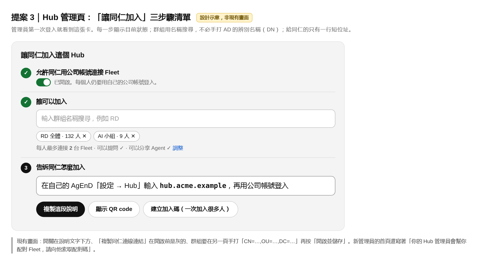
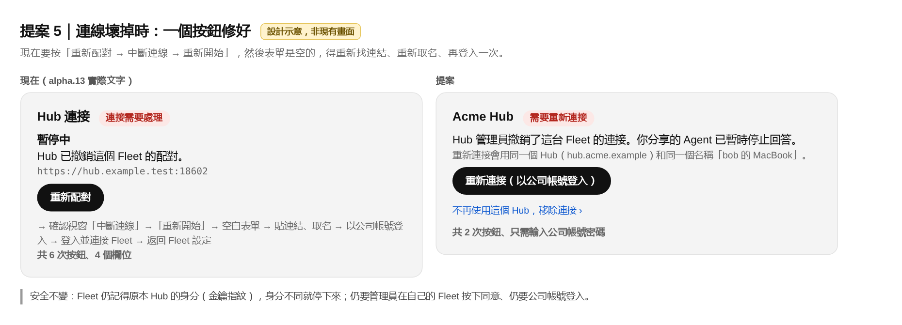
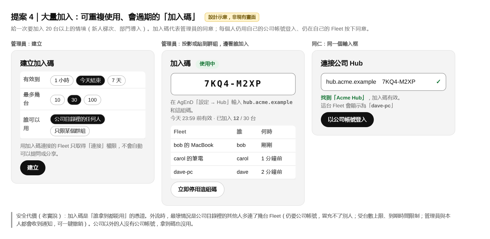
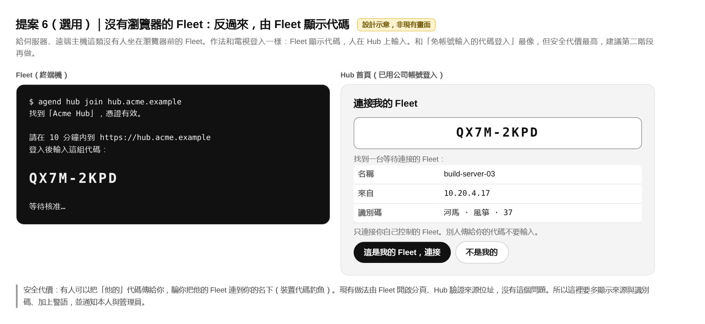

# AgEnD Hub 使用體驗審查與簡化提案（M-2902）

審查日期：2026-11-11。審查者：Lumen（Claude Fable 5.2，只做審查與設計，沒有改產品程式）。
審查版本：`release/2.3.5-alpha` @ `1066a85a`（alpha.13 的內容；到 `d02678ab` 為止 `src/hub` 與 Hub 畫面沒有變動，#3644 尚未合入）。
環境：一次性容器 `agend-hubux`（一個 Hub、兩個成員 Fleet、假的 AD），腳本在 `~/.cache/rh-hubux`。沒有碰正式 Fleet、Mac 試點或任何真實帳號。
截圖與示意圖：[`docs/evidence/hub-ux-review-m2902/`](../evidence/hub-ux-review-m2902/)。

## 一、結論

1. **「以公司帳號登入」這條路本身已經很短**：同仁貼上連結、取名、按一下、在 Hub 輸入公司帳號密碼，實測 19–34 秒連上，管理員不用為每一台做任何事。它其實也接受只輸入 Hub 位址（不必貼長連結），這一點畫面上幾乎沒有人會發現。
2. **讓人覺得複雜的是它周圍的東西**：架設 Hub 要回答 22 個問題；管理員要先完成三件分散在不同地方的前置設定；畫面上同時存在三種連接方式和四五套用詞；連線一旦壞掉，修復要按 6 次、而且在這一版會卡死。
3. **建議分三階段**：
   - **A（只改畫面，不動安全設計）**：Fleet 端改成一個輸入框、Hub 管理頁改成三步驟清單、修復改成一個按鈕、統一用詞。這一階段就能把「同仁加入」從 2 欄 3 按降到 1 欄 2 按。
   - **B（大量加入）**：可重複使用、會過期的「加入碼」，給一次 20 台以上的情境。
   - **C（選用）**：沒有瀏覽器的 Fleet 用「Fleet 顯示代碼、人在 Hub 輸入」。安全代價最高，建議最後再評估。
4. **上 Mac 實機前必須先處理的兩件事**：第 1 項阻礙（重新連接卡死，等 #3644）與 Hub 憑證條件（見阻礙 2 的最後一點）。

## 二、八段旅程實測紀錄

「按」是按鈕次數，「欄」是要輸入或貼上的欄位數。

| 旅程 | 在哪裡做 | 實測步驟 | 使用者要懂的概念 | 等待 |
|---|---|---|---|---|
| 1. 架設 Hub | 終端機 `agend hub init` | 22 次回答（其中 2 次要打整個英文字 `initialize`、`install`） | 兩個位址、兩個監聽位址、PEM 憑證鏈、LDAPS、base DN、bind DN、目錄代號、CA 指紋、保留天數 | 每步 1–6 秒 |
| 2. 管理員第一次登入 | Hub 網頁 | 帳號、密碼、登入 | 無 | 4 秒 |
| 3. 開放同仁加入 | Hub「管理」 | 開關 1 按 →「管理群組權限」→ 手打群組 DN →「新增群組」→ 勾 2 個權限 → 填台數 →「開啟」→「開啟並儲存」→ 回上一頁「複製同仁連線連結」，約 9 按 2 欄 | AD 辨別名稱（DN）、三種權限、實驗性開關 | 各 1–4 秒 |
| 4. 同仁加入（公司帳號） | Fleet「設定 → Hub」＋ Hub 分頁 | 貼連結、取名、「以公司帳號登入」→ 新分頁輸入帳號密碼、「登入並連接 Fleet」→「返回 Fleet 設定」：4 欄 3 按 | 連結是什麼、為什麼要取名 | 全程 19–34 秒，其中 Hub 分頁最久等了 9 秒 |
| 5. 分享 Agent、開放提問 | Fleet 開關 → Hub「我分享的 Agent」 | 開關 1 按 →「允許他人提問…」→ 新分頁要再登入 Hub 一次 → 輸入對方帳號、選天數、「允許」。每多一個人就重來一次 | 分享與「允許提問」是兩件事；期限最長 90 天 | 各 2–4 秒 |
| 6. 提問 | Hub「新對話」 | 「新對話」→「提問」→ 打字 → Enter | 無（說明文字清楚） | 見下方備註 |
| 7. 撤銷 | Hub「管理」 | 該列「⋯」→「撤銷…」→ 確認：3 按 | 無 | 3 秒內成員端顯示「Hub 已撤銷這個 Fleet 的配對」 |
| 8. 修復連線 | Fleet「設定 → Hub」 | 「重新配對」→「中斷連線」→「重新開始」→ 表單清空 → 重做旅程 4：6 按 4 欄 | 重新配對、中斷連線、重新開始三個詞的差別 | 這一版在此卡死，見阻礙 1 |
| 20 台以上 | 同旅程 4 | 每位同仁各做一次旅程 4；管理員不用逐台核准 | 同旅程 4 | 上限見附錄 A.4 |

備註：
- 旅程 6 在我的環境裡問題停在「等待回答」，因為假 Agent 不會呼叫 Hub 的回覆工具。這是測試環境的限制，不是產品問題；dev-claude 在 `rh-a13` 用真的 Claude Code 驗過回答會回來。
- 另外兩種連接方式（管理員配對碼、Hub 首頁「連接我的 Fleet」）我只走到產生代碼的畫面，沒有完成整段；步驟數取自設計文件與 dev-claude 的腳本。

## 三、阻礙排行（最嚴重的在前）

### 1. 重新連接會卡死，畫面只叫你「再試一次」

在 Fleet 按「撤銷連接」→「重新開始」之後再用公司帳號登入，Hub 分頁顯示「目前無法確認結果。請先檢查這次連接，不要另開一次連接。」之後這台 Fleet 每次重試都立刻出現同一句話，「再試一次」只會清掉訊息。十分鐘後那筆未完成的紀錄變成「已過期」，仍然擋住所有新的嘗試。我重試了四次，結果相同。

- 畫面：[Hub 分頁](../evidence/hub-ux-review-m2902/screens/F6-F2-hubtab-done-zh.png)、[Fleet 端](../evidence/hub-ux-review-m2902/screens/F3-F2-pressed-en.png)。
- 這和 dev-claude 在 alpha.13 排練回報的問題相同（未完成的開始會擋住之後的開始），#3644 正在修。
- **還沒查清的部分**：第一次失敗發生在公司帳號已經登入成功之後。當時這個人在 Hub 首頁還有一個沒用完的「連接我的 Fleet」代碼，Hub 上也還留著剛才那台的舊紀錄。是哪一個造成的，我沒有分離出來。#3644 合入後應該用同樣步驟再驗一次。
- 對照：「管理員撤銷 → 重新配對 → 重新加入」這條路我走通了一次，沒有卡住。

### 2. 架設 Hub：22 個問題，而且錯一步就全部重來

- 問題的用詞是給目錄管理員看的（base DN、bind DN、PEM full chain、SHA-256 指紋）。一般負責人無法獨立完成。
- 在「目錄 CA」選 `fetch` 後，畫面要求**手打完整的 64 位元指紋**；按 Enter 想取消，整個精靈直接結束，前面 9 個答案全部作廢。
- 「目錄位址」留空白按 Enter 會被接受，直到下一步才出現一句沒提到位址的錯誤。
- 「服務帳號密碼」前面先問「[1] 不顯示輸入 [2] 匯入檔案」。很容易在這個**會顯示文字**的提示直接打密碼（我就打錯了一次，用的是假密碼）。
- 兩個監聽位址的預設值是空的，直接按 Enter 才告訴你格式。
- 結束時印出的「如何連接 Fleet」只講舊的配對碼流程（建立配對碼、比對指紋、核准），完全沒提公司帳號連接。
- 網頁版設定（Fleet「設定 → Hub → 在這台電腦設定」）第一頁就有 9 個欄位，問的是同樣的東西（[畫面](../evidence/hub-ux-review-m2902/screens/O1-websetup-step1-zh.png)）。
- **憑證條件沒有說**：設計文件寫明公司帳號連接「使用一般的 HTTPS 憑證驗證」，而且 Hub 與 Fleet 的網頁必須是不同的主機名稱。精靈卻提供「產生 30 天自簽憑證」，只提醒瀏覽器會警告，沒說 Fleet 會因此連不上。這一點我沒有親自重現（我的環境是把測試 CA 裝進系統後才連上的，dev-claude 的環境也是），但照設計文件，用自簽憑證或同一台電腦同一個主機名稱的 Mac 試點會在這裡失敗。

### 3. 管理員開放加入：三件前置設定散在各處，說明順序和操作順序相反

- 卡片上的說明第一步是「在這裡複製同仁連線連結」，但按鈕是灰的；要先打開更下面的開關（[畫面](../evidence/hub-ux-review-m2902/screens/B1-admin-zh.png)）。
- 打開開關還不夠，還要到另一頁設定群組權限，否則同仁登入後不會被放行。畫面沒有告訴管理員「還差這一步」。
- 群組只能手打完整的 AD 辨別名稱，例如 `CN=Owners,DC=example,DC=test`。打群組名稱 `Owners` 得到「這不是辨別名稱。」（[畫面](../evidence/hub-ux-review-m2902/screens/D-2-wrongname-zh.png)）。
- 群組權限頁標著「實驗性」，有自己的「開啟／關閉」，按了「開啟」還要再按「開啟並儲存」。
- 管理員第一次登入看到的首頁寫著「你的 Hub 管理員會幫你配對 Fleet。請向他索取配對碼。」他自己就是管理員（[畫面](../evidence/hub-ux-review-m2902/screens/A3-hub-home-zh.png)）。

### 4. 三種連接方式同時出現，用詞四五套

- 同一件事有三條路：公司帳號連接、管理員配對碼（「進階」）、Hub 首頁的「連接我的 Fleet」（要開一個開關、貼另一個位址、輸入代碼、兩邊比對指紋）。第三條路在群組權限開啟後會出現在**每個人的 Hub 首頁最顯眼的位置**（[畫面](../evidence/hub-ux-review-m2902/screens/P3a-carol-home-after-rejoin-zh.png)），而它是三條裡最複雜的。
- 兩條路會互相擋：管理員替某人建立配對碼後，那個人自己按「連接我的 Fleet」會得到「管理員已為你建立手動配對碼。請使用它，或請管理員協助。」
- 動詞：配對、連接、連線、加入、使用。名詞：配對碼、一次性配對碼、手動配對碼、公司連結、同仁連線連結、Hub 連結、邀請。按鈕叫「撤銷連接」，按下去的確認視窗寫「中斷連線」（[畫面](../evidence/hub-ux-review-m2902/screens/T1-local-disconnect-dialog-zh.png)）。「公開的 Agent」和「我分享的 Agent」是同一件事。
- 使用者會看到兩個不同的 Hub 位址：連上時顯示 `:18601`，壞掉時顯示 `:18602`，配對碼流程還特別提醒「這與 Hub 的瀏覽器位址不同」。

### 5. 修復流程長，而且兩邊的清單會對不上

- 「重新配對」其實是「中斷連線 → 重新開始 → 從頭加入」，表單是空的，要重新找連結、重新取名（[畫面](../evidence/hub-ux-review-m2902/screens/S9-unconnected-zh.png)）。
- 在 Fleet 端中斷後，畫面說「Hub 管理員撤銷之前，Hub 上仍會列出這個 Fleet」。也就是每次本機重來，Hub 上就多一筆要管理員手動清的舊紀錄。
- Hub 管理員的清單顯示「carol 的 Fleet」兩筆（一筆已撤銷、一筆使用中），看不到同仁自己取的名字「carol 的筆電」，分不出哪一台（[畫面](../evidence/hub-ux-review-m2902/screens/R1-admin-fleets-zh.png)）。20 台以上時這張清單無法使用。

### 6. 同仁加入時多出來的東西

- 連結長 784 個字元，只能複製貼上，沒辦法唸給同事或寫在白板上。
- 「Fleet 名稱」是必填，但取了名字之後，連上的畫面只顯示「這個 Fleet」（[畫面](../evidence/hub-ux-review-m2902/screens/F9-F1-fleet-connected-zh.png)）。
- 說明文字提到「固定的身分指紋」「記住 Hub 的身分」，但這條路沒有任何東西要比對，只會讓人不安。
- 最後的「返回 Fleet 設定」是多按的一下；不按也已經連上了。

### 7. 分享之後，開放提問是一次一個人

- 「允許他人提問…」會開新分頁，沒有 Hub 登入狀態時要再輸入一次公司帳號密碼。
- 一次只能輸入一個人的登入名稱，期限最長 90 天，不能授權給群組（[畫面](../evidence/hub-ux-review-m2902/screens/G4-allow-dialog-zh.png)）。20 位同仁要問同一個 Agent，擁有者要開 20 次視窗，90 天後再來一次。
- 這不是配對問題，但它決定了「大家都連上之後能不能真的用起來」。

### 8. 其他較小的問題

- 連上後的卡片沒有寫是用誰的公司帳號連的。
- 每位成員的「設定 → Hub」最上面都有一張「設定 Hub — 在這台電腦設定」，比「Hub 連接」還前面。只想加入的人不需要它。
- Fleet 端每次 Hub 事件都會產生通知，走完這幾段旅程後通知數字累積到 15。

### 做得好的地方（建議保留）

- 公司帳號連接不用比對指紋、不用管理員逐台核准。
- 分享 Agent 就是一個開關，而且預設都不分享。
- 提問頁「誰看得到這段對話」的說明清楚、誠實。
- 管理員撤銷的確認文字清楚，成員端 3 秒內就知道。

## 四、簡化提案

精神和「免帳號輸入的代碼登入」相同：一個輸入框，其餘由伺服器判斷，不加額外的確認步驟。

### 階段 A：只改畫面（不動任何安全設計）

**提案 1：Fleet 端一個輸入框**

- 輸入框接受 Hub 位址、長連結或配對碼，Fleet 自己判斷是哪一種。只輸入位址**今天就能用**（我用 `https://hub.example.test:18601` 實測 19 秒連上），只是畫面沒有把它當成主要做法。
- Fleet 名稱預設用電腦名稱，之後可改，不再必填。
- Hub 分頁完成後自動關閉並回到 Fleet 設定，省掉「返回 Fleet 設定」。
- 配對碼收進「其他方式」。

**提案 2：連上之後說清楚身分和下一步**

**提案 3：Hub 管理頁的三步驟清單**

- 管理員認領後直接看到這張卡，每一步顯示目前是否完成。
- 群組改成用名稱搜尋（Hub 已經有唯讀的服務帳號可以查目錄）。
- 給同仁的是一行短位址；含指紋的長連結保留為「更嚴格」的選項。
- Hub 首頁的「連接我的 Fleet」（代碼＋指紋那條路）移到進階，不再放在每個人的首頁。

**提案 5：修復改成一個按鈕**

- 「重新連接」一次做完中斷、重來、帶入原本的 Hub 位址與名稱，接著開公司帳號登入。
- 重新連接成功時，Hub 用同一筆紀錄接回去（或自動把舊的標成已取代），不再留下孤兒紀錄。
- Hub 管理員清單顯示同仁取的名稱、最後上線時間，已撤銷的收合起來。

**用詞統一**（建議）

| 概念 | 統一用詞 | 取代 |
|---|---|---|
| 讓 Fleet 和 Hub 建立關係 | 連接 | 配對、連線、加入、使用 |
| 結束關係（Fleet 端） | 移除連接 | 撤銷連接、中斷連線、重新開始 |
| 結束關係（Hub 端） | 撤銷 | — |
| 修復 | 重新連接 | 重新配對、重新開始 |
| 讓 Agent 回答 Hub 的問題 | 分享 | 公開 |
| 舊流程的代碼 | 配對碼（只在進階出現） | 一次性配對碼、手動配對碼 |
| Hub 的位址 | Hub 位址（只給使用者看瀏覽器那一個） | 成員傳輸位址、Hub 連結 |

**架設精靈的修正**（不改流程，只修陷阱）：取消不該結束整個精靈、空白位址當場擋下、密碼提示不要緊接在會顯示文字的選擇題後面、指紋改成確認而不是手打、結束時的說明改成公司帳號連接，並明講憑證與主機名稱的條件。

**階段 A 的安全代價**

| 改動 | 代價 |
|---|---|
| 主推短位址，不主推長連結 | 長連結裡帶著 Hub 的身分指紋，是管理員「另外交到同仁手上」的比對依據。只輸入位址時，Fleet 靠 HTTPS 憑證驗證加上「第一次連上就記住」。差別只在第一次連接：如果攻擊者能拿到這個主機名稱的有效憑證並攔截連線，長連結擋得住，短位址擋不住。不過同仁本來就是在同一個 HTTPS 網站上輸入公司密碼，所以實際多出來的風險很小。長連結保留給想要更嚴格的單位。 |
| Fleet 名稱不必填 | 無。名稱只是顯示用。 |
| 自動返回 | 無。本機同意仍是管理員在 Fleet 按的那一下（決議 a9ccee59）。 |
| 一鍵重新連接 | 無。Fleet 記住的 Hub 身分不變，身分不同仍會停下來；仍要公司帳號登入。 |
| 群組用名稱搜尋 | 管理員可能選到同名的錯誤群組。顯示人數與完整路徑，儲存前照舊顯示影響預覽。 |

### 階段 B：大量加入用的「加入碼」

先說清楚兩個例子的評估結果：

- **「Hub 顯示短代碼，Fleet 管理員輸入一次」**：代碼登入之所以只要一個框，是因為瀏覽器已經知道要問哪一台伺服器。Fleet 一開始不知道 Hub 在哪裡，所以短代碼**無法單獨成立**，一定要搭配 Hub 位址。而對已在允許群組裡的人，只輸入位址就夠了，代碼沒有多帶來什麼。所以這個想法最好的落點就是提案 1（一個框、輸入位址）。
- **「可重複使用、會過期的加入碼」**：這個有實際價值，建議做。它解決的是「管理員不想先研究 AD 群組，就想讓這一梯次的人今天連上」。

加入碼的設計：

- 管理員選有效期（1 小時／今天／7 天）、台數上限、誰可以用。Hub 只存雜湊。
- 加入碼代表**管理員的同意**，作用等同現在的「例外邀請」，只是可多次使用。它不代表身分：每個人仍用自己的公司帳號登入，仍在自己的 Fleet 按下同意。
- 用加入碼連上的 Fleet 只取得「連接」，不會自動取得提問或分享權限（和現在的邀請相同）。
- 管理員頁面即時顯示誰加入了，並可隨時停用。
- 同仁端還是同一個輸入框：位址加上代碼。

**加入碼的安全代價**

| 性質 | 是否保留 | 說明 |
|---|---|---|
| 公司 AD 身分 | 保留 | 每一台都要本人用公司帳號登入，冒充不了別人。 |
| Hub 金鑰釘選 | 保留 | 與提案 1 相同（憑證驗證加第一次記住；或搭配長連結）。 |
| 本機管理員同意 | 保留 | 仍是 Fleet 管理員按的那一下。 |
| 管理員逐人同意 | **放寬** | 從「指定某個人」變成「拿到碼的任何公司同仁」。碼外流時，最壞情況是公司目錄裡不該加入的人連上了 Fleet。他能做的是分享自己的 Agent 給別人問（如果群組沒給他這個權限就不能），不能讀任何人的對話，也不能問別人的 Agent（那要擁有者另外允許）。 |
| 濫用上限 | 新增風險 | 有效期內可被用到台數上限。靠到期時間、台數上限、每人上限、既有的頻率限制，以及本人與管理員都會收到的通知來控制。 |

另外要注意容量：現有的頻率限制是每人每分鐘 5 次、全 Hub 每分鐘 48 次，而且同時進行中的加入名額是 48 個、每個名額保留到它的 10 分鐘期限。20 台沒有問題；一次 50 台以上會有人被擋，需要調整上限或在畫面上排隊。

### 階段 C（選用）：沒有瀏覽器的 Fleet

- 適用於伺服器這類沒有人坐在瀏覽器前的 Fleet。Fleet 顯示代碼，人在已登入的 Hub 上輸入，Hub 找出是哪一台。這是最接近「代碼登入」的做法。
- **安全代價最高**：別人可以把他的代碼傳給你，騙你把他的 Fleet 連到你名下。現在的做法由 Fleet 開分頁、Hub 驗證來源位址，沒有這個問題。要靠顯示來源、識別碼、警語和通知來補，仍然比現在弱。
- 不建議做的變形：「綁定某個擁有者、不用登入、可重複使用的代碼」。它讓拿到代碼的人**不需要公司帳號**就能以那個人的名義連上 Fleet，等於放棄了公司 AD 身分這一條。

### 步驟數比較

| 情境 | 現在 | 階段 A | 階段 B |
|---|---|---|---|
| 同仁加入一台 | 4 欄 3 按 | 3 欄 2 按（位址、帳號、密碼） | 同左，位址後面多一組碼 |
| 管理員開放加入 | 約 9 按 2 欄，跨兩頁，要懂 DN | 3 步清單，群組用搜尋 | 建立加入碼：3 個選項 1 按，不必先設群組 |
| 20 位同仁加入 | 每人 4 欄 3 按；管理員 0 | 每人 3 欄 2 按；管理員 0 | 同左；管理員看得到即時名單 |
| 連線壞掉修復 | 6 按 4 欄 | 2 按 2 欄（帳號、密碼） | 同左 |

## 五、建議的先後順序

1. 合入 #3644 後，照阻礙 1 的步驟重驗；同時查清第一次失敗的原因。
2. 階段 A 的提案 1、3、5 和用詞統一。這是負責人感受最直接的部分，而且不需要安全審查重新來過。
3. 架設精靈的陷阱修正，以及把憑證與主機名稱條件寫進精靈。
4. 階段 B 加入碼（需要安全審查）。
5. 開放提問給群組（阻礙 7）。它不在這次要求的範圍內，但會決定大量加入之後的實際使用感受，建議另開一張卡。
6. 階段 C 視是否真的有無瀏覽器的 Fleet 再決定。

---

# English technical appendix

## A.1 Scope, build and rig

- Build walked: `@songsid/agend@2.3.5-alpha.260` from dev-claude's private verdaccio = `release/2.3.5-alpha` @ `1066a85a`. `git diff --stat 1066a85a d02678ab -- src/hub src/ui` touches only the agent export dialog, so the Hub code and Hub UI are those of the alpha tip. #3644 was not merged at review time.
- Rig: my own container `agend-hubux` (image `agend-rh-b16-bus-nobinfmt`, `SAFE_RUN` flags, never `--privileged`, no host mounts), scripts in `~/.cache/rh-hubux`. It reuses dev-claude's `ad.mjs` fake LDAPS directory and their registry; their `agend-rha13-*` containers were not touched.
  - `hub` account: the Hub, created by walking the real `agend hub init` in a tmux pane. Web `https://hub.example.test:18601`, member `:18602`, rig CA installed in the container trust store.
  - `rh` (F1, health 19280) and `rh2` (F2, health 19290): web-only fleets with mock backends.
  - Directory people: `alice` (first admin), `bob`, `carol`, `dave`, `user01`–`user22`; one group `CN=Owners`.
- Browser: Playwright Chromium on the host through a CONNECT proxy in the container; `locale` en-US and zh-TW. Walk scripts `j1`–`j19.mts`, text dumps in `walk.log`.
- Not exercised here: a real backend answering a Hub question (mock agents never call the Hub answer tool; covered by `rh-a13` leg H), completing manual pairing and quick pairing through the UI (first screens only), the Hub with a self-signed certificate, the Hub and Fleet on one hostname, and more than two fleets joining concurrently.

## A.2 Measured journeys

| Journey | Result |
|---|---|
| `agend hub init` | 22 answers to reach a running service. Prompts in order: name, web address, member address, web listener, member listener, certificate file, key file, directory id, directory address, directory CA, trust y/N, directory type, base DN, bind DN, password mode, password, admin login, confirm y/N, content days, event days, `initialize`, `install`. |
| Admin first sign-in | `alice` signs in, lands on Chats with the member welcome copy. No admin onboarding. |
| Enable company join | Switch saves at once, no dialog. Group editor needs a full DN, `Turn on and save`. `GET /hub/v1/admin/company-join` then returns a `companyLink` of 784 characters (`/join-info#hub=` + 739). |
| Company join, pasted link (F1, `bob`, zh-TW) | Connected at 34 s; the Hub tab took 9 s to show its sign-in form. |
| Company join, typed `https://hub.example.test:18601` (F2, `carol`, EN) | Connected at 19 s. Same screens; no fingerprint shown. |
| Share + grant | Toggle applies at once (host web session self-confirms). `Allow others to ask…` opens `…/ui/hub/exposures?agent=…&grant=1`, asks for Hub sign-in, then opens the dialog (login name, 1/7/30/90 days). |
| Ask | New chat → Ask → send; receipt stays `Waiting` with the mock backend. |
| Admin revoke | Row menu → `Revoke…` → confirm. Member card reads held/revoked within 3 s. Row stays listed as Revoked. |
| Recover after admin revoke | `Pair again` → `Disconnect` → `Start over` → empty form → join again: succeeded. |
| Recover after member-side disconnect | `Connection settings` → `Revoke connection` (dialog says `Disconnect`) → `Start over` → join again: **failed**, see A.3. |

## A.3 Defects found while walking

1. **Re-join dead end (P1 for the pilot).** Sequence on F2: joined, admin-revoked, recovered and re-joined (OK), then member-side disconnect + Start over, then company sign-in again.
   - Attempt 1: the Hub tab, after a successful AD submit, showed "The result could not be verified. Check this same connection before starting another one." The Fleet page stayed on "Finish signing in on the Hub page".
   - Attempts 2–4 from new browser sessions: the Fleet page shows the same message immediately after the press and no Hub sign-in form appears. Local record `hub-member/company-joins/88c15600….json` read `stage: pending, issued: false` and, after its 10-minute deadline, `stage: held, reason: expired`; later starts are still refused. This matches the `priorBlocks()` finding from the alpha.13 rehearsal; #3644 targets it.
   - Open question: why attempt 1 failed. Two leftovers existed at that moment: `carol` had an unexpired quick-pairing offer on the Hub (created from her welcome page), and the Hub still listed the disconnected fleet as active next to a revoked one (her limit was 2). I did not isolate which one matters.
2. **`agend hub init`**
   - Enter at "Type the full SHA-256 fingerprint … or Enter to cancel" prints "The fingerprint did not match" and exits 1, discarding all answers.
   - An empty "Directory address" is accepted; the failure surfaces at the CA step with a message that does not name the address.
   - "Service password: [1] enter without echo [2] import a private file" echoes whatever is typed; a password typed there is shown on screen.
   - Both listener prompts show an empty default `[]`.
   - The handoff's "Connecting fleets to this Hub" describes only the pairing-code flow. It also tells the admin to open `…:18601` in one line and `…:18601/web` in another.
3. **Admin page copy/order.** The how-to list starts with "Copy the colleague connection link here" while that button is disabled until the switch below it is on; nothing says group permissions are also required.
4. **New admin welcome** shows "Your Hub admin pairs fleets for you. Ask them for a pairing code."
5. **Label drift on one action:** button `Revoke connection` / 「撤銷連接」 opens a dialog titled by `Disconnect` / 「中斷連線」.
6. **Admin fleet list** shows `<login> 的 Fleet` / "<login>'s fleet" for every row, not the label the member typed; revoked rows stay in the main list.
7. **Connected card** shows `Fleet: This Fleet` and no person.
8. **Member-side disconnect leaves an active row on the Hub** by design ("The Hub still lists this fleet until its administrator revokes it").

## A.4 Limits relevant to mass pairing (from code)

- `src/hub/pairing.ts:72,77`: quick pairing and company join share a budget of 5 per person per minute and 48 per minute Hub-wide.
- `src/hub/pairing.ts:112,141`: 48 retained automatic reservations, 64 for admin-issued; per `docs/design/hub-company-join.md`, an issued request keeps its admission slot until its original ten-minute deadline.
- `src/hub/pairing.ts:113`: per-person `maxFleets` from the group permit; the design caps it at eight.
- Company join deadlines: outer 10 min, first redemption 60 s, issued delivery 2 min.
- There is no bulk UI or CLI today; `agend hub` has only `init` and `handoff`.

So 20 fleets joining over a few minutes fit. A room of 50+ joining in the same ten minutes will see `backpressure`; the UI needs a queue or the limits need to scale with the enrolment code's `maxUses`.

## A.5 Trust model notes for the proposals

- `src/hub/join/descriptor.ts`: the company link's descriptor is `{hub identity, fingerprint, signature}` signed with the Hub's own issuer key, whose public key is inside the descriptor. It is an integrity-protected **expected identity**, not a third-party attestation. Its value is that it reaches the member out of band.
- `src/hub/join/trust.ts` `checkAndPin`: a typed address pins on first use (`first-use`), a link pins with an expected digest (`company-link`); a later mismatch throws `CompanyIdentityChanged` in both cases. Discovery itself uses ordinary HTTPS CA validation in both cases.
- Therefore "address only" versus "link" differs only at first contact, against an attacker holding a CA-valid certificate for the Hub's hostname. The AD password is typed on that same origin either way.
- A short code cannot carry an out-of-band pin unless it either embeds enough fingerprint bits (≥ 60 bits to resist grinding, i.e. 12+ base32 characters, which is no longer short) or drives a PAKE (new cryptographic dependency). The proposal therefore keeps the code as an **authorization** token only and leaves pinning to CA + first use, or to the long link.

## A.6 Proposal sketches for implementers

**Phase A (UI only; no protocol or storage change except where noted)**

- Fleet Settings → Hub: one input (`parseCompanyAddress` already accepts both forms; add detection of `address + pairing code` to route to the Advanced path). Default the label from the host name; make it editable after connect. Show the Hub's name after discovery.
- Close or redirect the Hub tab automatically once the Fleet reports the operation applied; keep `Return to Fleet Settings` only as a fallback link.
- Connected card: show the directory login the credential was issued to and the fleet label (both are known to the Hub; the member needs them in `pairing.json` or from the Hub on connect).
- Admin: a three-step card driven by `company-join.enabled`, group policy state and whether any group grants `pair_fleet`; a directory search endpoint for groups by name (uses the existing bind account and the existing 4/32 directory read pool); show the short web origin as the primary thing to share.
- Recovery: one action that chains the existing confirmed Disconnect, Start over and a Start with the saved web origin and label. Hub side: when the same person re-joins with a fleet whose previous row is revoked or locally disconnected, supersede the old row instead of adding one (storage change; needs review of quota accounting, since retained revoked rows count today).
- Move the welcome-page quick pairing under Advanced; keep its endpoints.
- Hide `Set up a Hub` behind a link once a connection exists.
- Wizard fixes listed in A.3 item 2; add a certificate/hostname preflight that says company join needs a CA-trusted certificate and a Hub hostname different from the Fleet's.

**Phase B: reusable enrolment code (needs security review)**

- Record: `{id, codeHash, createdBy (admin PersonKey), expiresAt, maxUses, uses, scope: directory | group objectId, revokedAt}`; display code 8 base32 characters (40 bits) is acceptable because it is only usable together with a fresh AD sign-in and is rate-limited online; lock the code after N wrong guesses per source, as with pairing codes (`pair:invalid`).
- Admission: treat a valid code as the approval that an individual invitation carries today (`Issuance … is that invitation's approval`), with provenance `enrolment-code:<id>` in audit and in `pairing-notices`. All other fences stay: Fleet key proof, PKCE, fresh session and directory epoch, eligibility, per-person `maxFleets`, notices to the person and the admin.
- Grants only `pair_fleet` for that fleet, never `ask_agents` or `share_agents`.
- Capacity: either reserve admission slots per code or raise the 48-slot window when a code with `maxUses > 48` is live; surface `backpressure` as "queued, retrying" on the Fleet page.
- Fleet input: `https://host[:port]` followed by the code, or a short URL `https://host/j/<code>` that the Fleet resolves over CA-validated TLS to the signed descriptor.

**Phase C: device-code direction (optional)**

- `agend hub join <address>` (and a headless Settings equivalent) creates a pending join and prints a user code; the signed-in person enters it on the Hub, sees label, source address and a short key identifier, and confirms.
- Loses the Origin-bound Fleet-to-Hub handoff that company join has today; device-code phishing becomes possible. Mitigations: explicit warning, source display, notices, short lifetime, one pending code per fleet key.
- An owner-bound, sign-in-free reusable code is **not** recommended: it removes the AD identity check at join.

## A.7 Evidence index

- `docs/evidence/hub-ux-review-m2902/screens/`: 27 real screenshots (zh-TW and EN) named by walk step: `A*` Hub sign-in and home, `B1` Administration, `D*` group editor, `E1` Fleet Settings → Hub first visit, `F*` company join, `G4` allow dialog, `H5` chat, `O1` web setup, `P*` pairing code and quick pairing, `R*` revoke and held card, `S*` Pair again, `T1` member disconnect dialog.
- `docs/evidence/hub-ux-review-m2902/mockups/`: six zh-TW mockups (`m1`–`m6`), each marked as a design sketch.
