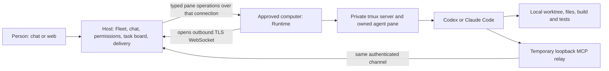

# Pair Linux and macOS computers as runtimes

**Design for approval — no product implementation or claim of Linux/macOS Runtime support.** Source snapshot: cb91653ba82c8d8f1c6196ef618e39b943d95a89 on the dev line. The [Settings previews](../evidence/paired-posix-runtime-m3458/README.md) are labelled design previews rendered inside the real scratch app; display-only proposal fields are not a functioning new protocol.

## Recommendation and first useful delivery

Reuse the paired-computer control plane, with a runner-local tmux adapter for Linux and macOS. Keep one Fleet on the existing host. Run each selected agent's CLI, repository, build and tests on its selected computer. Start with newly created Linux workers, then the macOS target matrix; leave existing local, Windows and General bindings where they are.

This moves tsc/vitest and ordinary provider-native shell work off the host. It does not move chat adapters, the web/Hub service or Fleet authority, and it does not create more AI-account quota. A Mac can take Mac-compatible work; Linux-only tests must run on a Linux computer.

Recommended first scope:

- Codex and Claude Code in persistent tmux panes, using the existing host-side pane/delivery controller and scoped MCP path.
- Manual installation and the existing pairing-code/fingerprint approval first. Bring the installer, user autostart and managed updates after the foreground lifecycle is proven.
- One explicit computer and runner-local credential profile/worktree per agent. No automatic machine migration, repository mirroring or host failover.
- Existing role-permitted text/task/message MCP tools. Runner-local files and provider conversations stay there. File-return and complete usage-meter parity remain separately gated work.

The user can approve this scope and order, or reject it, before implementation.

## What already exists

Historical [#2936](https://github.com/songsid/AgEnD/pull/2936), [#3007](https://github.com/songsid/AgEnD/issues/3007) and decision 72353fdf explain the origin; the active decision was moved to eead4282. Their original gaps are not all current gaps: General knowledge publication, persistent panes, remote accounts and managed Runtime updates now exist.

| Current seam | Evidence | Reuse or required change |
|---|---|---|
| Outbound authenticated channel | [runtime-client.ts:292](../../src/runtime-client.ts#L292); origin policy [runtime-client-store.ts:65](../../src/runtime-client-store.ts#L65) | Reuse TLS/WebSocket, bounded frames and no redirects. No remotely reachable runner listener. |
| Windows-only admission | [runtime-protocol.ts:220](../../src/runtime-protocol.ts#L220), [runtime-coordinator.ts:255](../../src/runtime-coordinator.ts#L255), [runtime-cli.ts:349](../../src/runtime-cli.ts#L349) | Production rejects non-Windows. Removing a guard alone is insufficient. |
| Portable terminal contract | [pane-port.ts:67](../../src/pane-port.ts#L67), [tmux-pane-host.ts:14](../../src/tmux-pane-host.ts#L14), [runtime-pane-port.ts:389](../../src/runtime-pane-port.ts#L389) | Keep remote machine/boot/pane/launch ownership outside a runner-local tmux implementation. Remote PIDs are never host supervision targets. |
| Current runner terminal | [runtime-pane-worker.ts:22](../../src/runtime-pane-worker.ts#L22), [runtime-pane-boot.ts:11](../../src/runtime-pane-boot.ts#L11), [runtime-pane-link.ts:42](../../src/runtime-pane-link.ts#L42) | ConPTY, Windows process/boot proof, executable lookup and drive-path checks need POSIX adapters. |
| Bundle | [runtime-bundle.ts:100](../../src/runtime-bundle.ts#L100), [runtime-pane-assets.ts:8](../../src/runtime-pane-assets.ts#L8) | Today a Windows ZIP with fixed code/knowledge and Windows native dependencies. Add explicit OS/architecture manifests; never bundle a user's workspace or credentials. |
| Remote MCP | [runtime-pane-mcp-relay.ts:30](../../src/runtime-pane-mcp-relay.ts#L30), [fleet-manager.ts:1708](../../src/fleet-manager.ts#L1708) | Reuse local-loopback relay plus exact owner tuple and current role/config checks on the host. |
| Accounts and General | [runtime-credential-profiles.ts:81](../../src/runtime-credential-profiles.ts#L81), [runtime-remote-accounts.ts:144](../../src/runtime-remote-accounts.ts#L144), [runtime-general-workspace.ts:45](../../src/runtime-general-workspace.ts#L45) | Port existing features, not a second account store or arbitrary file-upload path. Fix Windows path/case assumptions before enabling them. |
| Managed updates | [runtime-update-artifact.ts:8](../../src/runtime-update-artifact.ts#L8), [runtime-update-install.ts:91](../../src/runtime-update-install.ts#L91) | Checked, code-only staging/trial/activation exists; artifact routes and inherited launch helpers assume Windows. |

## Host, runner and data flow

The connection is outbound; work and responses use it in both directions. The MCP relay binds loopback only and the tmux socket is private local IPC. Pairing does not configure a firewall, public tunnel or SSH service. Keep the existing HTTPS-origin policy; literal-loopback HTTP is only for an explicitly prepared local forward. No certificate-check bypass.

The host retains configuration, agent/topic identity, chat integrations and history, Hub sharing/grants, decisions/tasks/schedules, human receipts, confirmation cards, delivery journals and permission checks. Models and heavy shell processes execute on the runner. The host still parses bounded terminal evidence, so offloading reduces compute rather than making the host cost-free.

Provider session files, sign-ins, repositories and test artifacts remain on the runner. A folder entered for that computer is opaque to host filesystem code. A reconnect is not permission to read a similarly named host folder.

## Pairing: preserve both existing consent modes

| Mode | Current consent | POSIX plan |
|---|---|---|
| Manual pairing code | Computer presents a pairing fingerprint; the administrator compares it with the terminal and approves that exact pending claim. [Client:952](../../src/runtime-client.ts#L952), [coordinator:480](../../src/runtime-coordinator.ts#L480) | First implementation reuses this flow and its expiry, duplicate-name, delayed-enable and stale-approval protections. |
| One-time install command | Administrator issues a short-lived preauthorization. The client verifies the pinned server signing fingerprint and encrypted exchange; the matching machine is already approved. [Client:1002](../../src/runtime-client.ts#L1002), [coordinator:442](../../src/runtime-coordinator.ts#L442) | A later Unix installer must preserve this distinct consent model. Do not describe it as waiting for another manual approval. |

The manual computer fingerprint, server signing fingerprint and TLS trust are different checks. No new flow may silently substitute one for another. The installer must keep the existing hash-before-execution property; no unpinned download-and-shell pipeline.

Settings changes are small: “Allow other Windows PCs to pair” becomes “Allow other computers to pair”; the local “Use this PC's Windows CLIs” switch remains Windows-specific. Connect asks about the **other computer's** system, not the browser's OS. Offer only published OS/architecture tuples. The preview illustrates Linux x64 and lists macOS Apple silicon as a candidate target; support for each architecture is earned by its own acceptance, not inferred from the OS name.

Keep an OS-specific, bounded ZIP/manifest approach initially rather than introducing a second archive format. Ship the matching audited tmux assets and notices, or require an explicit operator-selected absolute tmux path under the current override contract. No silent PATH fallback. macOS acceptance includes normal OS execution/quarantine/signing behavior without disabling OS protections. Node and provider CLIs are prerequisites; pairing does not install them or sign in for the person.

After approval, the computer may be online with no saved CLI inventory. “Detect CLIs” remains an explicit action. Connecting, reconnecting, opening a selector and starting work do not run discovery or sign-in probes.

## Runner, worktrees and profiles

### Owned tmux, not another Fleet

Extract/reuse the terminal utilities without importing Fleet startup or chat adapters into the runner. Introduce a runner-local tmux PaneHost implementation with immutable context per profile: root, socket namespace, client binary and terminfo. Do not mutate process-wide AGEND_HOME while concurrent profiles launch.

Current local code already supplies useful boundaries:

- [tmux-manager.ts:121](../../src/tmux-manager.ts#L121) prefixes control calls with the selected socket/config; [tmux-binary.ts:122](../../src/tmux-binary.ts#L122) separates the production socket from scratch roots.
- [tmux-binary.ts:185](../../src/tmux-binary.ts#L185) removes caller TMUX/TMUX_PANE for client calls. Bundled binaries use pinned receipts; explicit overrides are absolute executable paths ([72](../../src/tmux-binary.ts#L72)).
- [tmux-server.ts:141](../../src/tmux-server.ts#L141) retains socket/client/PID/start-time ownership; stop proof requires the process gone and socket refusing. Linux and macOS probes already differ ([223](../../src/tmux-server.ts#L223)).

Each pairing gets its own private socket namespace; each agent gets an exact owned pane/launch identity. Tests and project tmux commands must use their own isolated namespace. A private socket prevents accidental cross-profile control; it is not isolation from a hostile process under the same OS user.

Implement fixed typed spawn/input/capture/resize/stop operations with validated argv and owned launch records. Prompt text, working directories and profile names are data, never interpolated shell instructions. Retain the journal-before-spawn, generation/sequence and backpressure rules. No generic remote-shell RPC.

### Local work and sign-ins

Keep the portable pairing-state default and existing --profile/AGEND_RUNTIME_HOME precedence: [runtime-cli.ts:162](../../src/runtime-cli.ts#L162) uses ~/.agend-runtime; [runtime-connection.ts:29](../../src/runtime-connection.ts#L29) separates origins. Program installs/logs need an OS policy instead of AppData ([runtime-background.ts:38](../../src/runtime-background.ts#L38)).

Require private state directories/files with UID/mode and symlink checks, including existing paths. The current POSIX-compatible fallback creates private directories but does not verify every existing owner/mode ([runtime-client-store.ts:44](../../src/runtime-client-store.ts#L44)); that is work, not present production support. Preserve path case; macOS filesystem case behavior must not be guessed from its OS name. Windows' unconditional case folding must not merge different POSIX workspaces or profiles.

A developer prepares or explicitly authorizes a clone on the runner and gives each agent a distinct worktree. Git/SSH/GitHub credentials are provisioned there by the operator; never copied from the host as a pairing side effect. A managed-worktree option must record repository/common-dir ownership and preserve user files. Runtime code updates do not delete repositories or rewrite their branches.

The runner resolves the selected absolute directory locally. If the UI permits ~ shorthand, only that literal home shorthand is expanded there; arbitrary shell/environment expansion is refused. The confirmation shows computer, resolved folder, CLI, profile and file-permission mode. A working directory by itself is not a sandbox. Retain the provider's actual audited guard coverage and disclosure.

Credential profiles remain runner-local and per origin. Port existing environment sanitization/profile ownership; never fall back to the host's sign-in. General role files already have fixed, receipt-owned publication; port it without copying host trees or overwriting unowned AGENTS.md/CLAUDE.md files. General-on-POSIX is enabled only after that publication/binding path is proven; initial worker offload does not move an existing General.

A remote developer uses provider-native shell/file tools for code, tsc and vitest on the runner. Fleet/task/message tools still go through the host. Install the required private public-GitHub checker/hook through explicit private operator provisioning before that developer may push public work; it is not part of the public bundle. Missing publication policy must not silently become a public-push fallback.

## Parity and intentional gaps

| Area | Windows Runtime today | POSIX first delivery / remaining work |
|---|---|---|
| Terminal | Persistent ConPTY panes plus per-turn exec | tmux persistent panes for Codex/Claude; do not make exec-only support masquerade as resident dev agents. |
| MCP/authority | Exact-pane relay, role/tool allowlist, host dispatch | Reuse this path. The current exclusions in [native-pane-tools.ts:2](../../src/native-pane-tools.ts#L2) remain until their semantics are ported; no host-path tool is unlocked just to claim parity. |
| Files | Local runner files; selected file/checkout/release tools unavailable remotely | Local source/tests work; return text or approved repository/artifact links initially. General file return/preview needs a bounded owned-transfer design, not arbitrary path RPC. |
| Instructions | Fixed General publication and launch-local instructions | Port role/skill discovery and POSIX wording. An agent must know which computer owns shell/files and which service MCP controls. |
| Restart | Profile locks, stop requests and confirmed exit before background relaunch | Foreground first; later systemd user/launchd user launcher. No automatic root service or logout persistence policy change. |
| Updates/CLI install | Managed code-only Runtime update and fixed audited Windows CLI operations | Port OS artifact/launcher/profile adapters. Do not replace current behavior with arbitrary package/shell install. No automatic provider update from pairing. |
| Usage | Remote CLI quota signals, not full host subscription attribution | Keep unavailable/unknown explicit. Host account/profile names cannot prove a remote account's usage. Later bounded runner-local usage collection needs separate provenance and tests. |
| OS-specific tests | Windows execution | Linux-required tests go to Linux; macOS is not a Linux substitute. Docker and other dependencies are installed/approved locally. |

The existing global “agents at once on each computer” setting continues to bound starts; do not silently change its default or introduce automatic load balancing. Operators can choose a smaller limit for heavy dev work, understanding its scope. A future per-computer CPU/memory budget is separate work.

## Restarts, disconnections, updates and rollback

Use the persistent-pane lifecycle from [windows-persistent-panes.md](../windows-persistent-panes.md), not the older exec-only 45-second cancellation description. Ordinary client exit/reconnect preserves resident panes; current authority is withdrawn while disconnected. Reattach only the exact machine/host/pane/launch/profile. Replay reports, not Enter, prompts or uncertain mutations. Unknown ownership or missing evidence holds in Needs you; no automatic host-model replacement or machine migration.

Runner restart is not Fleet restart. [runtime-cli-background.ts:195](../../src/runtime-cli-background.ts#L195) requires a specific profile/all choice and confirmed stop before replacement. [full-restart.ts:20](../../src/full-restart.ts#L20) and [service-restart-selection.ts:27](../../src/service-restart-selection.ts#L27) belong to the host service. Remote instructions and UI must keep those owners distinct.

For Linux/macOS, port boot/process identity and exact owned process-group/server exit proof. Never signal a remote PID on the host or treat a lost WebSocket as stopped. A computer reboot can release only the launch whose recorded OS-boot evidence proves it cannot still exist. An unprovable macOS process identity remains held.

Foreground/manual install is the first acceptance path. Later user autostart uses an explicit systemd-user or launchd-user choice; do not silently enable linger, root services or sleep prevention. A laptop sleep is offline state, not a new conversation.

Keep versioned code installs separate from pairing state, profiles and worktrees. Extend the existing checked artifact/trial/activation/current-pointer transaction; no new update authority from self-reported versions. A failed or unconfirmed handoff remains held and retains old code. Tmux-server replacement needs its own owned-server proof, not just replacing a file while a server is running.

Schema recommendation: add a generic paired discriminator while preserving existing local/wsl and Windows configurations, stable machine_id/native_agent_id, pane identity and conversations. The current classifier/parser/registry and persisted machine/agent records are Windows-specific ([types.ts:104](../../src/types.ts#L104), [native-instance-registry.ts:14](../../src/native-instance-registry.ts#L14), [windows-agents.ts:16](../../src/windows-agents.ts#L16)). Design/version the POSIX records and protocol capability before enabling them; never relabel an old Windows binding or move its conversation to another machine.

Compatibility must be settled in the first slice: Windows v1 remains supported, unsupported OS/capability combinations fail before dispatch, and an older reader must not rewrite/drop new records. Downgrade preparation drains/stops POSIX bindings with positive proof and retains their profiles; an unsupported binary cannot be promised to load new config. No raw registry edit or silent conversation migration is a rollback procedure.

## Security: what a compromised runner means

| A compromised runner can… | The host must still enforce… |
|---|---|
| Read its user's reachable files, provider sign-ins and assigned questions; spend that account's quota; lie about output/inventory/build reports; disrupt its own panes | Pair only a trusted computer/user. File modes and a working folder are not a same-user security sandbox or remote attestation. |
| Steal its machine credential and imitate that approved computer | Credential scope stays the Runtime channel; it is not a dashboard cookie, bot token or general host API credential. Revocation fences new work/tools centrally. |
| Call tools granted to an assigned agent | Current role/world/adapter/config/launch allowlist and human-confirmation checks, including after awaits. No new admin powers merely because a machine is approved. |
| Forge terminal text that resembles an approval or a colleague | Only host-owned human receipts/actor proofs authorize actions. Remote text never becomes a person or a confirmation click. |
| Continue a local process after a connection is lost | Host input/MCP fences and held reservations; do not claim a malicious machine's stop report is attestation or automatically start a competing host agent. |

The host does not send adapter/provider secrets or arbitrary host files as part of pairing. Data explicitly assigned to the runner is inside its compromise boundary. Same-user code can attack local credentials despite sanitized child environment; a dedicated OS user is an operator isolation option, not something pairing creates secretly.

## Slices and acceptance gates

These are estimates for implementation planning, not approval to code or a promised schedule.

1. **Platform/schema groundwork — M, 2–3 days.** OS/architecture/capability matrix, platform path/environment/ownership policy, compatible persisted records and downgrade behavior. Fake executors and fail-first cross-platform/path/case/unknown-version tests. Windows behavior remains covered.
2. **Linux foreground pairing and owned tmux — split M+M, 4–7 days.** Bounded ZIP/native assets, strict local state, manual code/fingerprint flow, saved explicit inventory, owned tmux server/panes and current host controller. Prove lost ACK, duplicate input, restart, reboot/unknown exit and revoke/stop races.
3. **Developer/role workflow — M, 2–3 days.** Local profiles, worktree ownership, role/skill discovery, scoped MCP, build/test execution and private publication policy. Demonstrate an off-host worker changing a synthetic repo and producing a reviewable result without host filesystem access.
4. **macOS target adapters — M+acceptance, 3–5 days.** Per-architecture artifact/launch and filesystem/process identity, normal OS execution, sleep/log-out/restart behavior. Validate each supported tuple; no support claim from Linux unit tests.
5. **User startup and managed updates — M+M, 3–5 days.** systemd/launchd user choices, existing update transaction and fixed audited CLI/account operations. Positive ownership and failed-trial/downgrade controls.
6. **Parity follow-ons — separately designed cards.** Owned file-return/preview, full usage attribution and optional resource budgets. These are not hidden prerequisites for text/code/test offload, and first delivery must display their limits.

A useful Linux developer preview is roughly 8–13 engineering days through slices 1–3; macOS and managed lifecycle add work and require target machines. Split large slices into reviewable PRs. Initial candidates are Linux x64 and macOS arm64; Linux arm64/macOS x64 are enabled only with matching published artifacts and acceptance, not an untested fallback.

Before any actual signed-in CLI campaign, obtain the existing user/Leader permission and use isolated owned test profiles. This design work made no such calls. Required acceptance includes narrow/unfocused terminal fixtures, human-only safety/sign-in screens, tool refusal/role revocation, stale responses, disconnect/reconnect/no-replay, exact stop/boot proof, workspace/symlink/case controls, bad signatures/archives and Windows regression coverage. Mock protocol proof does not replace real OS/provider acceptance.

## Decisions requested

Recommended: approve Linux workers first, macOS next; manual fingerprint pairing before a new Unix installer; runner-local repositories/profiles with no automatic host sync; foreground first with managed user startup/updates later; explicit file/usage/General parity gates. Existing Windows/local bindings and permissions stay intact.

### 給使用者的短版

建議沿用目前「連接電腦」的配對、指紋確認與權限流程，先加 Linux，再加 macOS。AgEnD、聊天、工作看板與核准仍在原主機；Codex／Claude、Git 工作目錄與 tsc／vitest 跑在選定的電腦，才能把負載搬走。每台電腦使用自己的登入，不複製主機帳密；離線不會偷偷換主機或重送不確定的工作。

第一版先提供前景執行與手動配對，確認 tmux、停止／重連與開發工具都可靠，再補自動啟動與更新。檔案回傳、完整用量與 General 切換要分清楚，不會用「已配對」冒充全部功能都相同。附圖只是實際網頁中的設計預覽，目前產品仍未支援 Linux／macOS Runtime，沒有先改產品程式。
