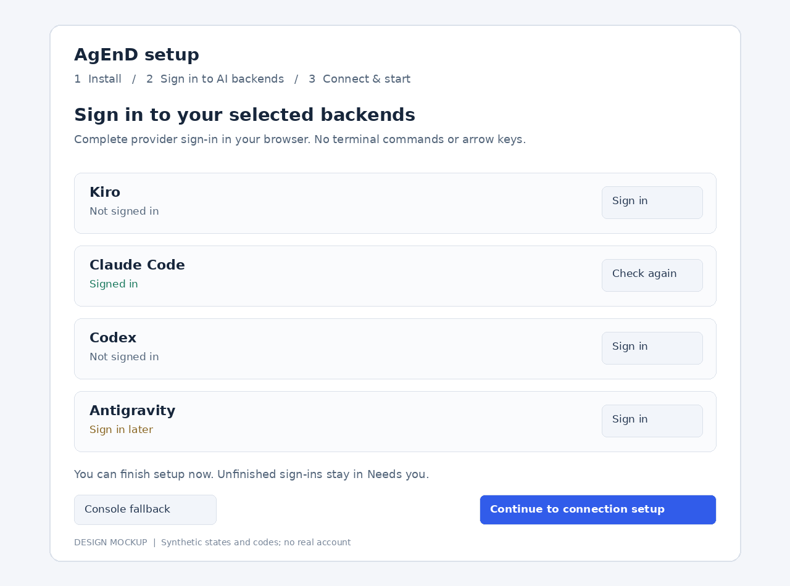
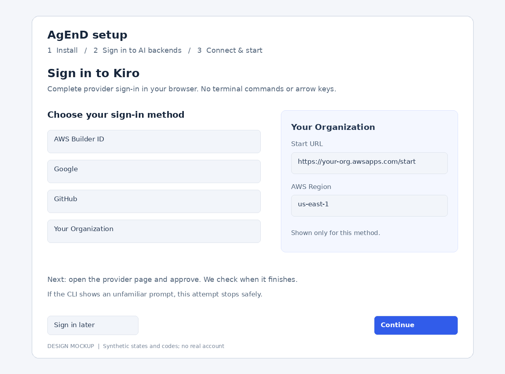
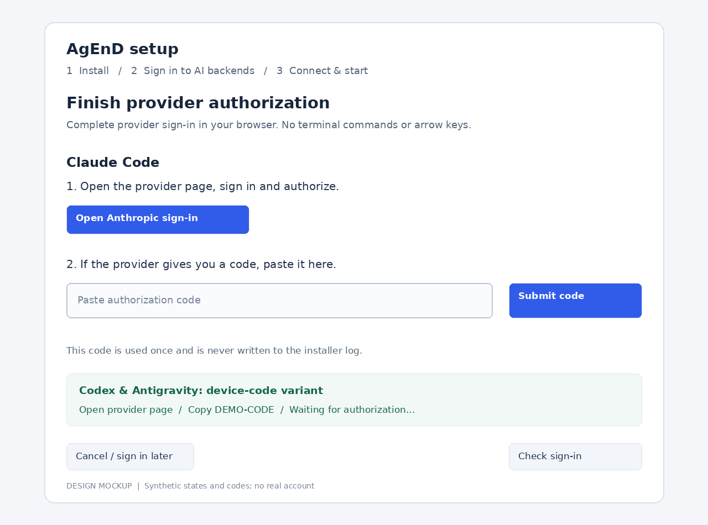

# Windows installation: browser-driven backend sign-in

Status: proposal for approval; no product implementation. Source inspected at main `6360bd496`. Requested by the user through the leader, 2026-10-24.

## Recommendation

Choose **B: a sign-in step in the existing, authenticated `agend setup` page, before any agents start**. Install AgEnD before that step. Present a selected-backend checklist, provider buttons and code fields; never show an embedded terminal as the normal path. The CLI may still require a private PTY internally. “No terminal interaction” means no human TTY, arrow keys, terminal paste or shell commands during sign-in.

The page offers **Sign in later**, **Retry** and an explicit **Console fallback**. Success is an independent backend auth check, never a click, an exit code alone or a progress marker.

## What exists, and why it is difficult today

- `website/public/install-agend.ps1` installs backends, then calls `Complete-LoginStage`/`Invoke-LoginStage` **before AgEnD is installed**. Each provider owns the console; Kiro needs arrows and Claude may require a pasted code. The Windows URL opener only opens links; it cannot turn those prompts into form controls.
- `src/web-backend-login.ts` / `src/ui/backend-signin.js` already provide session-bound sign-in orchestration for a running fleet. Codex is device-code-only. Kiro and Claude still offer a browser terminal, so merely redirecting the installer there does not remove terminal interaction.
- `src/login-flows.ts` already holds the commands, auth probes, provider URL/code and success patterns. Kiro's current audited menu is in `tests/fixtures/kiro-2.33.0-audit/login-menu-2.33.0.pane.txt`.
- **Antigravity is deliberately unsupported by remote `/login` and the dashboard today.** `agy` starts the full agent, with tools/MCP, rather than a dedicated login command. The Windows installer already runs it in its own tmux and waits for a stable credential file, `agy models` and the ready screen before quitting. This proposal does not turn that agent into a browser terminal or enable remote `/login agy`.

## A versus B

| Choice | Benefit | Cost / limitation |
| --- | --- | --- |
| A: start the fleet, then guide dashboard sign-in | Reuses existing local-admin dashboard sessions and Needs you; convenient for already-configured installs. | Requires the fleet to start before auth exists; setup-to-service replacement interrupts active login ownership. Current dashboard still needs a terminal for Kiro/Claude and refuses agy. Thus A alone does not satisfy the request. |
| B: sign in inside setup | Existing setup code/cookie proves possession of the host; agents never launch just to sign in. The browser keeps one wizard and clear progress. Works equally with no bot. | Needs a small setup login host and a reusable structured prompt driver; the authenticated pre-fleet surface must be carefully bounded. |

Use B for fresh installs; use the **same structured cards/driver** in Settings → Sign-ins for already-configured reruns and later retries. Keep the existing chat/terminal login flows as fallbacks. Do not instantiate FleetManager or expose fleet control endpoints inside setup.

## Proposed journey

1. Install WSL and the selected CLIs as today, preserving the keep-installed behavior from #2593.
2. Install AgEnD (currently stage 4). The old stage-3 marker is not evidence of valid auth; probe each chosen backend every run.
3. Open the existing setup page/code in Windows. After its code is redeemed, show **Sign in to your AI backends**, containing every installer-selected backend, including installed backends that will not be the first agent's backend. Run cheap auth probes; already signed-in entries are complete and never logged out silently.
4. One backend signs in at a time. The person chooses a method, clicks the provider link and, only where necessary, pastes the provider code into a normal browser input. The PowerShell window shows only bounded status such as “Waiting for Kiro in the browser”.
5. Continue to the existing connection/agent configuration and confirmation. Web only and Discord/Telegram use the same backend auth; there is no dependency on a bot, General, DM or chat admin before the fleet exists. Preserve the existing settings-confirmation boundary.
6. Before handover, cancel and confirm cleanup of every setup-owned login child. Only then release the setup fleet lock and start/install the service. Open the ordinary dashboard through its existing one-time sign-in flow; do not transfer the setup cookie into an admin dashboard cookie.
7. **Sign in later** finishes setup successfully with an honest “installed, sign-in pending” result. Needs you shows pending sign-ins after startup. An unavailable backend remains unavailable through the existing availability/auth gate; never declare it signed in or spin a restart loop.

The installer passes only canonical backend IDs, not commands, using a proposed `agend setup --backend-signins <comma-separated IDs>` option. The setup host validates a fixed allowlist and installed status. A small 0600 onboarding record in AGEND_HOME retains just the selected/pending backend IDs, schema version and dispositions for reruns/Needs you; it holds **no** OAuth URL, provider code, account token, raw output or session capability. Actual probes remain authoritative. It covers selected-but-not-yet-configured backends too. Remove completed entries; skipped entries can be dismissed in Needs you.

An already-configured rerun must not reopen/reset setup: start or reuse the existing service, use `agend web --code`, and land on the same guided Sign-ins checklist under a normal local admin session. A browser route is navigation, not authority. The existing dashboard gate owns every action. Browser refresh reattaches to the same attempt owned by that session; a new session sees only status and must cancel/restart with consent.

## Backend behavior

| Backend | Child command and browser controls | Completion / failure |
| --- | --- | --- |
| Kiro | `kiro-cli login`; render Builder ID, Google, GitHub and Your Organization from the audited selector. The server maps a named choice to the **currently observed** menu, then sends the required private PTY keys. Organization alone shows Start URL and Region form fields, submitted only when that prompt is live. Display provider URL/device code as available. | `kiro-cli whoami --format json` plus known flow state. A retained token requires explicit Re-login consent before the existing logout-first rule. Unknown menu/prompt fails safely; never guess by index. |
| Claude Code | `claude auth login`; normal provider/account-method buttons if observed, **Open Anthropic sign-in**, and a bounded one-use **Paste authorization code** field when the CLI asks. Send the code literally to that specific prompt, never through shell interpolation. | `claude auth status` must report `loggedIn: true`. Rejected/expired code yields a safe Retry message; a new attempt uses its own link/code. |
| Codex | Keep `codex login --device-auth`; show **Open OpenAI sign-in** and **Copy code**, then poll. No localhost callback assumption across Windows/WSL and no user terminal. If provider device auth is disabled, say how to enable it or offer explicit console fallback. | `codex login status`. Retry after expiry; do not switch silently to plain callback login. |
| Antigravity | A **local-only, read-only device-auth bridge** around the installer's dedicated `agy` child: capture only the allowlisted Google device URL and code; offer Open/Copy; accept no free-form input, keys or task text. Start with an empty private working directory, no fleet/instance environment and no AgEnD MCP injection. | Preserve #2239's credential inode/content/mtime stability check, recheck before quit, successful `agy models` and known ready screen. End the child before publishing completion/handover. Unknown onboarding prompts stop the attempt and offer Retry/console. Never expose its agent pane, tools or a shell to the browser. |

Antigravity's narrow local bridge is a **new capability requiring approval in this design**. Keep `remoteLogin: unsupported`, `noShellEscape` policy and public/tunneled agy refusal unchanged. No claim that agy itself becomes a restricted login executable: it remains a full CLI process started locally, as in today's installer, and can load its own local configuration. Before implementation acceptance, audit the currently installed agy startup fixture and prove the bridge cannot deliver any agent command; if a safe device-only state cannot be identified, report that blocker instead of weakening the boundary.

## Reuse and ownership

Extract a small shared structured-login session component beside the existing login flows; reuse commands, auth probes, locking, URL validation, expiry and cleanup. It produces typed states (`choose_method`, `organization_fields`, `provider_authorization`, `code_required`, `checking`, `done`, `failed`) and accepts a closed set of matching actions. Setup supplies its session authority; dashboard supplies WebBackendLogins' local-admin authority. Neither client supplies command, executable, cwd, environment, PTY bytes or a “token present” claim.

Each action binds attempt ID + session owner + prompt revision. Duplicate submits are idempotent; stale pages, old codes, replaced attempts and cancelled sessions cannot send input. At most one login owns the shared backend credentials at once, including console/chat flows. Do not run the existing generic terminal and a structured driver against the same attempt.

## Resume, skip and cleanup

- Refresh: the same live setup session reads its attempt again. No second CLI is started.
- Browser closed: retain only until the bounded setup/login TTL. An active login has its own explicit lifetime within a bounded setup session; do not extend setup forever by passive polling. Expiry/revocation cancels the owned child.
- Installer/WSL interruption: the next run probes auth first. Completed credentials are reused; pending choices are listed again. No stale OAuth code is persisted or replayed. Adopt an orphan only with provable ownership; otherwise terminate the owned login process and begin a fresh attempt after consent. Never kill unrelated tmux sessions.
- Retry: wait for confirmed teardown, then create a new attempt. No parallel credential writers.
- Skip: cancel the active attempt, preserve pending backend IDs, continue. The installer does not mark “all signed in” unless probes confirm it.
- Console fallback: preserve `Invoke-LoginStage` and provider commands behind an explicit installer switch/action. A web click only requests that the host installer offer its fixed console path; it is not a general shell endpoint. No fallback auto-launches a terminal during the browser path.

## Security boundaries

- New setup sign-in routes require the setup cookie, exact origin/Host and same-origin mutation protection, current session and local loopback surface. **No credentials or actions through `agend setup --tunnel`**, public links, guests or read-only sessions. Tunneling setup configuration must not imply permission to run a CLI.
- Serve no backend list before setup authentication. Endpoints exist only during authenticated setup, and disappear on finish. Reuse process-level fleet/login locks so setup cannot race a running fleet.
- Keep auth URLs/codes in attempt memory only; owner session can read them, other sessions see coarse status. Provider links use per-backend HTTPS host allowlists (including a narrowly reviewed Google device host for the local agy bridge). No raw vendor output becomes HTML.
- Never put codes, token files, callback URLs or raw terminal tails in process arguments, PowerShell status/transcript logs, daemon logs, the onboarding record, analytics or the Log tab. Log only backend, state, safe error kind and outcome. Disable uncontrolled BROWSER opening in structured children; the owner clicks the validated link.
- Bound all inputs/output, reject control sequences/newlines where inappropriate, and submit code as literal input only for the current code prompt. No Enter-as-arbitrary-command surface after login.

## Installer compatibility and sequencing

#2593 is merged; #2589 is still open at design time. Implement the PowerShell changes after both land, retaining their backend detection, Windows Terminal behavior and single-row status. Preserve PS 5.1 native-argument quoting and existing progress files; add a versioned browser-sign-in completion state rather than treating an old stage marker as proof.

The website script goes live independently of npm. Feature-detect the installed package's browser-sign-in capability. With an older package, preserve the explicitly chosen console flow or explain that browser sign-in needs a newer AgEnD; never invoke an unsupported setup flag or silently reintroduce console prompts. A rerun with valid credentials skips sign-in regardless of old marker state.

## Proof before shipping

Focused driver fixtures for every backend: method choice, code flow, success probe, rejected code, expiry, unknown prompt and safe fallback; real Kiro menu fixture plus synthetic provider fixtures, no accounts. A stub CLI/private PTY harness proves actions cannot become task/shell input and agy stops at ready. Test session revocation, public/guest denial, refresh without another child, one-use prompt revision, cleanup before service handover and token/code redaction.

Windows PS 5.1 stub-WSL tests cover new order, old progress migration, installed/valid backend skip, cancellation/retry, pending backend retention, old-version capability fallback and unchanged console mode. Chromium uses stub backends on private scratch HOME: finish all four without terminal input; refresh/resume, skip → Needs you, web-only and bot configuration. All fleet spawn/service handlers stubbed. Live provider acceptance, if requested, is a separate user-owned check.

Rollback: select the explicit console-login mode and preserve credentials. Removing the optional non-secret pending checklist must not remove provider credentials or fleet.yaml. No auth-storage migration is needed.

## Mockups

Static design illustrations, not implemented screens or account-authentication proof:

