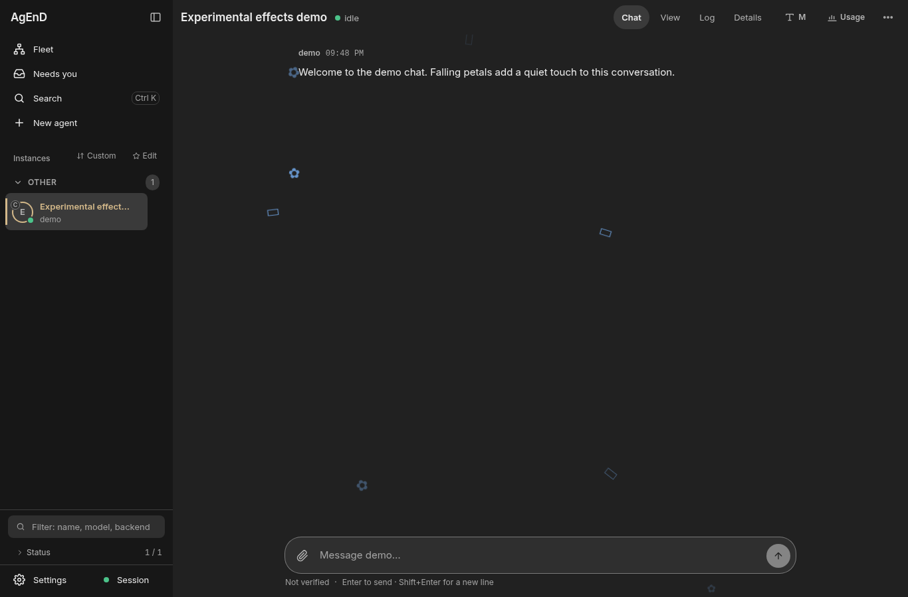
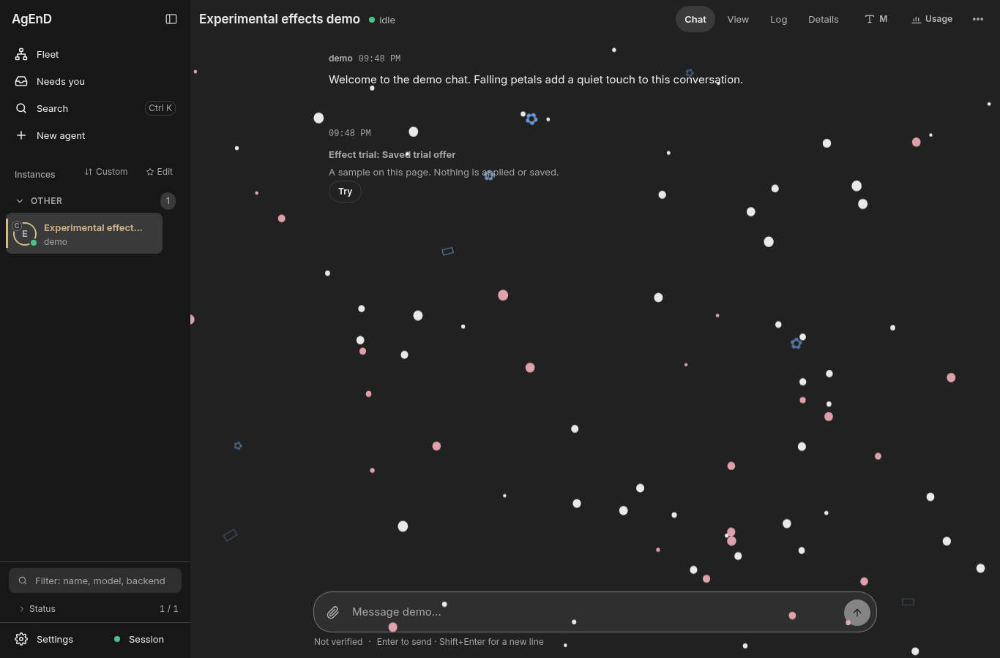
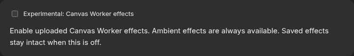
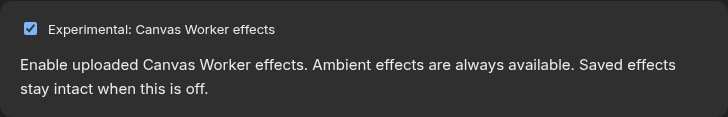

# Canvas Worker experimental switch (#2275)

`web.experimental.canvas_worker` is enabled only by literal boolean `true`. Missing,
invalid or unreadable configuration is off. The switch changes capability and
playback; it does not migrate, remove or rewrite saved CW content.

## Gated inventory

| Boundary | Off behavior |
| --- | --- |
| Agent tools | Hide the seven effect tools and `export_web_mod` / `propose_web_mod`; reject direct MCP, fleet IPC and HTTP-agent calls with the Settings instruction. |
| Mixed tools | Omit CW variants from appearance/settings schemas and summaries; reject CW settings changes. Keep ambient, themes, identity cards, widgets and CSS. |
| Guidance | Publish off variants of managed web-appearance/web-dashboard skills; filter standalone skill reads and pending agent notices. Preserve user-owned skill collisions. |
| Web boot and updates | Strict boot/status bit, including guest SSE and polling. No CW runtime import while off; revoke an in-flight import's admission if disabled. |
| Web UI | Hide chat mounts and menus, Try cards, posters, library, owner slots and CW settings/mod parts. Keep the local-admin experimental checkbox. |
| HTTP | Refuse the dashboard effect bootstrap and legacy preview `/effect` bootstrap, CW assets, effects, posters and trials before service/body work; recheck after asynchronous upload/trial bodies. |
| Personal settings | Refuse CW owner-slot writes including clears while off; retain existing preferences and allow non-CW preferences. |
| Mods and resets | Refuse CW stage/commit/uninstall/export while off; ordinary look export omits CW. Non-CW application and theme resets preserve saved CW placements. |
| Runtime disable | Dispose workers, frames and effect mounts; hide controls on status updates. Explicit re-enable creates a new playback owner with existing consent/trust rules. |

MCP processes notify clients when tool lists change. Their config reference is scoped
to the owning home, including fleets using a custom config path. Managed skill files refresh
without restarting agents. A model's already-read conversation cannot be erased;
authoritative calls still refuse after disable. Modules already loaded during an
on episode remain in the browser module cache, but cannot start or keep playback
while off. A fresh off page requests no CW module or worker.

The public link and guests share the capability bit and route guards. Only a
local administrator can change the switch; enabling uses the normal confirmed
Settings write. Ambient playback is data-only and remains independent.

## Verification boundaries

Tests use inert lifecycle/process boundaries and private temporary stores/listeners.
Chromium smoke uses a scratch home, a private loopback dashboard and a stubbed public
gateway. It blocks external requests and all fleet/CLI/tmux lifecycle methods.
It seeds saved CW content plus ambient content before boot, checks off/on/off/on,
and compares the saved content after toggles. No live fleet, account, tunnel or
provider is used.

The on smoke exposed an existing closed trust-inventory mismatch: stock message
reply actions/quotes were marked `thread-control` but were absent from that
inventory. The integration includes only their constrained stock selectors and
negative controls; it does not widen arbitrary markup admission.

Rollback: revert the PR to restore the earlier always-available CW feature. Saved
content remains compatible. Administrators can instead opt in to retain current
CW behavior while keeping the feature switch.

## Chromium smoke evidence

The scratch Chromium run observed zero CW requests and zero workers on an off boot
(including guest and stubbed public-link sessions). Enabling through the real
confirmed Settings HTTP path created one real worker;
disabling removed all CW frames/layers/Try controls; re-enabling created a second
worker and restored a usable Try button in the same mounted chat. The two enables
were explicitly confirmed in the private smoke store; disabling applied as a narrowing
write. No cookies or bearer tokens were copied into the server-owned replay. Ambient
remained at eight particles throughout. No page errors or external
network requests were observed, and saved placements/preferences were unchanged.

| Off | On |
| --- | --- |
|  |  |
|  |  |

Re-run `scripts/manual/smoke/smoke-canvas-worker-experimental.mts` with the documented
`REPO`, `PW_DIR`, `CHROME` and `OUT` environment variables in a capped private unit.
Its assertions cover local, guest and public off pages and live off/on transitions;
all seeded names and content are synthetic.
