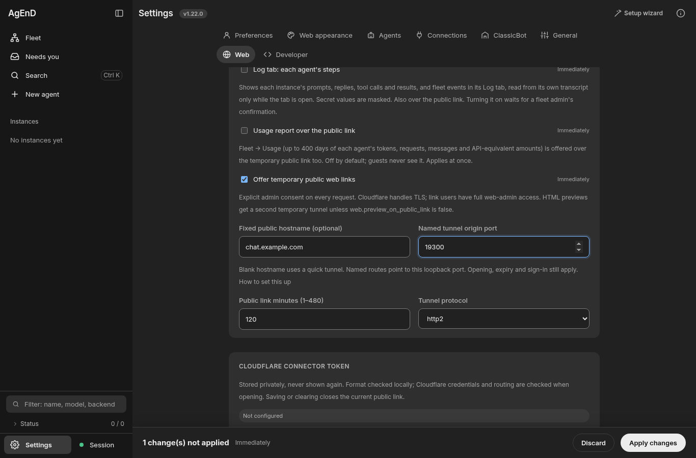

# Named-tunnel walkthrough follow-up (#2344)

The first external-user walkthrough found setup instructions that did not match the
Cloudflare dashboard, a hidden Web-settings draft step, and a startup failure with
no useful reason.

## Root causes and changes

- The guides described a Type dropdown and Unix-style token command. The current
  reported dialog has one Service URL field, and Windows uses `service install`
  without `--token`. Both guides now show the complete origin URL without a slash,
  the tunnel's own Routes tab, a free-text example name, and the token-only copy step.
- Web fields previously stayed only in component state until Review changes was
  selected. Valid edits now enter the existing shared Web draft immediately. Apply
  still owns the HTTP write and confirmation; token Set/Clear keeps its existing
  write-only confirmation path. This is compatible with the planned #2347 save model.
- Named mode discarded connector output in `CloudflaredHandle`, and `PublicWebLink`
  suppressed startup detail again. Bounded private evidence now selects a closed
  failure code. The provider, progress protocol and logger expose only static
  messages for token refusal, missing route, wrong readiness page, unreachable
  origin, connection failure or an occupied origin port. Unknown text stays generic.
- Node fetch wraps network failures in `cause` (often with only `fetch failed` in
  the outer message). The probe reads a bounded cause/aggregate chain: `ENOTFOUND`
  selects the hostname/DNS/route reason; transient DNS, timeout and connection
  codes select the connection reason. Raw error objects are never serialized.

The feature still requires this exposure's own readiness marker and proven process
cleanup. No failed route becomes ready, no fallback tunnel is created, and raw vendor
output is never returned as a user-facing message. Token environment delivery, the
write-only API and quick-tunnel behavior remain covered by regression tests.

## Verification

All process boundaries are fake. Browser evidence uses a scratch home and private
loopback HTTP with fleet, tmux, CLI and real-tunnel execution disabled. It demonstrates
that editing the hostname shows the existing sticky Apply bar before Review changes
and before any settings write. Real Cloudflare account acceptance remains manual;
see the setup guide.

Item 8's proposal for stricter token decoding is outside this change. A local format
check is not a credential-validity check; opening the link verifies the actual
credentials and route. No new decoder or token representation is introduced.

Rollback: revert this PR. The configuration and token storage formats are unchanged;
previous versions continue to read the same hostname, port and secret reference.
