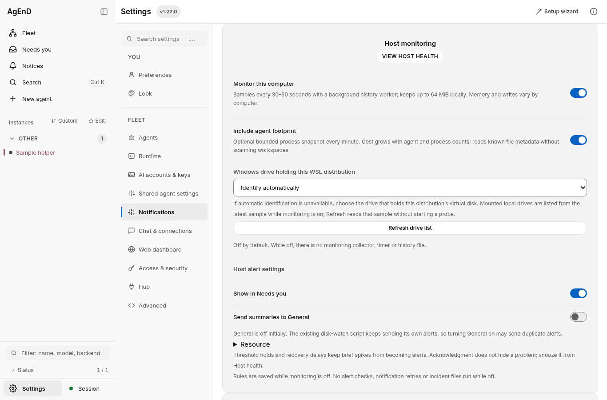
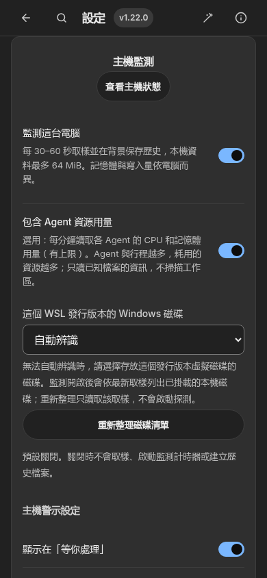
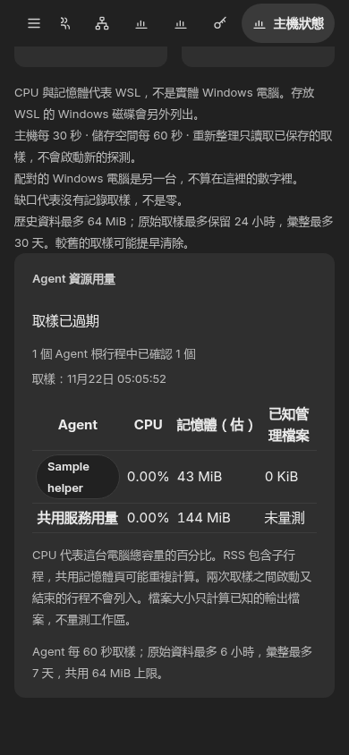
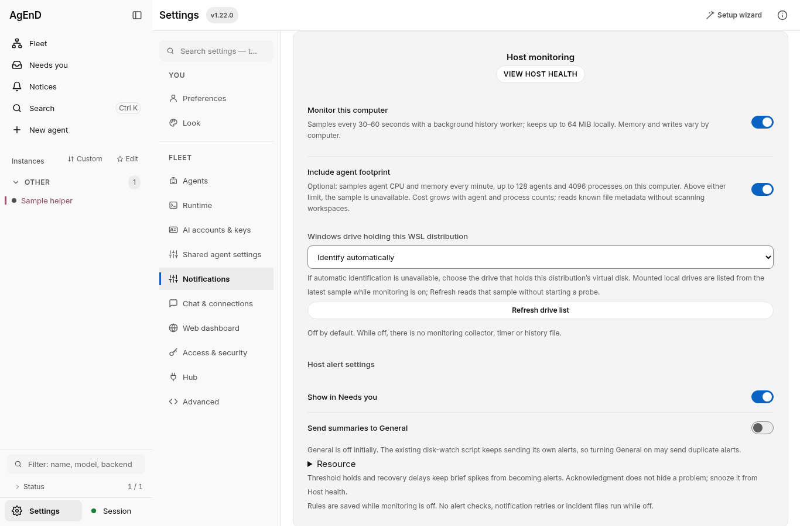
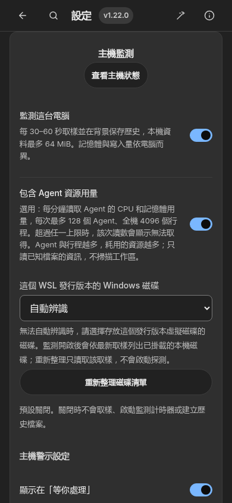
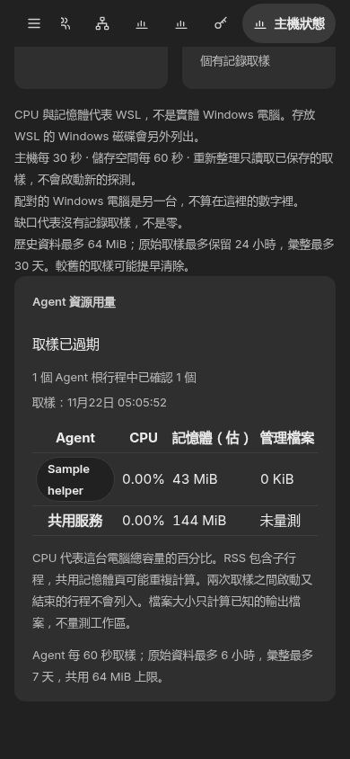

# Footprint wording: before / after

Actual retained S209 host cache, synthetic helper/volume aliases, unchanged sample times. This is a presentation follow-up, not a new measurement.

## Before

### before-settings-desk-light-en

### before-settings-phone-dark-zh-TW

### before-table-phone-dark-zh-TW

## After

### after-settings-desk-light-en

### after-settings-phone-dark-zh-TW

### after-table-phone-dark-zh-TW

