# Host monitoring: optional agent footprint

Actual completed one-hour host data in the real app. One owned idle helper; names and volume identities are synthetic aliases. Retained timestamps and stale labels are intentional, not live Fleet agent data. User approval pending.

## Before

### before-health-desk-light-en

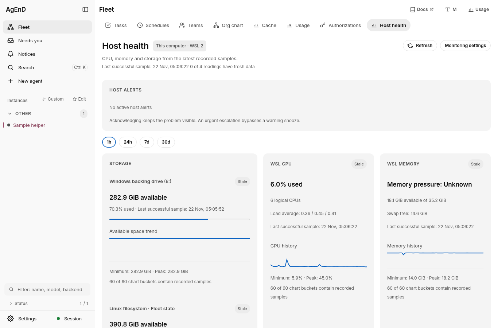

### before-health-phone-dark-zh-TW

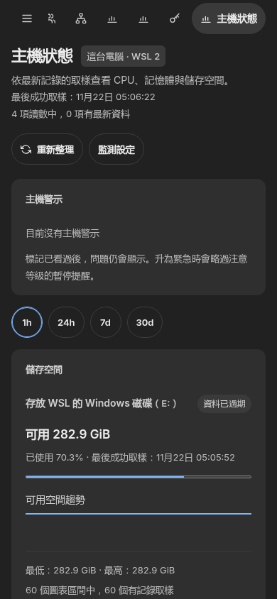

### before-settings-desk-light-en

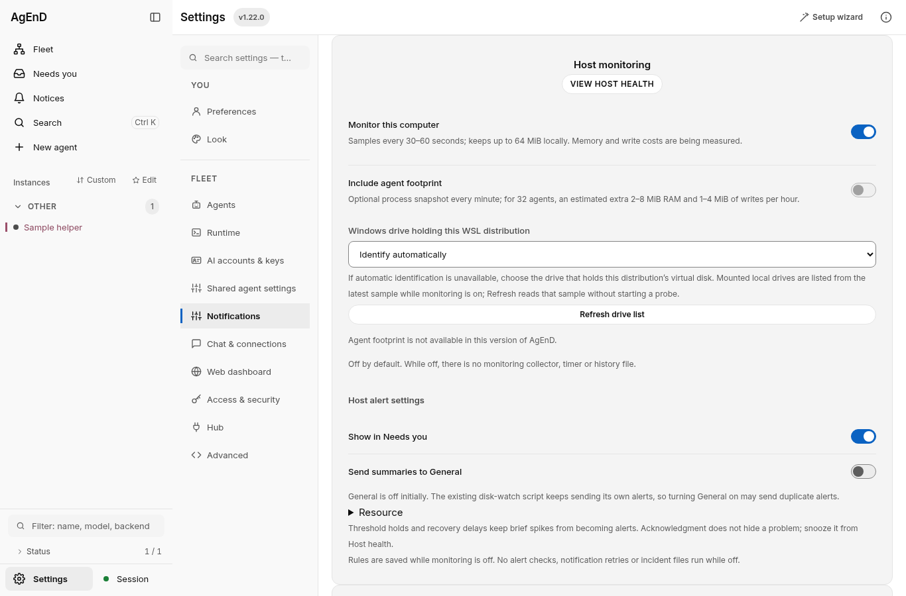

### before-settings-phone-dark-zh-TW

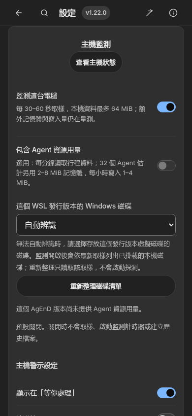

## After

### real-health-desk-light-en-footprint

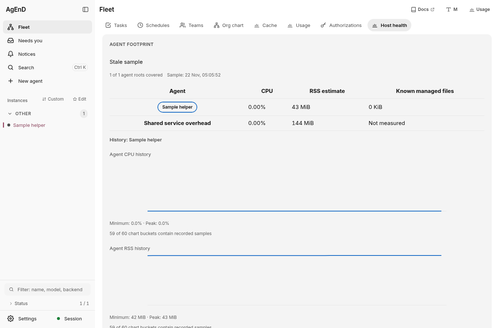

### real-health-desk-light-en

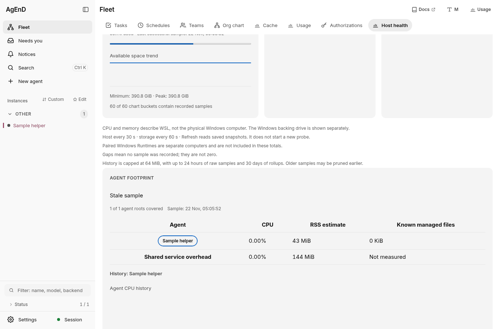

### real-health-phone-dark-zh-TW-alerts-empty

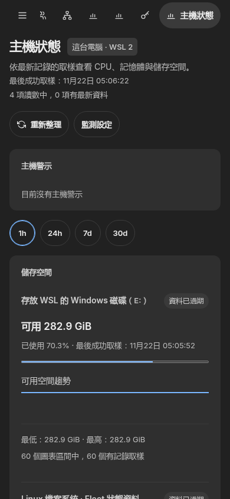

### real-health-phone-dark-zh-TW-footprint

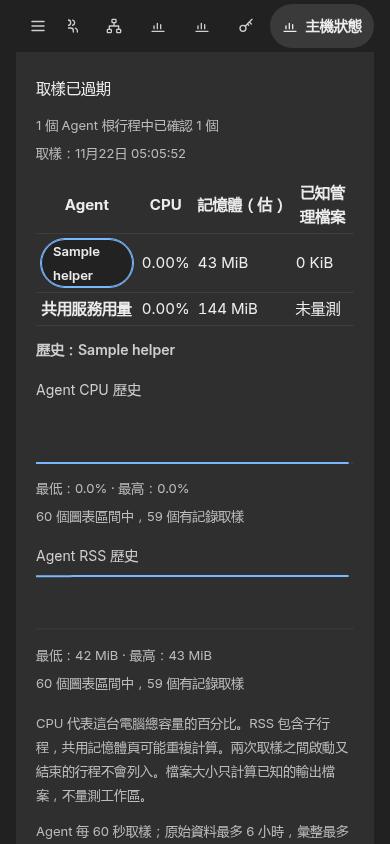

### real-health-phone-dark-zh-TW

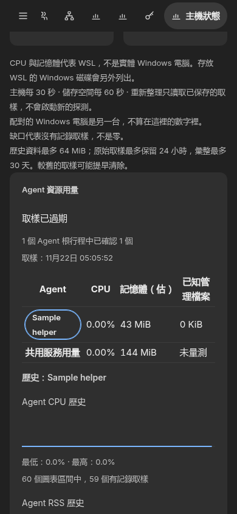

### real-settings-desk-light-en

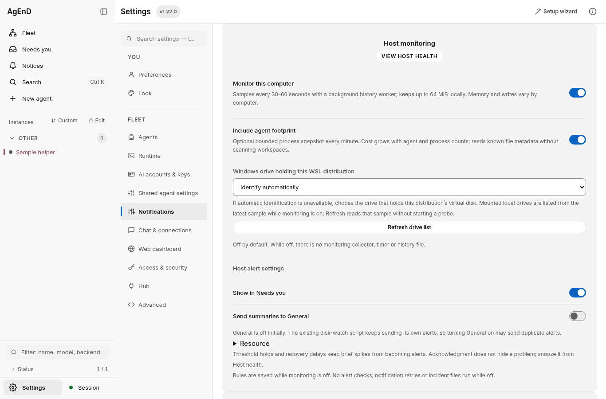

### real-settings-phone-dark-zh-TW

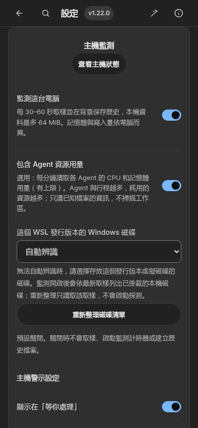
