# Platform views

Recorded platform inputs in the real app; controlled CPU/storage, empty history and synthetic resource aliases. No native Mac/Ubuntu execution claim. Scroll positions focus on memory meaning or the saved-rule choice.

## macOS

### Desktop EN · memory meaning

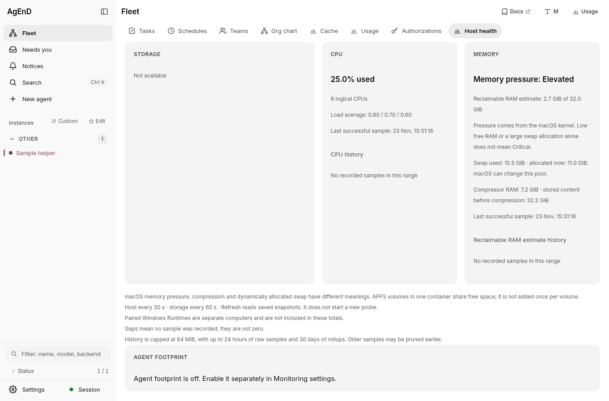

### 桌面 zh-TW · 記憶體規則

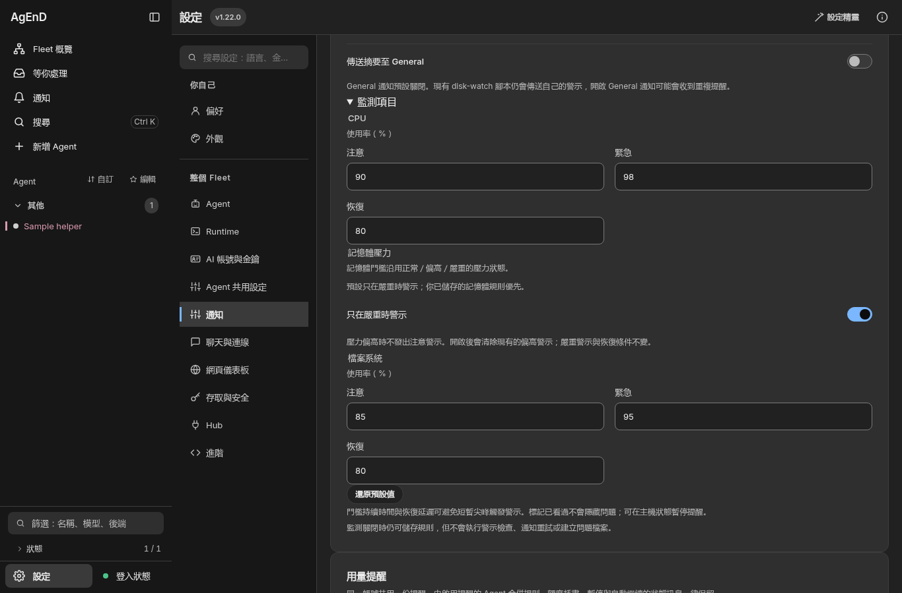

### Phone EN · memory rule

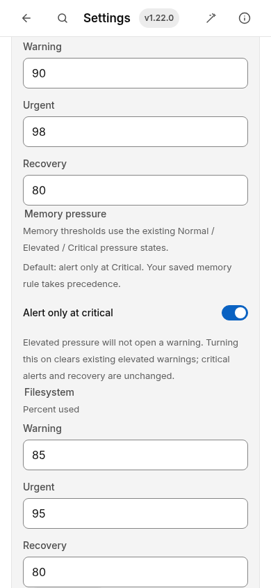

### 手機 zh-TW · 記憶體意義

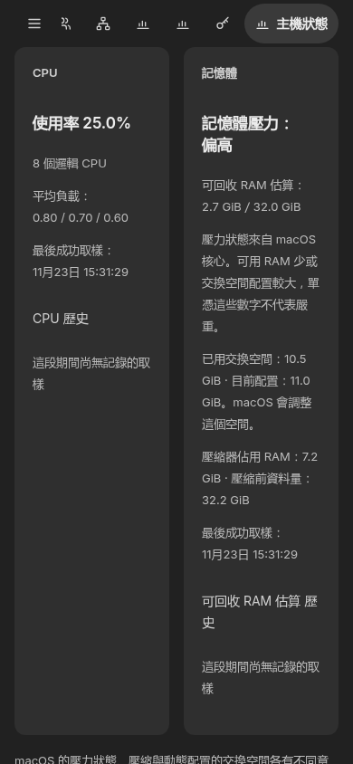

## Linux

### Desktop EN · memory meaning

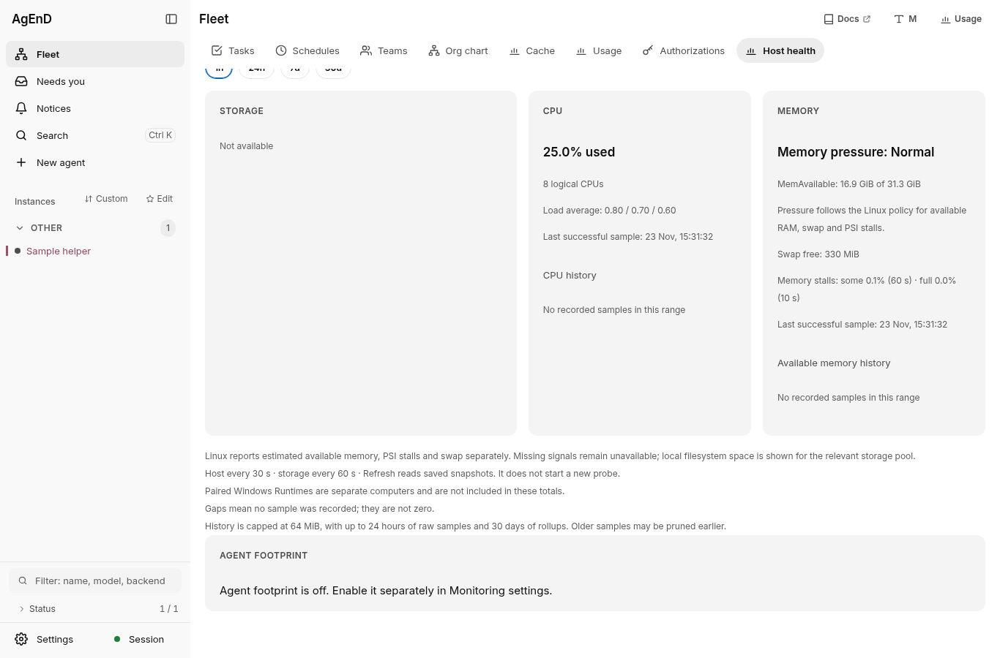

### 桌面 zh-TW · 記憶體規則

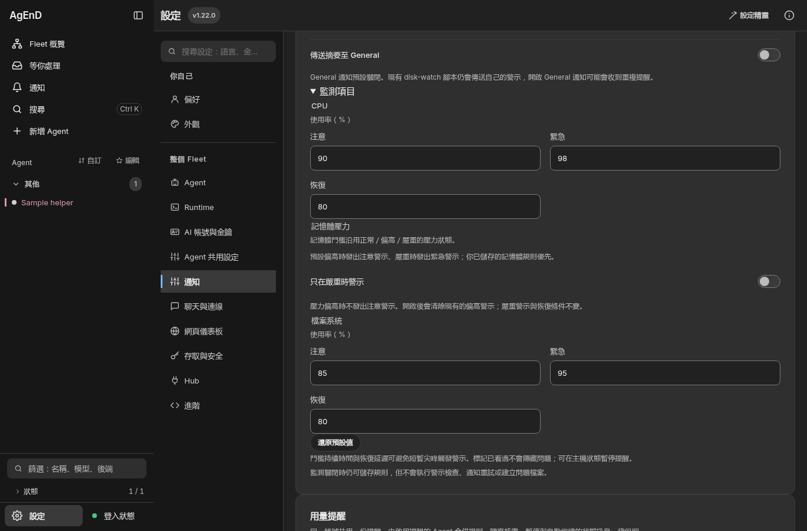

### Phone EN · memory rule

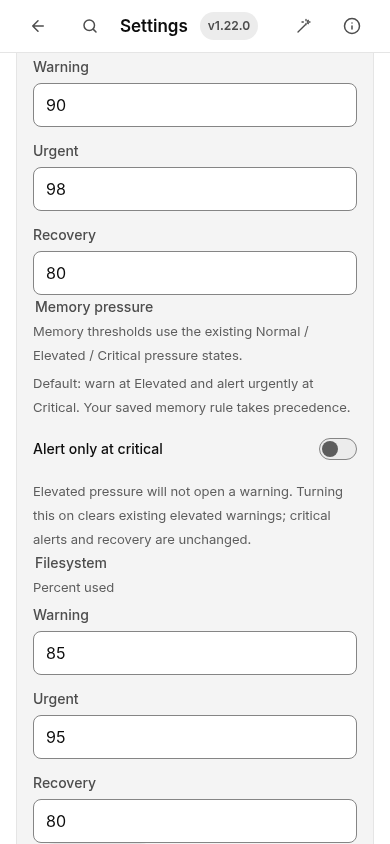

### 手機 zh-TW · 記憶體意義

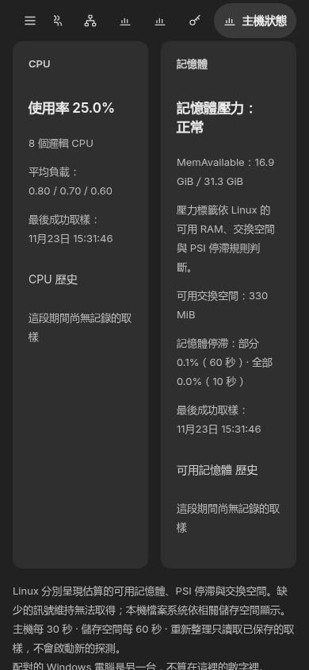

## WSL

### Desktop EN · memory meaning

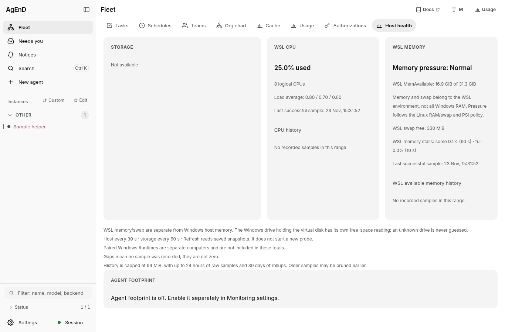

### 桌面 zh-TW · 記憶體規則

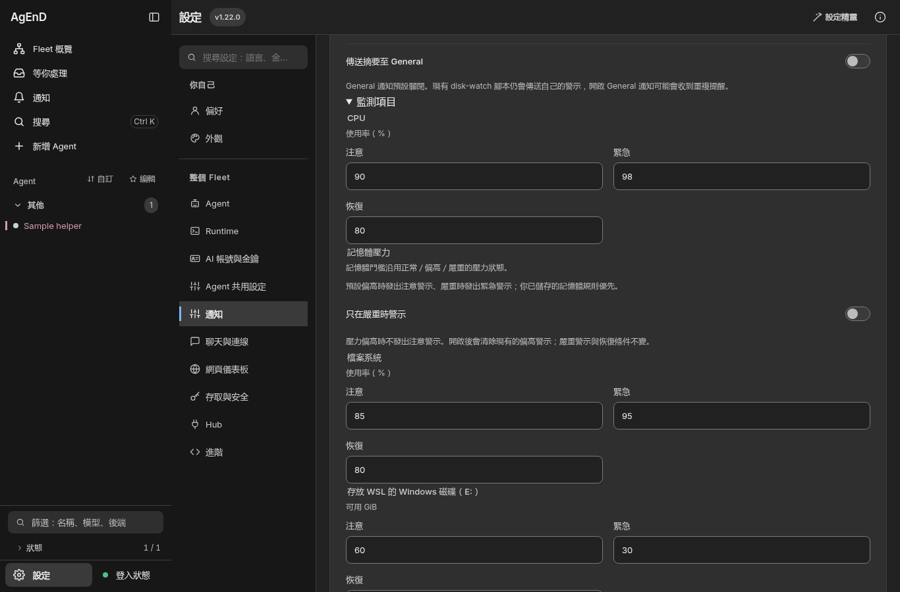

### Phone EN · memory rule

### 手機 zh-TW · 記憶體意義

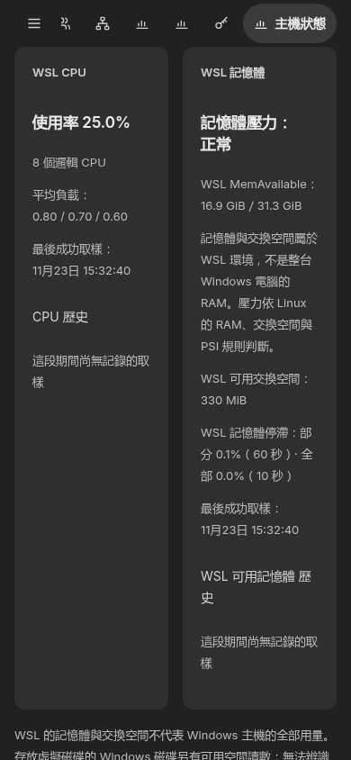
