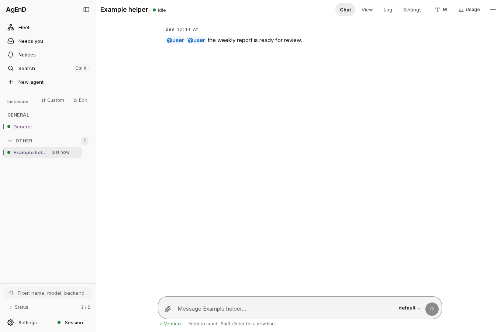
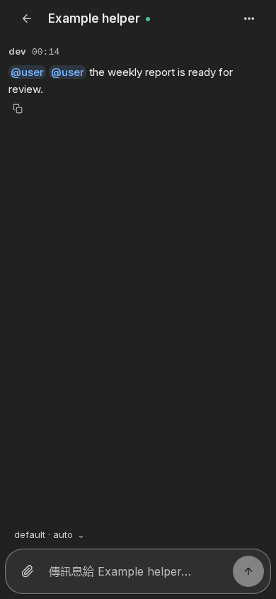
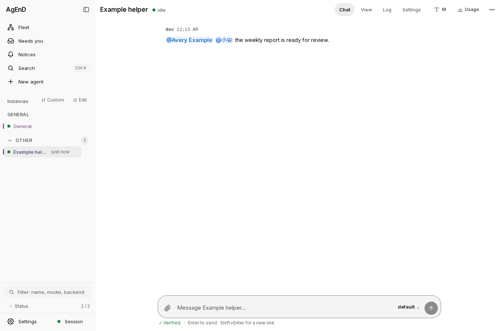
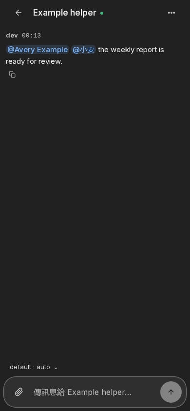

# M-3827: mention names across a fleet restart

An agent's message mentions two people who spoke on Discord before a fleet restart and not since.
`scripts/manual/mention-names-restart-m3827/capture.mts` captured it on the real web (an owned web fixture: no fleet start, no Discord, no network).

| | Desk, light, en | Phone, dark, zh-TW |
|---|---|---|
| **Before** (base 48b5d8e79): the people seen live only in memory, so after the restart both pills read `@user` |  |  |
| **After** (072ab13c6): the people seen are kept in `<home>/web-seen-users.json` and loaded at start, so the names stay |  |  |

The receipts are `receipt-before.json` and `receipt-after.json`. Each ran 5 of 5 checks from a committed tree with `src` clean.

To reproduce, run with `PW_DIR=<playwright-core> REPO=<checkout> OUT=<dir> npx tsx scripts/manual/mention-names-restart-m3827/capture.mts`.
The before shots come from running the same script with `REPO` set to a checkout of the base.
