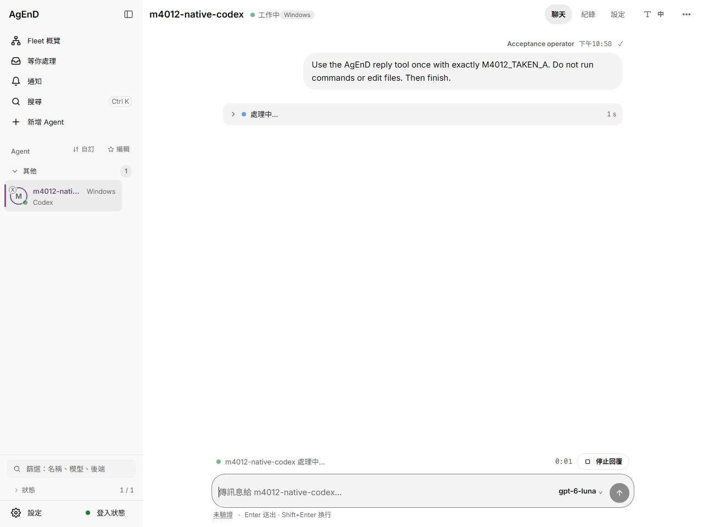
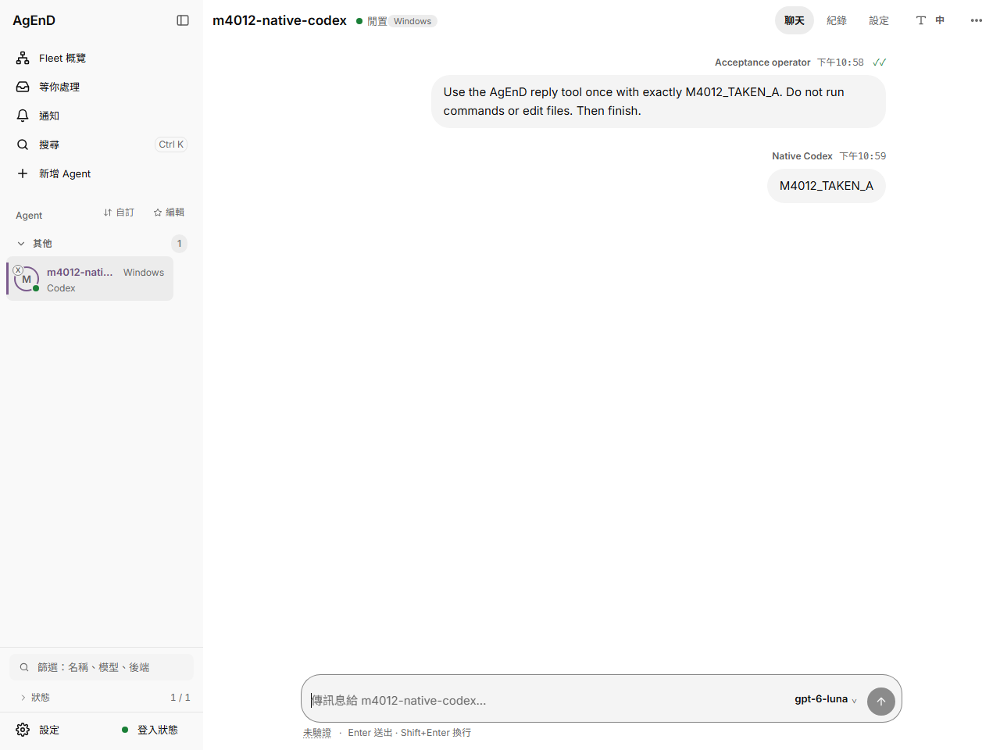

# #4012: native Windows Codex launch parity

Product source: `42462a18aded32e14db8b36e9cb51b6bd68e45ba`, built clean on alpha `8430ef136`. Native Codex `0.165.0`; cached `gpt-6-luna`; ordinary signed-in Windows home, read-only scratch sandbox. The user's existing approval covered these runs. No live Fleet, user pane, installed CLI, account configuration, or credentials were changed.

## Result

The missing `features.instant_interrupt=false` pin changes the expected queued-input behavior. Real matched omission controls failed the queue contract without that pin and passed with it. `--no-alt-screen` alone did not restore the queue contract; removing only that layout flag did not break this observed case. The fix supplies both pins, matching the ordinary Codex backend.

This is **not a claim that every unpinned input is lost**. All four matched controls eventually produced a canary reply. The released beta.4 case failed to establish the expected native queue/confirmation contract, while the fixed case retained its pending hand-off and confirmed it when taken. The earlier `[Pasted Content 1048 chars]` composer symptom was not reproduced deterministically in this matrix. That earlier failure remains documented in the [M-3133 packet](https://github.com/songsid/AgEnD/tree/eec8852491c58f337e9264540c597c6aee010139/docs/evidence/native-queued-handoff-m3133).

| Native launch | Layout pin | Queue pin | Native queued row before release | Canary reply | Confirmed | Queue contract |
| --- | --- | --- | --- | --- | --- | --- |
| Released beta.4 source | absent | absent | no | yes | no | **red** |
| Fixed source, queue pin omitted | present | absent | no | yes | yes | **red** |
| Fixed source, layout pin omitted | absent | present | yes | yes | yes | **green** |
| Fixed source | present | present | yes | yes | yes | **green** |

Every case used the same one-line setup and canary bodies. The setup requested a single blocking shell call with `yield_time_ms=30000` and an owned release-file wait. The coordinator waited for a running shell, sent the real human message through FleetManager/Daemon, observed it before release, and then released the wait. There were no early confirmations or replies in the matched cases. Each used a fresh owned scope; the omission controls explicitly changed only the indicated compiled argument entries. They did not change the installed Codex or the user's profile.

Actual Windows process command lines were inspected for the exact owned Codex process, exporting flag booleans and a digest only. See [control-summary.json](control-summary.json) and each case's original structured result, ACKs, hand-off transitions, diagnostics, build/control receipt, and cleanup receipt. Private raw command lines, pane contents, input wires, authentication files, and account paths are excluded.

Early exploratory runs allowed the setup tool to yield at intermediate boundaries; those are excluded from the causal table. Their cleanup receipts remain in the ledger. A transient final-capture refusal in an exploratory control is not counted as a product failure. The matched matrix used the explicit blocking-call setup and bounded read-only capture retries.

## beta.4 ordinary-message impact

The exact released tag `v2.4.0-beta.4` (`4ab65bb4bd563aea6135dd1e44d58a5325bd2123`) was built separately, not inferred from the candidate. A short ordinary idle message and an 867-character one-line idle message both produced delivery, confirmation, and the expected reply, with no draft left in the composer. The fixed source passed the same long-message check.

Thus these checks do not show a general idle-message outage in beta.4. Ordinary messages arriving while Codex is busy use the affected queue path: in the matched beta.4 busy case the agent replied, but the native queue/confirmation contract failed. The scope is these real runs, not a guarantee about every message length or user configuration.

## Validation and launch inventory

- New fresh/resume argv tests fail before the change: **2 failed**. Afterward: **65/65** across native configuration, pane-host, and #3944 hand-off tests.
- Source TypeScript build and test TypeScript program both exit **0**. Runtime assets and standalone bundles were built from clean pinned source; [fixed-build.json](fixed-build.json) and [beta4-build.json](beta4-build.json) record the hashes.
- Ordinary Codex's interactive invariants are update checking disabled, primary-screen layout, and instant interrupt disabled. Native already supplied the update guard; this patch adds the two omitted pins.
- Native `--no-daemon`, read-only/workspace sandbox selection, approval policy, model selection, developer-role instructions, scoped MCP identity, provider home, and exact resume id remain their existing policies. Fresh and resumed argv tests pin the interactive settings without broadening those policies.

The controller source is frozen under [controller-source](controller-source) for review. It is the private acceptance adaptation, not an installed command. Its staged code packages and state/auth files are not included. Signed-in execution requires the explicit task approval and the manual adapter build sequence; reviewers should consume this packet rather than start a duplicate native campaign.

## Fixed-head taken evidence

The full fixed case retained one runtime reference with no coordinator-local transcript path and no early confirmation. After release it produced `M4012_TAKEN_A`, one confirmation, and an empty hand-off store. Original actual-chat PNGs:

Both images were visually inspected: actual chat renders; the first has one processing tick and no delivered tick, the second has delivered ticks and the reply; neither exposes Windows account paths, email, or sign-in codes. This supplies the positive M-3133 leg only. Idle-not-taken and both restart cases remain for the next acceptance step.

## Cleanup and limits

All ten scopes from this repair's exploratory, matched, and ordinary-message checks were positively closed, exact test Codex sessions archived through the supported command, checked for zero remaining owned Windows processes, and removed by exact tagged scratch directory. See [cleanup-ledger.json](cleanup-ledger.json). One unused staging directory was removed without opening a CLI. Earlier M-3133 scopes were separately cleaned in their original packet.

The change applies to newly launched native Codex processes; no running user pane was restarted. Rollback reverts the two launch pins. It does not delete conversation state or replay messages. These checks do not certify the remaining M-3133 negative/restart legs or every CLI release.
