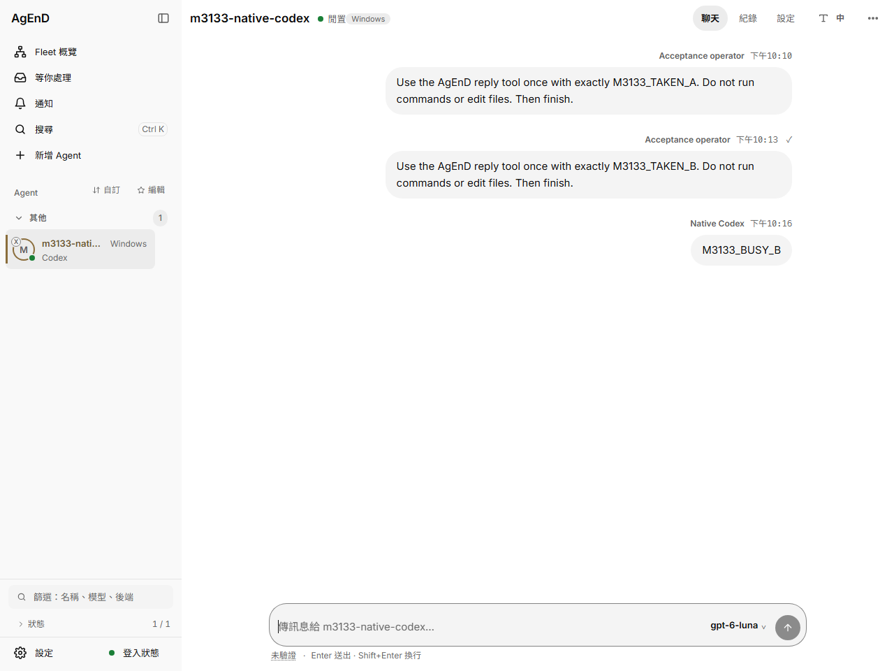

# M-3133: native Windows queued hand-off acceptance

Result: **incomplete; blocked before #3944's transcript-watch cases**. The valid native run applied one paste and one Enter, but the message remained in Codex's composer. Do not use this packet as taken, not-taken, restart, or release acceptance.

## Source and scope

- Clean alpha source: `0f7e0e39270781e60ccf719b4777e72441356f7e`.
- Native Windows Codex: `0.165.0`, cached `gpt-6-luna`, read-only sandbox; ordinary signed-in Windows provider home. No copied credentials or alternate CODEX_HOME.
- The build followed the manual adapter sequence: TypeScript output to a private package, `scripts/build-runtime-assets.mjs`, ordinary package resources, then `scripts/build-runtime.mjs`. Both TypeScript and the final bundle build exited 0. `source-receipt.mjs` recorded a clean tracked source tree.
- Bundle receipt: [build-receipt.json](build-receipt.json). The staged runtime ZIP SHA-256 was `345339b0cd6085abda64eae6b1068badc5714fde43a8c19cef80c987d34215ed`.
- One isolated FleetManager/Daemon, actual native pane host and scoped MCP, and the actual scratch Web chat. The Windows host remained separate from the coordinator process. No live AgEnD, user panes, account settings, or installed CLI were changed.
- Only one-line prompt bodies were submitted. Setup used a PowerShell wait for a file within the owned scratch directory. The canary asked for one `M3133_TAKEN_B` reply and no commands or edits.

## Valid retry B

After a positively running shell wait, the ordinary human-message delivery path produced:

1. `message_queued` and a persisted hand-off with a runtime reference, no local transcript path, and zero redeliveries.
2. A successful native paste ACK and Enter ACK, both `inputRefused:false`.
3. `message_delivered`, with no `message_confirmed`.
4. Two seconds later, `Native-queue paste not confirmed as submitted — retrying via idle-gated delivery`, proof `unproven`. The hand-off record was removed.
5. The same coordinator's capture showed `[Pasted Content 1048 chars]` still in the composer and `tab to queue message` while the shell wait ran. After releasing the wait, the setup produced `M3133_BUSY_B`; Codex became idle, with that pasted content still present.
6. The actual chat remained at a single processing tick for `M3133_TAKEN_B`, without a delivered or failed mark. The owned native link remained current throughout this valid retry.

[valid-run.json](valid-run.json) contains the native ACKs, persisted hand-off transitions, daemon diagnostics, and canary events. [owned-pane-tail.txt](owned-pane-tail.txt) is the bounded same-channel terminal capture after the wait finished.

The screenshot was visually inspected: the page renders, the runtime is idle, and the canary has one processing tick. It contains no Windows account path, email, or sign-in code.

The duplicate check found **one matching paste request, one applied paste ACK, one Enter, no further paste or Enter for that coordinator after this delivery, and no taken-canary reply**. No duplicate submission was observed. This is a bounded result for this run, not a general claim about retry safety.

## Concrete launch mismatch

`persistentNativeArguments()` in `src/runtime-pane-native.ts` omits both `--no-alt-screen` and `-c features.instant_interrupt=false`. The ordinary Codex backend pins both in `src/backend/codex.ts:1995–2001`. The native worker uses its separate argument builder at `src/runtime-pane-worker.ts:74`.

[launch-proof.json](launch-proof.json) reconstructs those flag booleans from the retained exact launch and clean compiled module; the staged Windows module was byte-equal. **The live process command line was not captured before cleanup.** This proves a launch mismatch and identifies a leading cause to investigate; it does not establish which omitted flag caused the observed queue failure.

The #3944 author confirmed there is no additional transcript-watch initialization or alternative supported queue mode. A successfully submitted native queue hand-off is required before its taken/restart behavior can be judged. The native submit failure should be tracked separately; no production fix is included here.

## Acceptance status

| Card item | Result |
| --- | --- |
| 1: user authorization | Verified before the run; receipt remains in the task's forwarded authority chain. |
| 2: clean build and source receipt | Complete. |
| 3: queued, no early confirmation, runtime-only record | Observed up to native submission; the record was subsequently dropped after unproven submission. No complete pass claimed. |
| 4: taken and record removed | Blocked by native submission. |
| 5: idle-not-taken after approximately 90 seconds | Not exercised with an accepted queue hand-off. |
| 6: restart, same launch rewatched without another paste | Warm reattachment retained the launch without startup input, but no accepted pending queue was available. No pass claimed. |
| 7: restart after launch gone | Not exercised with an accepted queue hand-off. |
| 8: evidence | This partial failure packet; completion evidence remains outstanding. |

An initial streaming-output attempt exhausted five positive sequence refusals. A subsequent diagnostic reader mistakenly opened a second native client, replacing the coordinator connection; that attempt is invalid and excluded from acceptance conclusions. Retry B used only its existing coordinator connection. These harness corrections changed no application source.

## Cleanup and next step

Both owned panes were positively closed; both native hosts exited 0. Their exact two Codex session UUIDs were archived with the supported CLI command. A bounded Windows process check found no remaining process belonging to either scratch scope, and only those two tagged scratch directories were removed. All owned headless browsers and scratch Web/coordinator processes were closed. See [cleanup.json](cleanup.json) and [earlier-cleanup.json](earlier-cleanup.json).

Next: fix or diagnose the native Codex queue-launch/submission mismatch, then resume items 3–7 with an applied and accepted queue hand-off. No further signed-in variants were run. Rollback is limited to discarding this evidence branch; no product change was made.
