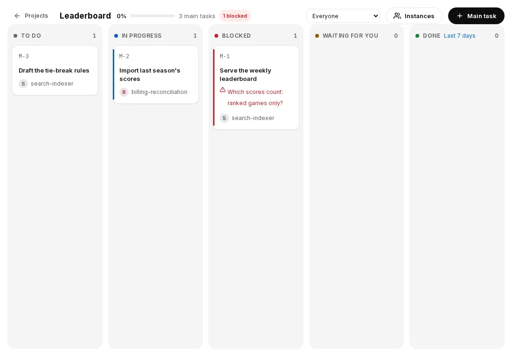

# 功能 (Features)

## Fleet 模式 — 一個機器人，多個專案

每個 Telegram 論壇主題 (Forum Topic) 都對應一個獨立的 Claude Code session。建立主題、選好專案目錄，Claude 就會開始工作；刪除主題，instance 就會停止。機器撐得住多少專案，就能開多少個。

## 排程任務 (Scheduled tasks)

Claude 可以透過 MCP 工具建立 cron 排程。排程存在 SQLite 裡，daemon 重啟後依然有效。

```
使用者：「每天早上 9 點，檢查有沒有需要審查的 PR」
Claude：→ create_schedule(cron: "0 9 * * *", message: "檢查需要審查的 PR")
```

可用的 MCP 工具：`create_schedule`、`list_schedules`、`update_schedule`、`delete_schedule`

協作 MCP 工具：`list_instances`、`send_to_instance`、`start_instance`、`create_instance`、`delete_instance`

排程可以指定某個 instance，也可以指向建立它的 instance 自己。排程觸發時，daemon 會把訊息推給 Claude，就像使用者親自傳來的一樣。

漏掉的那一次會補跑一次，不會跑兩次（#1995）：
- **重啟之後。** fleet 停止期間到期、且在 24 小時內的那一次，啟動時補跑一次。
- **fleet 執行中。** 已經到期卻 3 分鐘內都沒開始的那一次，也會用同樣的方式補跑一次，沿用同一個 run id，所以晚到但真實的觸發不會再跑一次。因為同一個排程的上一次還在執行而跳過的那一次，仍然維持跳過。fleet log 會記一行 `Missed cron tick — catching up`。
- **在 fleet log 裡。** 每次註冊都會記一行 `Cron schedule registered`，附排程 id、來源（`init`、`reload`、`create`、`update`、`repair`）與下一次執行時間。已啟用卻沒有對應排程工作的排程（例如用 `agend schedule add` 新增、但重新載入沒有生效的），會在一分鐘內被發現並記一行 `Cron schedule was not registered — registering`，漏掉的那一次照上面的方式補跑。每次觸發都會記一行 `Cron tick`，附排程 id 與 run id。觸發後沒有開始的會記 `Cron tick not run` 與原因（`disabled`、`still_running`、`already_ran` 等），執行失敗的會記 `Schedule run failed`。

網頁儀表板的 **Fleet → 排程** 會列出所有排程，並可在那裡管理（#1724）：
- 每一列以文字顯示排程的執行方式（「每週一到五 18:00」、「每 15 分鐘」、「一次 · 2026-10-13 14:00 (UTC+8)」），以及依 fleet 時區顯示的下次執行時間；原始 cron 改放在提示文字中。已停用的排程會有明顯標示。
- **編輯**按鈕會開啟已填好內容的排程表單，可切換**重複 / 一次**，儲存時與 `update_schedule` 工具使用相同的驗證。
- **新增排程**也能建立一次性排程。
- 臨時公開連結可以檢視排程，但無法新增、編輯或刪除。

## 當機復原 (Crash recovery)

AgEnD 會讀取 CLI 的狀態列 (status line) JSON 取得 context 用量（用於儀表板和日誌）。所有 CLI 後端（Claude Code、Codex、OpenCode、Kiro CLI、Antigravity CLI、Grok Build、Meta Muse Code）都內建 auto-compact，自己處理 context 上限，因此 AgEnD 不會因為 context 用量或 session 存在多久而觸發重啟。

CLI 程序當掉時，daemon 的健康檢查會發現 tmux 視窗已經不在，接著：

1. **快照** — 把最近的使用者訊息、工具活動和狀態列資料收集到 `rotation-state.json`
2. **清理程序** — 用 process group 訊號結束整棵程序樹（CLI 加上 MCP server），並依 PID 檔結束任何殘留的 MCP server
3. **嘗試 resume** — 用 `--resume` 恢復完整的對話歷史
4. **退而求其次** — resume 失敗時，開一個全新的 session，並把快照當作 context 注入
5. **退避** — 反覆當機時採指數退避；5 分鐘滑動視窗內當機 3 次以上就暫停重啟

### Fleet 層級的斷路器（storm window）

當 tmux server 本身掛掉或被換掉（而不只是單一視窗），所有 instance 會同時失去視窗。fleet 會把這當成單一事件，也就是一個 **storm window**，而不是 N 次各自獨立的當機：

- **第一次 server 當機就開啟。** 每觀察到一次「存活 → 死亡」的轉變（或 server PID 改變）才算一次死亡，不會因為有幾個 instance 回報就算幾次。
- **退避：** 第一次當機後，instance 的重啟會暫緩 30 秒；第二次暫緩 2 分鐘；第三次起暫緩 10 分鐘。視窗關閉後，fleet 連續平穩 10 分鐘，退避等級才會歸零。
- **投遞也會被擋下：** 退避期間，任何訊息都不會貼進任何 instance；復原期間，傳給受影響 instance 的訊息會等到該 instance 復原後才送。
- **復原：** 退避結束後 instance 會重啟；所有受影響的 instance 都復原、或滿 10 分鐘時，視窗關閉。視窗開啟期間，個別 instance 的事故通知（當機重啟、MCP 掛掉、卡住等）會先壓下，最後合併成一則事件回報。
- **`window_loss`：** server 正常，但 60 秒內有 4 個以上的 instance 失去視窗時，也算一個事件（代表主機或 tmux 層級出了問題）。這種情況不會暫緩啟動，但復原會以 storm 的節奏進行，而且只回報一次。

### 防止 MCP server 成為孤兒程序

CLI 程序結束時，它底下的 MCP server 子程序也該一起結束。這裡有三層保護：

1. **輪詢 ppid**（主要機制）— MCP server 每 5 秒檢查一次 `process.ppid`，一旦被改掛到 PID 1（代表父程序已死）就立刻結束。各平台都適用，也不受 macOS 上 libuv/kqueue 的 bug 影響。
2. **監聽 stdin EOF**（次要機制）— 監聽 stdin 的 `end`/`close`/`error` 事件。在 Linux 上可靠；在 macOS 上，libuv 遇到斷掉的 pipe 會空轉吃 CPU，所以不太可靠。
3. **依 PID 檔結束**（daemon 端）— MCP server 會把自己的 PID 寫進 `channel.mcp.pid`。當機重啟時，daemon 先讀這個檔，對殘留的孤兒送 SIGTERM，再啟動新的 CLI。

## Instance 替換 (Instance replacement)

instance 的 context 被汙染或陷入迴圈時，可以用 `replace_instance` 一次把它換成全新的 instance：

1. 從 daemon 的 ring buffer 收集交接用的 context（最近的訊息、事件、工具活動）
2. 停止舊 instance，保留它的設定
3. 用相同設定建立新 instance，沿用原本的 Telegram topic
4. 透過一般的訊息投遞路徑，把交接 context 送給新 instance

## Instance 暖機 (Instance warmup)

instance 啟動時，daemon 會把剛組好的 fleet 指示，和上次告訴 agent 的版本（記錄在 instance 目錄的 `prev-instructions`）做比對。**只有指示改變時才會暖機**；指示沒變的重啟什麼都不送，每次重啟能省下 agent 10 到 30 秒。

- 第一次啟動（還沒有任何紀錄）：只記錄指示，不送任何東西。
- Claude Code 在 resume 時會自己重讀指示，所以永遠不用通知它。
- 其他後端會收到一行通知，請它重新載入自己的指示檔（`AGENTS.md`、kiro 的 agent 檔或 steering 檔、`.agents/AGENTS.md` 等）。如果沒有訊息在等，這則通知會延到下一則真正的訊息再一起送，免得 agent 平白回一段話；如果已經有投遞在排隊，daemon 會等到閒置，先貼上通知。

不需要任何設定。

## 版本更新後的「新功能」通知（#1633）

升級後，每個既有的 instance 會在收到下一則訊息前收到一則簡短通知——不會在 turn 進行中插入，也不會發給沒人傳訊息的 instance。通知列出與 agent 相關的變更與確切參數名稱，並提醒重新載入看起來比目前版本還舊的工具說明。每一項每個 instance 只會收到一次；紀錄在 daemon 重啟後仍保留。新 instance 一開始就是最新的工具，不會收到通知。沒有 agent 相關變更的版本不會發送任何通知。

**誰會收到哪些項目，以及提到的 skill（2.2.5，#2163）。** 給 General 或 coordinator 的項目（例如網頁設定工具）只會送給 General，以及工具組為 coordinator 或 full 的 instance；其他 instance 會直接記為已知，不會收到。通知若提到某個 skill，也會說明在任何地方都能讀取的方式：`agend-agent skill <name>` 會印出 AgEnD 內建的 skill，`agend-agent skill` 則列出全部。Skill 依角色以檔案發佈：General 會拿到全部，fleet worker 拿到標給 worker 的那些，ClassicBot 房間的 agent 只拿到 `web-appearance`、`persona-emoji` 與 `web-dashboard`，而且只寫進它自己在 `<AGEND_HOME>/workspaces/` 底下、由 AgEnD 管理的資料夾；位於其他位置的 Classic 資料夾什麼都不會寫入，資料夾裡連到別處的連結也一樣。

## Instance 狀態圖示 (Instance status indicators)

冷啟動或完整重啟時，網頁儀表板會在 Agent 全部啟動完成前開放。**Fleet 啟動中 N/M** 會顯示可啟動 instance 中已成功啟動的數量，不包含原本暫停的 instance；側邊欄、聊天標題和組織圖會區分「等待啟動」與「啟動中」。啟動期間可以查看狀態、歷史訊息、用量和任務板；傳送訊息或修改設定時，會明確提示等啟動完成後再試。回訪的訪客可能需要稍候，等連線權限初始化；這不會登出既有登入。替換程序的完整重啟，仍會在舊程序結束、新監聽器初始化時短暫重新連線。服務的就緒判定和啟動逾時維持不變。

`agend ls`（欄位為 Name、Backend、Status、Team、Src、Ctx、Mem、Activity）和聊天裡的 `/status` 指令，每個 instance 都只顯示一種狀態。這個狀態由 daemon 的執行狀態（idle / working / stuck / paused）和生命週期（running / paused / stopped / crashed）合併而成：

| 狀態 | `agend ls` | `/status` |
|---|---|---|
| 閒置 | 綠色 ● `Idle` | 🟢 |
| 工作中 | 藍色 ● `Working` | 🔵 |
| 卡住 | 紅色 ● `Stuck` | 🔴 |
| 當機 | 紅色 ● `Crashed` | 🔴 |
| 暫停 | 暗黃色 ○ `Paused` | ⏸ |
| 停止 | 灰色 ✗ `Stopped` | ✗ |

連不上 fleet API 時，`agend ls` 會退回依 pane 活動顯示 `Busy` / `Idle`。在 `/status` 裡，還沒有執行狀態快照的執行中 instance 會顯示 🟢 Running。

## Fleet /collab

讓 fleet topic 也能接收 bot 對 bot 的訊息和 webhook 訊息。某個 topic 開啟 `/collab` 後，其他 bot 和 webhook 傳來的訊息都會轉給該 instance，讓多個 bot 能在同一個 Telegram/Discord 頻道裡協作。

fleet 在 `open` 模式下，bot 訊息會自動通過過濾，不需要切換 `/collab`。

## 取消按鈕 (Cancel button)

訊息送到 agent 之後，它的 topic 或頻道裡會出現一個「🛑 Cancel」按鈕，按下去就會中斷目前的生成：

- **Telegram**：inline keyboard 按鈕
- **Discord**：按鈕元件
- **`/cancel` 指令**：效果相同，可以直接打字，也可以用 Discord 斜線指令

取消時送出的是各後端自己的中斷鍵：Kiro CLI 和 Grok Build 是 Ctrl+C，其他後端都是 Escape。agent 回覆時、按鈕被按下時、被更新的按鈕取代時，或 instance 進入閒置時，按鈕就會失效。

跨 instance 訊息和排程觸發也能取消。

這則按鈕訊息同時也是進度泡泡：30 秒後它會顯示 agent 已經工作多久，如果後端有回報，也會顯示它現在正在做什麼。

## 投遞狀態 (Delivery status)

投遞進度會以 reaction 的形式顯示在使用者自己的訊息上，隨著訊息往下走而替換：

| 狀態 | Discord（內建） | Telegram（內建） | 意義 |
|--------|--------------------|---------------------|---------|
| `received` | 👀 | 👀 | fleet 已收到訊息 |
| `queued` | ⏳ | 👀 | 等著交給 CLI（前面還有別的訊息，或 CLI 忙碌中、還在啟動） |
| `processing` | 👀 | 👀 | agent 已拿到訊息 |
| `delivered` | ✅ | 👀 | agent 已開始處理 |
| `failed` | ❌ | 👎 | 投遞失敗（例如視窗已經不在，重試次數也用完了） |

Telegram 只接受一組固定的 reaction，⏳、✅、❌ 都不在其中，所以它的內建值不一樣。

這些 emoji 可以用 `status_emojis` 依頻道或依 instance 自訂（見英文版 [configuration](configuration.md#channeloptionsstatus_emojis-discord-and-telegram)），其中也包括 `photo` 和 `attachment`，也就是 ClassicBot 存下照片或檔案時蓋上的戳記。

### Persona emoji

在有好幾個 bot 的頻道裡，每個 agent 都可以挑一個代表自己的 emoji，讓大家看得出是誰處理了訊息。這由三個 MCP 工具完成，內建的 `persona-emoji` skill 會一步步帶 agent 用它們：

- `list_emojis` — 這個 instance 能用的 emoji：平台的標準 emoji，以及在 Discord 上，它的 bot 能用來按 reaction 的伺服器 emoji。伺服器 emoji 只回傳值（除非加 `with_image_urls`，否則不附圖片網址），並可用 `name`（名稱片段）、`limit`（所有伺服器合計）和 `primary_only` 縮小範圍。在熱鬧的伺服器上，完整清單曾經多達約一萬字元，而 agent 只是想挑一個 emoji。
- `preview_emojis` — 下載最多 8 個伺服器 emoji，各回傳一個本機圖片路徑，讓 agent 先看過再挑。圖片網址由 fleet 依 emoji id 自己組出來，而且只保留小尺寸的 PNG。
- `set_persona_emoji` — 設定這個 instance 自己的 `delivered` 戳記（或它指定的其他狀態），檢查方式和 Settings 相同。

每種工具權限組合 (tool profile) 都能列出和預覽；除了 `minimal` 以外，也都能設定自己的戳記（`general` 從 2.1.9 起可以）。ClassicBot instance 能列出和預覽，但戳記要在 Settings 裡設定。這些工具永遠只會改動呼叫者自己的那一項。

### 貼圖 (Stickers)

agent 可以在 Discord 和 Telegram 傳送貼圖（2.1.12 起）。兩個平台上的工具用法相同，底層則各有各的做法：

- `list_stickers` — 這個 instance 在它說話的地方能傳的貼圖，每張是 `{ id, name, emoji_or_tags, format }`，不附圖片網址。**Discord：** 列出 instance 自己頻道所在伺服器的貼圖；bot 無法傳別的伺服器的貼圖，所以不會列出（Discord 的標準貼圖包也不列）。**Telegram：** 貼圖放在貼圖包裡，任何聊天都能用，所以呼叫時要指定 `set`（`t.me/addstickers/<name>` 裡的 `<name>`），或列出這條連線的 [`options.sticker_sets`](configuration.md#channeloptions-telegram)。可以用 `name` 和 `limit` 縮小範圍。
- `preview_stickers` — 從 `list_stickers` 的結果裡下載最多 8 張貼圖，各回傳一個本機圖片路徑供讀取。只有 `list_stickers` 回傳過的貼圖才能預覽。Discord 的 Lottie 貼圖，或沒有縮圖的 Telegram 動態貼圖，沒有靜態圖可看，會標成 `preview_unavailable`。在 Telegram 上，下載是在 adapter 裡完成的，所以檔案網址裡的 bot token 不會離開 adapter。
- **傳送：** `reply` 接受 `stickers`（最多 3 個，取自 `list_stickers` 的 id），這時 `text` 可以省略。**Discord** 會把貼圖和文字放在同一則訊息（文字很長時放在最後一段）。**Telegram** 先送文字，再一張接一張送貼圖。送出任何東西之前都會先檢查貼圖：在 Discord 上，它必須是回覆目標伺服器裡可用的貼圖，所以別的伺服器的貼圖會直接回錯誤，而不是送出一則悄悄少了貼圖的回覆。貼圖永遠不會寫在文字裡，文字裡的 id 就只是文字。
- 在 CLI 上，`agend-agent stickers [set] [--name …] [--limit …]`、`agend-agent sticker-preview <id…>` 和 `agend-agent reply <text> --sticker <id>` 可以做到同樣的事。

不支援上傳貼圖或建立貼圖包。

### 回覆按鈕

agent 可以提供讓人點選、而不必打字的選項（2.2）。同一組按鈕會出現在網頁聊天、Telegram（inline keyboard）與 Discord（message components）。

- **送出：** `reply` 接受 `buttons`：1–10 個 `{ label, value? }`。
  - label 是一行純文字，最多 80 個字元（Discord 的上限，三者中最嚴格）。
  - `value`（最多 200 字元）是與 label 不同時 agent 收到的內容；它只存在 AgEnD 內，不會送到任何平台。
  - 按鈕必須搭配 `text`，放在文字的最後一則訊息上。不能與 `stickers` 一起使用；`files` 照常在文字之後送出。
  - `buttons` 不合規時，該次回覆會回傳錯誤，且不會送出任何東西。
- **點擊** 會以點擊者發出的一般訊息送給 agent：`[button] Deploy`，value 不同時為 `[button] Deploy (value: deploy-prod)`。它也會顯示在網頁聊天裡。
  - Discord 與 Telegram 的點擊會使用和打字訊息相同的工作中／取消氣泡，包含進度與閒置、回覆後的清理。點擊不會建立新的平台訊息，因此接收與處理中的狀態反應會放在帶有按鈕的回覆上。網頁選項沿用 daemon 回報的工作中／停止狀態；網頁訊息的合成 id 不會送到平台的反應 API。
  - 投遞失敗時，平台狀態會改為失敗，選項會重新開放以供重試。重試成功後，既有的投遞狀態流程會取代失敗狀態。
- **每則回覆只有一個選擇。** 第一個有權限的點擊就代表所有人。之後各處的按鈕都會顯示選了什麼、誰選的：Discord 上按鈕停用並標出選項，Telegram 顯示單一個「✓ Deploy — alice」按鈕，網頁聊天則停用按鈕。之後的點擊會收到「已經有人回答了」。
- **誰能點：** 能在那裡對該 instance 發訊息的人。
  - fleet topic：該連線允許的使用者。
  - ClassicBot 房間：房間裡的任何人。
  - 網頁聊天：已登入的使用者，或透過公開連結的訪客（他們也能發訊息）。
  - bot 的點擊一律不算。
- **有效期：** 按鈕 24 小時後過期，並會標示出來。AgEnD 重啟後按鈕仍有效：每組按鈕是 `reply-buttons.db` 裡的一列，只對應原本那則訊息，而且只能回答一次，所以點擊無法被重放。
- **無法顯示按鈕的地方**（例如 `agend-agent reply`）：選項會以編號清單附在文字後，讓人直接回覆。
- **安全：** 平台上只帶不可猜的 id 與按鈕的序號，不帶 label 或 value；label 一律以純文字顯示。

#### 投票

`reply` 同時帶 `buttons` 和 `poll`，按鈕就變成有時限、Kahoot 式的投票（#1823），可用在 Discord 與 Telegram（fleet topic 和 ClassicBot 房間）以及網頁聊天。AgEnD 只負責計票；正確答案、計分和排行榜由 agent 依結果自行處理。問答遊戲就是一題一個投票。

- **送出：** `poll: { seconds, multi?, reveal?, show_voters? }`，搭配 2–10 個 `buttons` 作為選項。
  - `seconds`：10 秒到 24 小時。投票隨著送出開始（計時在訊息送出前一刻就開始，所以送出時截止時間已確定），經過這段時間後截止。
  - `multi`（預設關）：每人可選多個選項，每次點擊切換一個。
  - `reveal`：`"close"`（預設）在開放期間只顯示「已有 N 人作答」和剩餘時間，截止時才公布票數；`"live"` 則隨投票即時顯示票數。
  - `show_voters`（預設關）：截止時在投票下方另發一則訊息，列出誰選了什麼。
  - 回覆的結果包含 `poll_id`。無法顯示投票的地方（`agend-agent reply`，或沒有 fleet 的 instance）會拒絕這次回覆，而不是改用文字送出。
- **投票：** 能點回覆按鈕的人都能投票，每人一票，可以改票。投票者自己的選擇只會告訴他本人：Discord 是只有自己看得到的回覆，Telegram 是提示，網頁聊天則由頁面標出（這台裝置會記住）。再點一次已選的選項不會改變任何東西。
  - **網頁聊天裡**，每個已登入的裝置（它的工作階段）算一位投票者，名稱是 `web · <裝置> (<id 前 4 碼>)`；和回覆按鈕一樣，透過公開連結的訪客也能投票。同一個人用兩台裝置會投兩票。在 Discord 或 Telegram 發出的投票，也能從網頁聊天投票。
- **開放期間：** Discord 會自己倒數截止時間（`⏳ 截止 …後`）；Telegram 會重繪狀態按鈕（`🗳 已有 3 人作答 · ⏳ 1:35`），最後兩分鐘每 5 秒一次，之前較少；網頁聊天每秒倒數。重繪會合併，最多每 2 秒（Discord，以頻道計）或 3 秒（Telegram，以整個群組計，各主題共用）一次；網頁最多每秒通知一次新的投票。
- **截止時：** 按鈕停用，顯示每個選項的票數與比例；之後的點擊會收到「這個投票已經截止」。agent 會在投票所在的聊天裡收到一則來自 AgEnD 的 `[poll results]` 訊息，並應在那裡回覆：每個選項的票數與投票者，每位投票者附上固定的 id（`<連線>:<使用者 id>`）和從投票開始到他最後一次改動的毫秒數。改過票的人以最後一次改動的時間計。AgEnD 只負責計票。
- **提前截止：** `close_poll({ poll_id })` 會立即截止 instance 自己的一個進行中投票（例如所有人都答完時）。效果和到期截止相同，結果會註明 `closed early by close_poll after N s`。
- **重啟後仍只送一次：** 截止時間和投票一起存在 `reply-buttons.db`。AgEnD 停機期間到期的投票會在下次啟動時截止，結果裡會註明晚了多久。結果經由投遞 outbox、以投票的 id 送出，所以即使 AgEnD 在交付途中停止，agent 也只會收到一次。

## 工具進度（`tool_progress`）

`tool_progress` 會把 agent 的工具活動加進進度泡泡，以這一輪的累積清單呈現：

| 值 | 顯示內容 |
|---|---|
| `off`（預設） | 只有經過時間 |
| `standard` | 語意標籤（例如 `npm test` 顯示為 `🧪 執行測試`），絕不顯示 shell 參數 |
| `verbose` | 同樣的標籤，再加上截短的指令預覽 |

這個功能要自己開啟，因為進度泡泡會把活動廣播到頻道裡；張貼之前會先遮蔽憑證（API key、token、bearer header、`password=` 這類指派等）。進度泡泡失效後，清單會留下來，成為唯讀的工具歷程。可以依 instance、在 `defaults` 裡，或依 ClassicBot 頻道設定。

## 回覆完成守衛（`reply_completion_guard`）

人類傳來的訊息必須透過 `reply`（或 `react`）工具回覆；agent 只印在自己終端機裡的文字，永遠到不了聊天室。在 Claude Code 上，回覆完成守衛會發現「面向人類的這一輪已經結束，卻沒有送出任何回覆」的情況：

- 它會等到 instance 確實處理過這一輪、而且接著閒置滿 60 秒才判斷，所以這一輪中途的停頓不會被誤認為結束。
- 接著它會提醒 agent 一次，請它用 `reply` 或 `react` 送出結論，不必重做一遍。
- 如果 agent 嘗試過回覆但結果不明（可能已經送出、只是逾時），守衛不會重試，所以你不會收到兩次答案；聊天室裡會出現一則簡短通知，說明這則回覆無法確認。

預設開啟（`reply_completion_guard: true`）；要關掉，就依 instance、在 `defaults` 裡，或依 ClassicBot 頻道設為 `false`。

支援的後端：
- **Claude Code**，以及成功建立的 **Kiro** legacy/TUI 啟動。
- **Codex** 與 **Muse**，但還要 CLI 自己的 session 紀錄顯示：裝著你這則訊息的那一輪已經結束，而且之後沒有新的一輪開始。Muse 在執行中收到的訊息會再開一個 run，那一個也必須結束。被中斷的一輪（Esc）或因 provider 錯誤結束的一輪不會提醒；紀錄裡找不到的一輪也照舊不會提醒。

其他後端沒有這個功能。

### 網頁聊天的 reaction（#2305）

agent 可以用泡泡下方的一個 emoji 回應網頁聊天的訊息，而不必寫回覆——這就是 Discord 與 Telegram 原本就有的最小回覆（「OK」、「謝謝」）。回應會立刻出現，並和聊天紀錄一起保存，所以重新整理、換一台裝置或重新啟動後都還在。訪客在自己看得到的訊息上也看得到。如果那則網頁訊息有複製到 agent 的 Discord/Telegram topic 或 ClassicBot 房間，副本也會有同樣的回應。回應會完成這一輪，所以聊天不再顯示 agent 結束這一輪卻沒有回覆，AgEnD 也不會再要求補送結論。Emoji 使用 Telegram 的固定回應集合（所有平台同一套），且不會用 AgEnD 標示送達狀態的 emoji；其他 emoji 會被拒絕，錯誤訊息會列出可用的。agent 的指示與 `react` 工具說明寫清楚什麼時候用回應就夠了。

## 點對點 Agent 協作 (Peer-to-peer agent collaboration)

Instance 透過權限組允許的工具協作。一般 worker 可以找到同儕並傳訊；建立、啟動或喚醒 instance 則需要對應的管理工具權限。見[工具權限組](features.zh-TW.md#工具權限組合-tool-profiles)。

**核心 MCP 工具：**

- `list_instances` — 找出所有已設定的 instance（執行中或已停止），附上狀態、工作目錄和最後活動時間
- `send_to_instance` — 傳訊息給另一個 fleet instance；支援結構化的 metadata（`request_kind`、`requires_reply`、`correlation_id`、`task_summary`）
- `start_instance` — 喚醒已停止的 instance，好讓你傳訊息給它
- `create_instance` — 建立新 instance 和它的 topic（目錄可省略；省略時自動建立 `~/.agend/workspaces/<name>`）；支援用 `branch` 建立 git worktree 隔離
- `delete_instance` — 移除 instance 和它的 topic
- `replace_instance` — 把 instance 換成全新的（交接 + 刪除 + 建立）
- `describe_instance` — 取得某個 instance 的詳細資訊（描述、模型、最後活動）
- `set_display_name` — 設定顯示名稱，會出現在訊息、活動紀錄與其他 agent 看到的地方
- `set_description` — 設定角色描述，會注入 agent 的系統提示，下次 session 重啟後生效

**高階協作工具**（優先使用這些，而不是直接用 `send_to_instance`）：

- `request_information` — 向另一個 instance 提問並等它回覆（`request_kind=query`、`requires_reply=true`）
- `delegate_task` — 把工作連同成功標準交給另一個 instance（`request_kind=task`、`requires_reply=true`）
- `report_result` — 把結果交回給請求者，並帶回 `correlation_id`，讓回應能對上原本的請求

**Team 工具**（以一群 instance 為對象）：

- `create_team` — 定義一個有名字的 instance 群組
- `list_teams` — 列出所有 team 和成員詳情
- `update_team` — 新增或移除成員，或更新描述
- `delete_team` — 移除 team 定義
- `broadcast(team: "name", ...)` — 傳訊息給某個 team 的所有成員

一個 instance 傳訊息給另一個時，目標的 topic 會出現通知：`sender → receiver: summary`。為了減少雜訊，General Topic instance 不會收到這類通知。

如果你對已停止的 instance 執行 `send_to_instance`，錯誤訊息會提示先用 `start_instance()`，agent 不需要人介入就能自己修正。

### 投遞追蹤（`delivery_status`）

跨 instance 的傳送只要 fleet 一接手就會立刻回傳（`{ sent, queued }`，附上 `operation_id` / `delivery_id`）；之後由 fleet 透過持久化的 outbox 負責投遞。`delivery_status` 可以查出某次投遞進行到哪裡，查詢時要剛好指定 `delivery_id`、`operation_id`、`correlation_id` 或 `message_id` 其中之一（可用 `limit` 分頁，最多 100 筆，搭配 `cursor`）。一筆紀錄會經過 `queued`、`delivering`、`submission_started`、`reconciliation_pending`、`retry_wait`，最後變成 `delivered`、`failed`、`uncertain` 或 `cancelled`。`uncertain` 代表訊息可能已經送達，不要貿然重送。

每筆紀錄也會說明它怎麼被投遞、到了 CLI 之後怎麼了（#1201）：
- `delivery_mode`：`steer`（插進進行中的回合）或 `idle_queue`（作為下一則訊息），與 `send_to_instance` 回報的一致。
- `submission_mode`：最近一次嘗試的寫入方式：`idle_submit`、`steer`、`native_queue_handoff`（交給忙碌中 CLI 自己的佇列）或 `raw_paste`。
- `consumed_at` / `consumed_via`：steer 或交給原生佇列的訊息，早在模型讀到之前就已被 CLI 收進輸入；Claude Code 會在下一個工具結束時或回合結束時才取用。當 CLI 的 transcript（claude-code、codex）顯示這則投遞自己的 marker 被取用，就記下時間，以及它是作為自己的回合（`turn`）還是併入進行中的回合（`mid_turn`）。這也是唯一能把 `uncertain` 變成 `delivered` 的情況；此時尚未寄給寄件者的失敗通知會被撤回。找不到 marker 絕不改變任何紀錄。
- `waiting_reason`（#1641）：在 `queued` 或 `retry_wait` 的紀錄上，以文字說明目標為什麼沒有接收（「CLI 看起來卡住了。」、已暫停、有對話框、登入失敗），只是單純排在後面時為 null。常駐的目標若有排隊中的工作因為這類原因等了 30 分鐘，會在它的主題通知一次。

Instance 可看到自己送出、收到，或經 `forwards` 明確授權的紀錄（身分取自它自己的 socket 或 token，絕不取自參數）。用收到的訊息的 `message_id` 去查，就能確認同伴傳來的訊息真的經過 fleet："Delivery not found" 可能是 ACL 隱藏、紀錄過期，或沒有投遞，不能證明從未投遞。無法驗證時不要行動，請對方明確 forward 可驗證的參照。每種工具權限組合都有 `delivery_status`，連 `minimal` 也有。

`send_to_instance` 和 `delegate_task` 支援選填的 `forwards` 清單，最多 16 個寄件者已能讀取的已投遞訊息 ID。收件者就能用 `delivery_status` 查那些 ID，包括使用者授權收據（`verification_id` / `agend-human-id`）。轉發鏈的每一跳都要明確列在 `forwards`；把 ID 寫在訊息文字裡不授予任何權限。使用者收據分開保存原始身分、adapter、平台與內容，缺乏 owner 綁定的正向證據時維持 uncertain。完整說明見 [cross-instance-messaging.md](cross-instance-messaging.md) 與 [delivery-verification.zh-TW.md](delivery-verification.zh-TW.md)。

### `awaiting_input`

`list_instances` 和 `describe_instance` 會回報 `instance_state`。除了執行狀態（`idle`、`working`、`stuck`、`paused`）之外，它也可能是 `awaiting_input`：CLI 正顯示一個在等人處理的提示，例如權限請求、危險指令確認、登入畫面或其他對話框，而且這個觀察是新的（不到 15 秒）、已經確認而不只是懷疑。另外的 `execution_state`、`interaction` 和 `interaction_summary` 欄位帶有細節。它只用於呈現，不會回饋到 fleet 自己的狀態或任何閘門。

### Fleet context 系統提示 (Fleet context system prompt)

啟動時，每個 instance 都會自動收到一段 fleet context 系統提示，告訴它：

- 它自己的身分（`instanceName`）和工作目錄
- 完整的 fleet 工具清單和用法
- 協作規則：怎麼處理 `from_instance` 訊息、什麼時候要帶回 `correlation_id`、範圍意識（絕不假設能直接存取另一個 instance 的 repo 檔案）

所以 instance 從第一則訊息起就知道自己在 fleet 裡的角色，不需要任何手動設定。

## 任務看板 (Task board)

<p align="center"></p>

一份全 fleet 共用的任務清單，存在 fleet 的 SQLite 資料庫裡，透過單一個 `task` 工具操作：

- `task(action: "create")` — 建立新任務，帶 `title`，以及選填的 `description`、`priority`（`low` / `normal` / `high` / `urgent`）、`assignee` 和 `depends_on`（任務 ID）。
- `task(action: "claim")` — 把一個 `open` 的任務指派給自己。相依的任務還沒全部 `done` 的話，就不能認領。
- `task(action: "done")` — 把自己認領的任務標成完成，可附上 `result`。只有 `claimed` 的任務能完成。需要確認的任務會改成 `review`（見下方）；負責確認的人（派工者）可用 `done` 把 `review` 的卡完成。
- `task(action: "update")` — 變更 `status`（`open` / `claimed` / `review` / `done` / `blocked` / `cancelled`）、`priority`、`assignee` 或 `result`。
- `task(action: "list")` — 列出所有任務，最緊急的排最前面；可用 `filter_assignee` 和 `filter_status` 縮小範圍。不加篩選時列出還沒完成的（`open`、`claimed`、`blocked`、`review`）。

`id` 可以是任務 id、8 位 hex 前綴，或網頁上的卡號（`M-3`）；清單的每一列會帶卡號 `code`。

看板自己的動作會回純文字，一張卡一行，讓 agent 在 context 重置後不用讀 JSON 就能接手：

- `task(action: "mine")` — 你的工作：被退回的、進行中、卡住、等使用者確認、可以開始（你自己的待辦卡，以及你統籌的主任務底下沒人負責的子任務）、在等前置卡的、有你還沒看過留言的卡，以及你統籌的主任務和進度。
- 對看板上的卡 `task(action: "get")` — 那張卡：在哪裡、目標、範圍、驗收條件、背景、目前狀態、卡住原因、產出、主任務的子任務，以及負責人還沒看過的留言（你下一次寫這張卡時會把它們交給你）。
- `task(action: "move", id, to)` — 改成 `claimed`、`blocked`（附 `reason`：需要誰回答什麼）、`review` 或 `done`（附 `result`）、`open` 或 `cancelled`（附 `reason`），照看板的規則；可以同時帶 `comment` 和 `version`。
- `task(action: "create")` 帶 `project`（在那個專案開主任務）或 `parent`（在那張主任務底下開子任務），以及 `description`（目標）、`scope`、`acceptance`、`context`、`size`、`needs_review`、`depends_on`（卡號）。
- `task(action: "update")` 帶看板欄位 — `state`（覆寫：已完成／下一步／注意）、`log`（一行進度紀錄）、`comment`、`acceptance`、`check`／`uncheck`（從 1 開始）、`description`、`scope`、`context`、`size`、`depends_on`、`version`。看板卡的狀態改變要用 `move`。
- `task(action: "list")` 帶 `project` 或 `parent` — 那些卡，一張一行；`task(action: "projects")` — 所有專案和它們的數字。

在看板上協作：

- **一次做一張。** 每個 instance 同時只能有一張看板卡在進行中；已經有一張時再開始另一張（認領、從卡住或待確認拉回來）會被擋下：先做完，或先把它標成卡住並寫清楚要問什麼。`task` 工具本身的任務不受限，instance 開給自己的卡（自己的審查、筆記）也不受限。需要同時做幾張別人交辦的卡的角色，可以在 instance 設定裡用 `board_cards_at_once` 調高上限（見[設定](configuration.zh-TW.md)）。負責人已經到上限時，派工者的回覆會留在卡上當留言，卡片維持卡住，等負責人自己接回來。
- **派工者。** instance 替別人開的卡，會把開卡的人記成**派工者**（create 或 update 時可以用 `dispatcher` 指定；子任務跟主任務）。卡片卡住時會先通知派工者：它去問人，再回到卡上回覆——用 `move` 改回 `claimed`，把決定寫在 `comment`（或 `reason`），負責人就會被叫醒。派工者也可以編輯那張卡。
- **卡片的消息。** 別人指派看板卡給它（卡片可以開始時才通知；`task` 工具本身的任務本來就附有派工訊息，不另外通知）、幫它開始、退回、回覆它卡住的問題、留言、它等的最後一張卡完成、確認或取消它（包括主任務被取消時連帶取消）時，instance 會收到一則 AgEnD 發的 `[Task board]` 通知；派工者會收到它派出去的卡卡住、等它確認（由它確認或退回）和被確認的消息；主任務自動送你確認但還沒補齊時，通知主任務的負責人。10 秒內的消息合成一則（一次指派整個計畫時只寫總數）；送出時已經不成立的不會列進去（卡片已經不是可以開始、進行中或已回覆的狀態；它已經讀過的留言）。通知由投遞匣保管，等 instance 能接收時再送。

建立、認領和完成任務都會寫進活動日誌。除了 `minimal` 以外，每種工具權限組合都有 `task`。

### 在網頁上（Fleet › Tasks）

Tasks 分頁就是看板本身（設計：[task-board](design/task-board.md)，從任務會所 taskhall 移植）：

- **專案**把相關的工作分在一起。分頁一打開是所有專案和各自的完成度（已完成的子任務佔全部的比例；沒有子任務的主任務算一份，你確認後才算完成；進度條只填已完成的部分，卡住或待你確認的數量寫在旁邊），上方是待你處理的事：做完等你**確認**或**退回**的卡，以及等你**回覆**的卡住的卡。在專案以外開的任務（目前所有 `task` 工具開的任務）放在**未分類**。
- 專案頁是它的**主任務**（M-1、M-2…）看板，依狀態分欄：待辦、進行中、卡住、待確認、完成（近 7 天或全部；專案的完成度一律算全部）。可以依負責人篩選，把卡拖到別欄或同一欄的其他位置。主任務可以展開它的**子任務**（S-1…），也就是 instance 拆出來的步驟。
- 卡片在對話框裡打開，每個欄位都能直接編輯：目標、範圍、完成定義（子任務是驗收條件）、背景、目前狀態、產出，以及負責人、專案、優先度、大小、相依和**做完要停在待確認，等我確認**；下面是子任務（輸入標題就能新增）、留言、進度紀錄和變更歷史。**搜尋卡片**會找標題、各欄位、驗收條件和留言。
- **你確認。** 在網頁上開的主任務做完會停在待確認；子任務只有勾了才會。agent 開的主任務不需要你確認（#2434）：agent 自己完成內部工作（審查、接手、修正）；agent 勾了要確認的卡，由派工的 agent 確認（沒有派工者時由負責人確認），你也仍然可以確認。只有人能把卡從待確認改成完成或退回（附上要改什麼，負責人會看到）：在網頁登入的人，或在聊天室「待你處理」裡的 fleet 管理員（按確認；退回則是回覆 bot 發的提示）；取消勾選或重新打開已完成的工作，只有在網頁登入的人可以：instance 對這種卡的 `done` 會變成 `review`，只帶 web token 的請求也照 instance 的規則處理。有子任務的主任務會跟著子任務變化：有子任務開始就進行中，全部完成就等你確認；你也可以把它標成卡住，在已確認的主任務底下新增子任務（只有你可以）會把它重新打開。
- **版本。** 每張卡都有版本。你開始編輯之後 instance 才寫入的話，你的修改會被拒絕；畫面會載入最新內容、保留你的修改，再存一次就會覆蓋。
- **聊天室也能處理（需開啟）。** 設定 `needs_you.task_board: true`（自 2.3.0 起預設關閉）後，等你確認的卡片，以及你派出去而卡住的卡片（卡片在問你），會出現在**等你處理**：每個 bot 在 General 的那則訊息會列出自己 agent 的卡，等你確認的卡有**確認**和**退回**按鈕，卡住的卡有**回覆**按鈕（一次最多三張卡，fleet 管理員才按得動）。退回和回覆需要寫內容：回覆 bot 發的那則提示訊息，你的回覆就是退回理由或答案。只有你派出去的卡會等你（#2434）：agent 派出去的卡由那個 agent 確認或回覆，不會出現在任何「等你處理」。
- **不用拖曳也能操作。** 卡片標題本身是按鈕：Enter 打開，Alt+← / Alt+→ 移到前一欄或後一欄，Alt+↑ / Alt+↓ 在同一欄裡上下移。手機上可以用卡片裡的**移到…**和**位置**（上移、下移）。
- **公開連結**上的看板只能看，也不會顯示設成 `cross_instance_visibility: hidden` 的 instance 的卡片。要修改請在儀表板本身操作。
- **確認前先補齊。** 主任務的最後一張子任務（常常是審核員的）完成時，主任務會自動送你確認——這時負責人可能還沒勾完成定義或寫產出。這種卡會標**待補齊**，「待你處理」和卡片會寫出缺什麼，也會通知負責人補；你按**確認**時會先問一次：可以退回，也可以留一句意見照樣確認。
- **現在誰在做。** 主任務卡會顯示進行中的子任務和誰在做（沒有就顯示卡住的，再來是可以開始的下一步）——審核階段是審核員在做，不是主任務負責人；負責人在滑鼠提示裡，卡片也有**目前**這一列。卡片的**派工**這一列顯示是誰交辦的，可以在那裡改。
- instance 做事時看板會即時更新，卡片的網址（`?card=M-3`）會直接打開那張卡。

看板以前就有的任務保留原本的 id，變成未分類底下的主任務，依建立順序編號。`retention_days` 會清掉沒有專案的已完成舊任務；封存專案裡的已完成主任務，要等它的子任務也都完成且一樣舊才會一起清掉。進行中專案的紀錄（卡片、留言、歷史）都會保留。要退回沒有任務板的舊版前，先把 `retention_days` 調高（見 [downgrade-compatibility.zh-TW.md](downgrade-compatibility.zh-TW.md)）。

## 決策 (Decisions)

決策是比一段對話活得更久的規則和慣例。`post_decision` 用 `title` 和 `content` 記錄一條決策，可選填 `tags`、`ttl_days`（多少天後封存，預設永久保留），以及用 `supersedes` 取代較舊的決策。`scope: "project"`（預設）只讓同一個目錄下工作的 instance 看到；`scope: "fleet"` 則讓所有 instance 看到。`list_decisions` 依標題列出仍有效的決策（id、標題、範圍、日期、tags；可用 `include_archived`、`tags` 篩選）；要看某一條的全文就傳 `id`，要看全部就傳 `full: true`（2.2.5，#2152：完整清單已超過 100 KB），`update_decision` 則用來修改或封存決策。後者是 coordinator 動詞，因為它會改到別人記下的東西。

有效的決策會在 instance 啟動時注入它的指示。fleet 範圍的決策也必須相關才會注入：沒有綁定專案的全域決策，或來自同一個專案、或其 worktree/checkout 的決策。General instance 會拿到所有 fleet 範圍的決策，因為它負責在專案之間分派工作。

## 檢出其他 repo（`checkout_repo`）

`checkout_repo(source, branch?)` 會把另一個 repository 以 detached git worktree 的形式掛在 instance 自己的目錄下（`<instance dir>/repos/<repo>-<branch>`），並回傳它的 `path`、`branch`、`source` 和簡短的 `commit`。這樣 agent 就能閱讀另一個專案，又不會碰到那個 instance 的工作目錄（它是另一個 worktree；並沒有強制唯讀）。`source` 必須是指向 git repository 的絕對路徑或以 `~` 開頭的路徑（可用 `describe_instance` 查出 repo 的 `working_directory`）；`branch` 預設為 `HEAD`，而且必須是單純的 ref 名稱。`release_repo(path)` 會移除用這個方式建立的 worktree，而且只限 instance 自己 `repos/` 目錄下的。兩者都是 worker 工具。

## General Topic instance

綁定到 Telegram General Topic 的一般 instance。它在 fleet 啟動時自動建立，作為不屬於特定專案的任務的自然語言入口。它的行為完全由它專案裡的 `CLAUDE.md` 決定：

- 簡單任務（網路搜尋、翻譯、一般問題）— 直接處理
- 特定專案的任務 — 用 `list_instances()` 找到對的 agent，必要時先 `start_instance()`，再用 `send_to_instance()` 委派
- 新專案的請求 — 用 `create_instance()` 建立新的 agent

在 General topic 裡用 `/status` 可以看 fleet 概況。其他專案管理工作，都由 General instance 透過自然語言處理。

## 外部 session 支援 (External session support)

只要把 `.mcp.json` 指向某個 instance 的 IPC socket，就能把本機的 Claude Code session 接上 daemon 的頻道工具（reply、send_to_instance 等）：

```json
{
  "mcpServers": {
    "agend": {
      "command": "node",
      "args": ["path/to/dist/channel/mcp-server.js"],
      "env": {
        "AGEND_SOCKET_PATH": "~/.agend/instances/<name>/channel.sock"
      }
    }
  }
}
```

daemon 會用分層的環境變數，自動把外部 session 和內部 session 區隔開：

| Session 類型 | 身分來源 | 範例 |
|---|---|---|
| 內部（daemon 管理） | 透過 tmux 環境的 `AGEND_INSTANCE_NAME` | `ccplugin` |
| 外部（自訂名稱） | `.mcp.json` env 裡的 `AGEND_SESSION_NAME` | `dev` |
| 外部（零設定） | 退回 `external-<basename(cwd)>-<pid>` | `external-myproject-48213` |

內部 session 的 `AGEND_INSTANCE_NAME` 由 daemon 注入 tmux 的 shell 環境。外部 session 沒有這個變數，所以會退回 `AGEND_SESSION_NAME`（有設定的話），否則就用工作目錄加上 MCP server 的 PID 自動產生名稱，同一個專案裡的兩個 session 才不會撞名。因此同一份 `.mcp.json` 在內部和外部 session 會得到不同的身分，不會有設定衝突。

外部 session 可登錄身分、出現在 `list_instances`，並呼叫允許的 fleet 工具。登錄本身不會建立通往該外部 CLI 目前對話的可驗證收件路徑；不要依賴 `send_to_instance` 在那裡提交回合。

## 工具權限組合 (Tool profiles)

agent 能做什麼，由每個 instance 的 `tool_set` 決定，而且是由 fleet 強制執行，不是看模型被展示了哪些工具。重要的權限組合有三種：

| 權限組合 | 怎麼取得 | 內容 |
|---|---|---|
| `worker` | **預設** | 和人與同伴對話、讀取 fleet 狀態、完成工作。包括 `reply`、`send_to_instance`、`broadcast`、`report_result`、`request_information`、`delegate_task`、`delivery_status`、`task`、`post_decision`、`checkout_repo` / `release_repo`，以及所有唯讀查詢，其中也有 `list_schedules` 和 `list_deployments`，所以看得到有哪些東西，但不能更改。從 2.1.6 起，它也能建立和修改以自己為目標的排程（#896），還能列出、預覽並設定自己的 persona emoji，以及列出和預覽貼圖。共 39 個工具。 |
| `coordinator` | `tool_set: coordinator` | worker 有的全部，再加上管理 fleet 的動詞：建立／刪除／替換／啟動／停止／重啟／喚醒 instance、部署和拆除模板、team 的增刪改查、建立和修改排程、`update_instance_config`、`update_fleet_defaults`、`update_decision`。 |
| `full` | `tool_set: full` | AgEnD 的所有工具。 |

**`coordinator` 和 `full` 目前是同樣的 55 個工具**，差別在於意義，而不是內容。`coordinator` 表示「這個 agent 負責管理 fleet」，日後若發現某個動詞不屬於這裡，就會把它收窄；`full` 表示「不管怎樣都給它全部」，也是舊版預設值的名字。想讓 agent 擔任協調者，就寫 `coordinator`；為了拿到*更多*而選 `full`，什麼也不會多，反而會錯過之後所有的調整。

`standard`（30 個工具）和 `minimal`（9 個）仍然存在。`minimal` 在 2.1.9 加入了 `list_emojis` 和 `preview_emojis`，在 2.1.12 加入了 `list_stickers` 和 `preview_stickers`。**`general` 是一種身分，不是可以自己挑的權限組合**：它會指派給設定了 `general_topic: true` 的 instance，手動寫上會通不過驗證，因為兩種成為 General 的途徑遲早會互相矛盾。

`delegate_task` 刻意設計成 worker 工具。它不建立任何東西、不刪除任何東西，而且目標必須已經存在，所以一般 agent 可以把工作交給同伴，卻不能自己生出一個同伴。

### 為什麼由 fleet 決定，而不是看工具清單

以前，收窄權限組合的意思是模型看到的工具比較少，但這不等於它無法使用那些工具。要呼叫 fleet 工具有四條路，其中只有一條會參考那份清單：在 `tools/call` 裡直接指名工具照樣有效；寫入 instance 自己的 socket 則完全繞過 MCP server；`POST /agent` 會檢查*是哪個* instance 在呼叫，卻從不檢查它有沒有權限。現在權限在這些路徑匯合的地方判斷，所以權限組合是一道真正的邊界，而不只是建議。

被拒絕的呼叫會說明原因：哪個工具、instance 用的是哪個權限組合，以及兩條出路（回報你需要什麼，或請人把你標成 `coordinator`），因為 agent 會把這段錯誤當成下一步的指示來讀。

### 指定 coordinator

```yaml
instances:
  team-lead:
    working_directory: /home/you/projects/app
    tool_set: coordinator
```

升級後第一次啟動時，AgEnD 會讀取最近三十天的活動，列出實際用過 worker 已拿不到之工具的 instance，以及使用次數。它絕不會修改你的設定：哪些 agent 負責協調，是你怎麼組織 fleet 的決定；明確寫上的 `tool_set: full` 也會原封不動保留。

**`tool_set` 與 `skipPermissions` 只能透過 Settings 或直接編輯 `fleet.yaml` 設定。** 透過 `update_instance_config` 傳入 `tool_set` 會收到權限邊界錯誤（#804/#814）。`create_instance` 則明確拒絕這兩個欄位。（`skipPermissions` 不是 `update_instance_config` 接受的欄位；Zod 會靜默剝除它。）

## 權限系統 (Permission system)

使用 Claude Code 原生的權限轉送 (permission relay)：權限請求會以 inline 按鈕（Allow/Deny）轉到 Telegram。Claude 要使用敏感工具時，daemon 會在 Telegram 上問你，等你回應後才繼續。

權限提示會顯示每 30 秒更新一次的倒數計時。「Always Allow」按鈕可以讓你在目前的 session 裡核准某個工具之後的所有使用。你回應後，決定會直接顯示在訊息裡（「✅ Approved」/「❌ Denied」）。

## 語音轉文字 (Voice transcription)

Telegram 語音訊息會透過 Groq Whisper API 轉成文字再送給 Claude。topic 模式和私訊 (DM) 模式都適用。需要在 `.env` 設定 `GROQ_API_KEY`。

## 動態 instance 管理 (Dynamic instance management)

instance 由 General instance 透過 `create_instance` 建立。這是 coordinator 工具，所以一般 worker 不能建立 instance（見[工具權限組合](#工具權限組合-tool-profiles)）。告訴 General instance 你想做哪個專案，它就會建立 Telegram topic、綁定專案目錄，並自動啟動 Claude。建立時也可以加 `--branch`，產生一個 git worktree 來隔離功能分支。刪除 topic 會自動解除綁定並停止 instance；要連 topic 一起完全移除，請用 `delete_instance`。

## 花費防護 (Cost guard)

無人看管時，避免收到嚇人的帳單。在 `fleet.yaml` 設定每日花費上限：

```yaml
defaults:
  cost_guard:
    daily_limit_usd: 50
    warn_at_percentage: 80
    timezone: "Asia/Taipei"
```

instance 接近上限時，會在它的 Telegram topic 發出警告；達到上限時，instance 會被停止並發出通知。它不會自己恢復；要繼續就再啟動它。

## Fleet 狀態 (Fleet status)

在 General topic 用 `/status` 看即時概況。它是一張表格，每個 instance 一列：

```
| Instance | Backend | Model | Ctx | Effort | Cost | State |
```

State 欄把暫停、停止或當機和執行狀態合併顯示（見 [Instance 狀態圖示](#instance-狀態圖示-instance-status-indicators)）；Model 是目前實際使用的模型，和 `/ctx` 回報的相同。`/status` 是給 fleet 管理員用的。（IPC 欄已在 2.1.9 移除。）

## 診斷與各 agent 的聊天指令 (Diagnostics and per-agent chat commands)

除了 `/status`，下面這些指令也能在聊天裡使用（Discord 上是斜線指令；Telegram 上，全 fleet 層級的指令在 General topic 回應）。每個指令誰能用，請見英文版 [commands](commands.md)。

- **`/usage`**（所有人）— 這台機器上已登入之 CLI 的 AI 訂閱用量：Claude、Codex、Muse、Grok、Kiro 和 Antigravity。設定了[憑證 profile](#憑證-profile-與第二份訂閱-credential-profiles-and-a-second-subscription) 的後端，每份訂閱各佔一列。agent 可以用 `get_usage` 讀取同樣的資料。

  **完整或精簡（2.3）。** 用量面板的標題有 **完整／精簡** 切換。精簡檢視依供應商分組，每個帳號幾行：帳號名稱、方案和重置時間，再加上較短和較長的時間窗（有的話）各一條長條和百分比（不到兩天的，例如 5 小時；兩天以上的，例如一週或一個月）。Antigravity 帳號則是每個額度池一行。選擇會同步到你所有的裝置（`usage.compact`）。每個 Claude 登入（預設帳號和每個 credential profile）各有一列：額度用完時顯示 100% 和重置時間，被限流時顯示「Rate limited」。Antigravity 會顯示方案名稱、付費方案的 Gemini 額度，以及 Gemini 4 Argon 的一列。

  **讀取失敗時保留上次的數字（#2236，2.3）。** 讀取失敗時（token 過期、rate limit、網路問題等），該列仍會顯示，並保留上次成功讀取的數字（最多保留一週）。數字會變灰，並附上說明：**已過期 · 快取於 14:05**、**暫時無法更新** 或 **讀取失敗**；如果是 token 過期或其他錯誤，第二行會告訴你怎麼做（例如「執行 `agy` 一次」）。已過了重置時間的視窗，會顯示**已於 … 重置** 而不是舊的百分比。從未成功讀取過的 provider，仍然顯示錯誤；讀取成功後就會清除標示。重新啟動後，上次的數字從 `AGEND_HOME` 的 `usage-last-good.json` 讀取。`get_usage` 標為 stale 的列會帶有 `stale`、`cachedAt`、`staleCause`；已過重置時間的指標帶有 `resetPassed`。
- **`/doctor`**（fleet 管理員）— 健康診斷，分成六個區塊：Prerequisites、Service、Fleet、Channel gateways、MCP IPC 和 Resources，每項檢查的結果是 `ok`、`warn` 或 `error`。
- **`/sysinfo`**（所有人）— fleet 的運行時間和記憶體、instance 數量、系統記憶體，以及每個後端 CLI 的版本。
- **`/model`**（頻道管理員）— 從選單切換 instance 的模型（Telegram 上也可以用 `/model <name>`）。2.2.5 起，選單列的是 instance 所用帳號的模型清單（Claude Code 的[憑證 profile](#憑證-profile-與第二份訂閱-credential-profiles-and-a-second-subscription) 各有自己的一份），而 instance 正在用的模型一定在選項裡：CLI 清單裡沒有的會排在最前面，標示「目前使用中 — 不在這個 CLI 的清單裡」。詳見[後端可用性與模型清單](#後端可用性與模型清單-backend-availability-and-model-lists-225)。
- **`/backend`**（頻道管理員，和 `/model` 相同）— 把 instance 換到另一個 CLI backend：先選 backend，再選模型（`/model` 的清單，或預設），再選推理強度（`/effort` 的等級；backend 沒有推理強度就跳過），最後確認。instance 只在最後**重新啟動一次**，並開**全新的 session**：對話不會跨 backend 延續。`/backend <backend> [模型] [推理強度]` 會直接跳到確認。2.2.5 起，每個 backend 都會列出，並附上這台主機對它的判斷（[後端可用性](#後端可用性與模型清單-backend-availability-and-model-lists-225)）：未安裝、未登入或版本太舊的會停用並寫出原因，直接打出來也會被拒絕並說明原因；尚未檢查的仍可選；目前使用中的 backend 永遠不會停用。Discord 的選單無法停用單一選項，所以原因寫在選項文字裡，選了就會告訴你為什麼。只適用 fleet instance；ClassicBot agent 的 backend 在 `classicBot.yaml` 或設定頁裡設定。
- **`/effort`**（頻道管理員）— 設定推理強度（`low` / `medium` / `high` / `xhigh` / `max`，會限制在後端接受的範圍內）。Claude Code、Grok、Antigravity 和 Muse 可以在執行中直接更改；Kiro CLI 和 Codex 要重啟 instance 才會生效；OpenCode 沒有推理強度設定。agent 可以用 `get_effort` 讀取。

## 每日摘要 (Daily summary)

每天會在可設定的時間（預設 21:00）把報告發到 General topic：

```
📊 Daily Report — 2026-03-26

proj-a: $8.20, 2 restarts
proj-b: $2.10
proj-c: $0.00 ⚠️ 1 hang

Total: $10.30
```

## 任務看板的每日摘要

每天一次，時間為 `defaults.task_board.summary_at`（依 fleet 時區的 `"HH:MM"`；自 2.3.0 起**沒設定就關閉**，例如設 `summary_at: "09:00"` 即開啟），各平台的 General 會收到任務看板的摘要，網頁聊天室的 General 也看得到同一則：

```
📋 任務看板每日摘要 10/20 09:00 – 10/21 09:00

等你確認（1）
• M-2「發獎 API」 · 捕魚機

卡住（1）
• M-3「活動頁」 · 捕魚機 @dev-b：活動結束後要不要保留頁面？

完成（2）
• M-5「登入修正」 · 捕魚機
• 子任務 1 張：S-1

新開（1）
• M-6「做每週排行榜」 · 捕魚機

專案進度
• 捕魚機 40%（2/5），等你確認 1、卡住 1

看板：網頁的 Fleet › Tasks。
```

- 「等你確認」和「卡住」是發送當下的狀態；「完成」和「新開」涵蓋上次摘要到現在（最多一週）。
- 每個平台只列自己那邊 instance 的卡；不屬於任何平台 instance 的卡（沒人負責、人負責的）放在第一個平台。
- 沒有等你處理、也沒有任何進度的日子不發。AgEnD 停機錯過的摘要，當天開機後會補發。升級後的第一則會在隔天早上發。
- 設成 `"off"` 就關掉，下一分鐘檢查時生效。
- 公開連結上，提到在那裡被隱藏的卡（負責人、建立者或派工者是 `cross_instance_visibility: hidden` 的 instance），或已經不在看板上的卡的摘要，不會顯示。

## 卡住偵測 (Hang detection)

instance 正在工作、但畫面連續 10 分鐘（`hang_detector.timeout_minutes`）沒有變化時，daemon 會發出附 inline 按鈕的通知：

- **Force restart** — 停止並重啟 instance
- **Keep waiting** — 關閉這則警示

偵測依據的是 pane 的狀態：一個回合在整段逾時內畫面都沒有新輸出，才算卡住；只要有新輸出就重新計時。

## 感知頻率限制的排程 (Rate limit-aware scheduling)

目標 instance 的 5 小時用量超過 85% 時，排程觸發會延後，不照常執行，並在 instance 的 topic 通知。如果讀數所屬的額度視窗已經重置，就不再算數：claude-code 只在畫面更新時才改寫 statusline，所以閒置的 instance 可能在重置後很久還顯示 100%。

延後的那次會在額度重置後**補跑一次**：
- **什麼時候跑。** statusline 有重置時間時，在重置時間（加一分鐘）補跑；沒有的話，每 15 分鐘檢查一次，第一次低於門檻時就跑。
- **agent 看到什麼。** 補跑沿用原本那次的 run id，訊息開頭是 `[retry] originally due 21:00 (Asia/Taipei), deferred by the 5h rate limit at 100%`。silent 排程則原封不動貼上它的指令。
- **絕不跑兩次。** 補跑絕不會在下一次正常排程的時間點或之後執行，也不會超過 5 小時 15 分。下一次排程、catch-up 或手動觸發先到的話，補跑就取消。
- **跨重啟。** 等待中的補跑在 fleet 重啟後仍會保留。
- **`last_status`。** 會顯示 `deferred → delivered (retry)`，或 `deferred → skipped (superseded | deferred again | expired)`。
- **補跑不成時。** 被下一次取代、重置後又被延後，或一直等不到重置，排程所在的聊天會說明，並 @ 該 world 的管理員（頻道的 `access.allowed_users`）。

## 模型備援切換 (Model failover)

主要模型碰到頻率限制時，daemon 會在下一次 session 重啟時自動改用備用模型。在 `fleet.yaml` 設定備援順序：

```yaml
instances:
  my-project:
    model_failover: ["opus", "sonnet"]
```

發生切換時，daemon 會在 Telegram 通知你；頻率限制恢復後，會再切回主要模型。

## 平順重啟 (Graceful restart)

聊天裡的 `/restart`（不加 `full`）會在執行中的 fleet 進程內重啟各 instance：它會等所有 instance 都進入閒置（對話紀錄 10 秒沒有活動），再逐一重啟。另有 5 分鐘的逾時，避免被卡住的 instance 拖住。CLI 的整個 fleet 重啟是 `agend restart`，會透過服務管理器執行（#2356）；`agend fleet restart` 現在只是改執行 `agend restart`，2.4 會移除。

## Topic 圖示與閒置封存 (Topic icon + idle archive)

執行中的 instance 在 Telegram 上會有圖示標示；instance 停止或當機時，圖示會跟著改變。閒置的 instance 會自動封存，對封存的 topic 傳訊息就會自動重新開啟。

## Daemon 端重啟快照 (Daemon-side restart snapshot)

每次 context 重啟前，daemon 會儲存一份 `rotation-state.json`，內容包括最近的使用者訊息、工具活動、context 用量和狀態列資料。下一個 session 會在系統提示裡收到這份快照，不必靠 Claude 自己寫交接報告也能接續下去。

## 服務訊息過濾 (Service message filter)

Telegram 的系統事件（topic 改名、置頂、成員加入等）會在送到 Claude 之前被濾掉，節省 context 視窗的 token。

## 健康檢查端點 (Health endpoint)

供外部監控工具使用的 HTTP 端點，位於 fleet 的 web server 上：

```
GET /health  → { status, uptime, instances: { configured, running, crashed, paused, stopped },
                 adapters: { total, connected, states, details }, startupComplete,
                 memory, hostMemory, problems: [ ... ] }
GET /status  → { instances: [{ name, status, context_pct, cost }] }
```

`/health` 不需要 token。它的 `status` 有三種：

- `ok` — 所有檢查都通過：至少一個頻道 adapter 已連線、沒有 instance 當機、啟動已完成（在 Linux 上還要沒有主機記憶體壓力）；
- `degraded` — 連得到，但有地方需要看一下（adapter 正在重試、有 instance 當機、啟動尚未完成、記憶體有壓力）；`problems` 會說明是什麼；
- `down` — 有設定 adapter，卻一個都沒連上，所以收不到也回不了任何訊息。

只要不是 `ok`，就回應 **HTTP 503**，一般的 HTTP 監控就能察覺。（以前不論實際狀態如何，都回 200 `ok` 加上已設定的 instance 數量。）

`/status` 需要 web token（`X-Agend-Token` header 或儀表板的 session cookie）。`cost` 是 instance 狀態列裡的 `cost.total_cost_usd`（Claude Code 會寫這個值；其他後端回報 0）。

在 `fleet.yaml` 設定：

```yaml
health_port: 19280  # 頂層設定，預設 19280，綁定 127.0.0.1
```

## Webhook 通知 (Webhook notifications)

把 fleet 事件推送到外部端點（Slack、自訂儀表板等）：

```yaml
defaults:
  webhooks:
    - url: https://hooks.slack.com/...
      events: ["restart", "hang", "cost_warn"]
    - url: https://custom.endpoint/ccd
      events: ["*"]
```

## Discord adapter

把你的 fleet 接上 Discord，取代 Telegram 或與它並用。

### 支援的功能

- **Topic 模式**：每個 instance 對應「AgEnD Agents」分類（可用 `options.category_name` 改名）底下的一個文字頻道，另有一個 General 頻道。
- **ClassicBot**：在任何文字頻道打 `/start`，它就變成 agent 頻道；`/stop` 則移除。`/start` 之後預設開啟 collab 模式，只有 @ 這個 bot 才會觸發 agent。
- **同一個伺服器放多個 bot**：每個 bot 是 `channels[]` 裡獨立的一項；bot 只回應提到自己的訊息，絕不替別的 bot 回答。
- **斜線指令**：共 29 個名稱（28 個命令加上 `/web` 別名），包括 `/chat`、`/steer`、`/btw`、`/cancel`、`/ctx`、`/compact`、`/model`、`/backend`、`/effort`、`/web`、`/usage`、`/login`；需要管理員權限的會標上 🔒（這個標記和實際執行權限檢查的是同一張表產生的）。
- **按鈕與選單**：權限核准（Allow / Always / Deny）、後端選單、取消，以及 hang / model / effort 選擇器。
- **Reaction**：對 bot 訊息按的 reaction（包括其他 bot 按的）會轉給 agent；投遞狀態戳記可依 instance 或頻道設定；persona emoji 可以用伺服器 emoji。
- **附件**：圖片、檔案和音訊都會下載；轉傳的訊息會保留圖片；回覆一張圖片時會把那張圖一起帶上。
- **長訊息**會以 2000 字元切分，不會切斷 code fence；斜線指令的長回覆改用 embed。
- **穩定性**：gateway watchdog 會把停滯的連線重新接上，共用的送訊佇列遇到頻率限制會自動退避。

### 設定步驟

Discord 支援已內建在核心套件中，不需要額外安裝。

1. **建立 Discord bot**，前往 [Discord Developer Portal](https://discord.com/developers/applications)：
   - 建立新的 Application → Bot
   - 啟用 **Privileged Gateway Intents**：Presence Intent、Server Members Intent、Message Content Intent
   - 產生邀請網址，scope 選 `bot`，權限選 `Send Messages`、`Read Message History`、`Manage Channels`
   - 把 bot 邀請到你的伺服器

2. **執行 quickstart**（或 9 步驟的 `agend init`；兩者都會問你要用 Telegram 還是 Discord）：
   ```bash
   agend quickstart    # 出現提示時選擇 "Discord"
   ```

3. **或手動設定** `fleet.yaml`：
   ```yaml
   channel:
     type: discord
     mode: topic           # 選填，預設就是 topic
     bot_token_env: AGEND_DISCORD_TOKEN
     group_id: "123456789012345678"   # Discord snowflake ID 要加引號，避免精度遺失
     access:
       mode: locked
       allowed_users:
         - "your_discord_user_id"     # user ID 也要加引號
   ```

4. **設定 bot token**，寫進 `~/.agend/.env`：
   ```
   AGEND_DISCORD_TOKEN=your_bot_token_here
   ```

### 疑難排解

- **訊息內容是空的：** 到 Discord Developer Portal → Bot → Privileged Gateway Intents 啟用 **Message Content Intent**。
- **ID 精度遺失：** YAML 裡的 Discord ID（guild ID、user ID）一律加引號。它們是 64 位元的 snowflake，超出 JavaScript 整數的精度。
- **MCP 導致啟動很慢：** 如果後端 CLI 因為連接 MCP server 而啟動逾時，可以在 `fleet.yaml` 調高逾時：
  ```yaml
  defaults:
    startup_timeout_ms: 60000   # 預設：25000（25 秒）
  ```
- **`registerBotCommands` ETIMEDOUT：** 這不是致命錯誤，bot polling 照樣會啟動。網路不穩時會出現。
- **找不到 `working_directory`：** 從 v1.19 起目錄會自動建立。如果還是看到這個錯誤，請更新到最新版。

## 外部 adapter 外掛系統 (External adapter plugin system)

社群 adapter 可以用 npm 安裝，並自動載入：

```bash
npm install agend-plugin-slack
```

遇到非內建的 `channel.type` 時，daemon 不會掃描 adapter，而是依序嘗試 import `@songsid/agend-plugin-<type>`、`@suzuke/agend-plugin-<type>`、`agend-plugin-<type>`、`agend-adapter-<type>`，最後才是裸名稱 `<type>`（`src/channel/factory.ts`）。頻道相關的型別由套件進入點匯出，供 adapter 作者使用。

## Kiro CLI 後端 (Kiro CLI backend)

支援 AWS Kiro CLI 作為後端（`backend: kiro-cli`）。支援 session 恢復、MCP 設定，以及這些模型：`auto`、`claude-sonnet-4.5`、`claude-haiku-4.5`。在 `fleet.yaml` 的設定方式和其他後端相同。

### 啟動韌性（kiro）

Kiro 的 `--resume` 要先和它的後端來回一趟才會畫出任何東西，所以 `runtime.*.kiro.dev` 變慢或連不上時，以前看起來就像 CLI 死掉了。從 v2.1.4 起，daemon 會：

- 給 kiro 的 **resume** 啟動 60 秒的預算（全新啟動維持預設的 25 秒；較大的 `startup_timeout_ms` 不會被調低）；
- 清除 session 前先**再 resume 一次**，後端慢不再賠上整段對話（最多 2 次 resume 加 1 次全新啟動）；
- 把 kiro 的 `dispatch failure (timeout) … kiro.dev` 輸出認定為**全 fleet 的後端故障**：每次故障只在 General topic 發一則通知，而不是每個 instance 各一則；故障期間 resume 失敗會保留 session、讓這次啟動失敗，而不是改成全新啟動；
- **自動重試啟動失敗的 instance**：在 1、5、15 分鐘後重試（後端仍故障時之後每 15 分鐘一次，最多 6 次），會經過 spawn gate，而且 tmux storm 期間絕不重試。只會發一則彙整的「N instances failed to start」通知，真的放棄時再發一則「gave up」通知。執行 `agend start` / `/restart` 會取代待執行的重試。

resume 預算、resume 重試和故障短路只針對 kiro（屬於後端能力）。延遲的自動啟動重試則適用於**所有**後端和所有無人值守的啟動路徑（fleet 啟動含 General、完整重啟、設定 reconcile）：啟動失敗後就永遠停在 `stopped`，本來就不是 kiro 才有的問題。明確執行的 `agend start` / API 啟動仍會同步回報錯誤。被自動暫停的 kiro instance 喚醒時，也使用同樣的 60 秒 resume 預算。

### 工作區信任（kiro-cli V3）

kiro-cli 的 V3 引擎在 TUI 啟動前會問 **Trust this workspace?**：在尚未信任的資料夾裡，以及每次在你的家目錄啟動時都會問。instance 以 `--trust-all-tools` 執行時，AgEnD 會用 Enter 回答預設的 **Trust, continue**。如果游標已被移到 **Don't trust, exit**，AgEnD 不會按任何鍵。沒有 `--trust-all-tools` 時，這個提示會留在 instance 的終端機畫面，等你在那裡回答。

### 固定 UI 與引擎（`kiro_ui`、`kiro_engine_status`）

`kiro_ui` 決定 kiro instance 的啟動方式：`legacy`（預設）以 kiro 的 legacy UI 搭配 v1 agent 引擎執行（`--legacy-ui --agent-engine=v1`），`tui` 則以它的終端機 UI 搭配 v2 引擎執行（`--tui --agent-engine=v2`）。每次啟動都會明確帶上這兩個旗標，所以 kiro-cli 的預設值或儲存的設定都無法把 instance 換到另一個引擎上，否則它的對話不會跟過去。如果安裝的 kiro-cli 已經跑不了 instance 固定使用的組合，AgEnD 會拒絕啟動並說明原因，而不是讓 kiro 自己挑（#1109）。`kiro_ui: v3` 在 kiro 的 v3 介面能無人值守執行之前，都會被驗證擋下（#849）。

`kiro_engine_status`（除了 `minimal` 以外每種權限組合都有的唯讀工具）會針對每個 kiro instance 和 ClassicBot 頻道，顯示它的 `kiro_ui`、下次啟動會用的引擎旗標（或 kiro-cli 會拒絕的原因）、歷次啟動紀錄（每次變動時的 kiro-cli 和 AgEnD 版本）、它的 V3 session，以及它的憑證 profile。它讀的是 AgEnD 在上次啟動時記錄的內容，自己從不執行 kiro-cli。

## agend quickstart

建議的入門精靈會偵測已安裝的 backend，並產生精簡的 `fleet.yaml`。Telegram 從 `/start` 訊息找出群組與使用者；Discord 從伺服器訊息或私訊偵測帳號，請你明確確認，失敗時改為必填且驗證 snowflake 的手動輸入。網頁精靈也必須填有效的管理員 ID。

## Web Dashboard

Fleet 會在 `127.0.0.1`（`health_port`，預設 19280）提供網頁儀表板。其中的 `/ui` 就是**網頁聊天**：選一個 instance，就能在瀏覽器裡跟它對話。這和那個 instance 在 Telegram 或 Discord 上的是同一段對話：從網頁送出的訊息會以 `🌐 web · <你的名字>: …` 出現在 topic，Agent 的回覆兩邊都看得到。用 `/web` 的驗證碼登入時，對 Agent 來說你就是你的 Discord 或 Telegram 帳號（用它的使用者 id，`via web`：一般的請求 agent 會當作是你本人提出的；發布、破壞性操作、花費或密鑰則要你帳號點頭，授權那個瀏覽器即可——之後就是 `via web (verified)`；見 [web-dashboard.zh-TW.md](web-dashboard.zh-TW.md#agent-看到的是誰1827)）。可以傳檔案和圖片（📎、貼上或拖進來）、按 Stop，也看得到每則訊息送到哪一步；沒有設定任何聊天平台的 fleet，也能只靠儀表板操作。`/view` 是以檢視為主的總覽，`/settings` 是 fleet 設定。

用一次性登入碼登入：傳 `/web`（fleet 管理員），或在主機上執行 `agend web`。開啟[訪客登入](#訪客網頁登入-guest-web-sign-in-225)後（2.2.5，預設關閉），其他人傳 `/web` 會以訪客身分登入，只看得到他們在聊天中本來就能用的 agent。要從手機或其他電腦使用，請看[從別的裝置連線](web-dashboard.zh-TW.md#從別的裝置連線)。完整說明在 [web-dashboard.zh-TW.md](web-dashboard.zh-TW.md)。

**ClassicBot 聊天室也會同步網頁聊天（2.2.5，#2054）。** 從網頁傳給 ClassicBot agent 的訊息會貼到它的聊天室（`🌐 web · <名字>: …`），群組頻道也一樣；除非聊天室在 `classicBot.yaml` 設了 `web_echo`（或在聊天室的設定裡切換**網頁同步**），否則依照 `web.echo_to_channel`。升級後，只要 fleet 的 `web.echo_to_channel` 沒有關閉，從沒設定過的聊天室就會開始同步；要讓那個聊天室保持安靜，就設 `web_echo: false`。

### 公開連結的 Cloudflare named tunnel（#2307）

**設定 → 網頁**可以設定或清除不可讀回的 Cloudflare named tunnel 連接器 token，並指定精確網域與本機連接埠。儀表板的公開連結再開時會維持同一個主機名稱，所以手機「加入主畫面」的捷徑網址不會變。未指定主機名稱時仍用隨機的 quick tunnel。Token 只能設定或清除（讀不回來）；憑證不放進命令列、API 回應或 log。設定 token 時會檢查解碼後的 Cloudflare 憑證結構，移除前後空白與引號，並以不洩漏憑證的提示說明格式錯誤（#2344）。原本的開啟、到期、關閉、登入與撤銷 session 規則不變；這不是永遠開著的公開服務。登入終端機與預覽 tunnel 維持各自的行為。設定教學：[named-tunnel.zh-TW.md](named-tunnel.zh-TW.md)。

## 遠端登入 CLI（`/login`）

`/login [backend]`（fleet 管理員；Telegram 的 General topic 或 Discord）不必 SSH 就能讓後端 CLI 登入；如果 CLI 還沒安裝，會先幫你裝好。不帶參數時，會顯示所有已安裝或可安裝之後端的選單。每次登入都在專屬的暫時 tmux 視窗裡進行（不會動到 instance 的 pane），10 分鐘後逾時，也可以用 `/login cancel` 中止。

- **裝置碼** — `codex` 和 `grok`：網址和代碼會貼在聊天室。
- **瀏覽器終端機** — `claude-code` 和 `kiro-cli`：AgEnD 會開一個一次性的網頁終端機，執行登入指令，你在那裡完成登入（必要時把代碼貼回去）。這個連結預設只在這台機器上有效（可透過 SSH 轉發、tailscale 或你自己的 proxy 連過去）。
- **只安裝** — `opencode` 和 `muse` 在這裡沒有登入流程。`antigravity` 不支援遠端登入，因為 `agy` 沒有獨立的登入指令。

**公開連結。** 如果手機連不到這台機器，`claude-code` 或 `kiro-cli` 的登入可以透過 Cloudflare Quick Tunnel 提供一個暫時的公開 https 連結：確認訊息上有 **I understand (temporary public link)**、**I understand (local network)** 和 **Cancel** 三個按鈕，按下第一個就代表同意，每次登入問一次。`PATH` 上有 `cloudflared` 就用它；沒有的話，AgEnD 會把 Cloudflare 的版本下載到 `~/.agend/bin/`，只下載一次，版本固定，並以隨附的 SHA256 驗證。連結和存取權杖會分成兩則私訊傳給你，絕不貼在頻道裡；登入不論以何種方式結束，tunnel 都會關閉。TLS 在 Cloudflare 端解開，所以 Cloudflare 看得到那個終端機。設定 `web_terminal.tunnel.allow_public: false` 可以在這台主機上關閉這個選項。詳見 [configuration](configuration.zh-TW.md#人不在機器旁完成-login公開連結)。

**從網頁 dashboard 登入（2.3，#2233）。** 在這台機器或它的網路上登入 dashboard 的 fleet 管理員（不是透過公開連結，也不是訪客）不需要任何聊天連線也能做同樣的事：**設定 → Agent → 登入** 列出每個 backend 的登入，以及代理使用的每個憑證設定檔，附 **登入** 按鈕；網頁的 `/backend` 選單在未登入的 backend 旁提供 **登入 <backend>**；**需要你** 在因登入而暫停的代理上提供 **登入**。對話框跑的是同一個流程：裝置碼直接顯示在對話框；瀏覽器終端機登入會顯示 **開啟登入終端機** 和一次性存取碼，只給這個瀏覽器工作階段（不經過私訊，所以只用網頁的 fleet 不需要 bot）。檢查、次數限制和 10 分鐘的時限都相同，公開連結仍是每次登入自行選擇；進行中時每個管理員頁面都會顯示，附 **開啟**（啟動它的瀏覽器看得到連結和代碼，其他人只看得到是誰、在哪裡，並可取消）。啟動它的瀏覽器工作階段結束時，登入會被取消。這裡不會安裝尚未安裝的 CLI：對話框會給出安裝指令。

登入成功後，這個後端執行中的 instance 會重啟，以套用新的憑證。打字 `/install-cli` 只會印一行指向 `/login`，不會執行登入；它不會出現在任何指令選單裡。

## 憑證 profile 與第二份訂閱 (Credential profiles and a second subscription)

CLI 只會把登入資訊存在一個地方，所以預設情況下，同一個後端的所有 instance 共用一個帳號。`credential_profile` 可以替 instance 指定一份有名字、獨立的登入，支援 **`kiro-cli`**、**`codex`** 和 **`claude-code`**：

```yaml
instances:
  work-agent:
    backend: kiro-cli
    backend_options:
      kiro-cli:
        credential_profile: work
```

profile 存放在 fleet 底下的 `~/.agend/credential-profiles/<backend>/<profile>`，所以好幾個 agent 可以指向同一份訂閱。沒有指定 profile 的 instance 不受影響。只有登入資訊會分開：kiro 龐大的執行期快取會連回共用的那一份，Codex 則只有 `auth.json` 不同。切換 profile 就是改設定再重啟（`update_instance_config` 會兩件事一起做）；切換到從未登入過的 profile 會被拒絕，並附上登入它的指令。在 kiro 上切換會開始新的對話，因為 kiro 把對話和登入資訊存在同一個地方（AgEnD 會把最近的 context 交接過去）。在 Codex 上，對話會保留。在 Claude Code 上，AgEnD 會把對話複製到新 profile 並在那裡接續（#1753），舊 profile 保留自己的那一份。

**ClassicBot 頻道（#1220）。** `classicBot.yaml` 裡的頻道也接受同樣的 `backend_options.<backend>.credential_profile`，而且優先於從 fleet defaults 繼承來的 profile（值為空或 `null` 代表用共用的登入）。頻道的 agent 會以這個 profile 啟動，`/usage` 會把它算在那份訂閱的那一列（例如 `Codex (personal)`），`kiro_engine_status` 也會回報它。profile 名稱無法使用時，這個頻道的 agent 會直接不啟動，而不是改用別的登入執行。更改 profile 會重啟該頻道的 agent。

`/usage`、`get_usage` 和儀表板都是每份訂閱各一列，絕不加總。完整說明見英文版 [configuration](configuration.md#credential-profiles-multiple-subscriptions-of-one-backend)。

## 後端可用性與模型清單 (Backend availability and model lists, 2.2.5)

AgEnD 會保存一份「這台主機能跑什麼」的快照（#2072），每個 backend 的狀態是**可用**、**未安裝**、**未登入**、**版本太舊**（只有 kiro-cli 有最低版本 2.21.0），或**未知**（還沒檢查，或無法判斷）。讀取時不會啟動任何可能自我更新或連網的 CLI：版本從磁碟讀取（muse 的 `.muse-version`、npm 安裝的套件自己的 `package.json`、claude 的 `…/versions/<v>`、codex 的 `…/releases/<v>-<target>/`），讀不到時只在 Linux 上以無網路的方式（`unshare -rn`）執行 `<cli> --version`，期限 5 秒；讀不到版本就是未知，絕不會判為「太舊」。登入狀態從憑證檔與 API key 環境變數判斷，絕不向帳號查詢；macOS 上的 Claude 把登入存在鑰匙圈裡，因此在那裡是未知。有憑證 profile 的 instance，看的是那個 profile 的登入。快照在啟動時、每 10 分鐘、以及每次 `/login` 之後更新，請求只讀取它。探測失敗會保留上一次的明確結果，而且只有明確的結果才會停用：未知的仍可選，套用時會再檢查一次。

會用到它的地方：
- 聊天裡的 **`/backend`**（見[上方](#診斷與各-agent-的聊天指令-diagnostics-and-per-agent-chat-commands)）：不能用的 backend 會停用並寫出原因，直接打出來也會被拒絕。
- **網頁的新增 agent 對話框，以及設定頁的每個 backend 欄位**（agent、fleet 預設、ClassicBot 預設與聊天室、Fleet → Config）：「未安裝」、「未登入（請用 /login）」與「需要 X 以上版本」會停用並寫出原因；「尚未檢查」仍可選；目前的值永遠可選，已經移除的 backend 會排在最前面並標示已移除。
- ClassicBot 的 `/start` backend 清單與設定精靈也讀同一份快照。`create_instance` 工具本身不檢查它。

模型清單：
- **`/model`** 與網頁聊天的模型選項，列的是 instance 所用帳號能跑的模型。Claude Code 的憑證 profile 各有自己的清單，用那個 profile 的登入讀取；Codex 與 Kiro 的 profile 則每個 backend 共用一份。instance 正在用的模型一定在選項裡；CLI 清單裡沒有的會排在最前面，標示「目前使用中 — 不在這個 CLI 的清單裡」。
- **設定頁的每個模型欄位**（agent 的模型與備援模型、fleet 預設、ClassicBot 聊天室、新增 agent 對話框）都是下拉選單，列出那個 backend 對那個帳號的快取清單，打開時絕不探測。目前的模型一定列出；**其他…** 會打開一個文字框，裡面預先填好目前的名稱，可以改成 CLI 接受的其他名稱，清空則改為沿用。新增 agent 對話框選 **Fleet 預設**時，列的是 fleet 預設 backend 的模型。

## 內建工作流程模板 (Built-in workflow template)

fleet 的協作工作流程會透過 MCP instructions 自動注入。由 `fleet.yaml` 的 `workflow` 欄位控制：

- `"builtin"`（預設）— 標準協作工作流程
- `"file:./path.md"` — 從檔案載入自訂工作流程
- `false` — 不注入工作流程

## 工作流程分層：coordinator 與 executor (Workflow layering: coordinator vs executor)

General instance 會收到完整的 coordinator 手冊（挑選協作者、評估任務大小、委派原則、目標與決策管理）。其他 instance 則收到精簡的 executor 工作流程（溝通規則、進度追蹤、保護 context）。這樣 General instance 能扮演聰明的調度者，worker instance 則專心做事。

## 感知當機的快照復原 (Crash-aware snapshot restore)

context 快照現在在偵測到當機時也會寫入，不再只限於 context 輪替。快照檔會保存在磁碟上，搭配記憶體中的「已使用」旗標，所以即使 daemon 重啟也能復原。agent 在意外當機後也能帶著 context 回來，而不只是計畫中的輪替才行。

## 錯誤監控的 hash 去重 (Error monitor hash dedup)

PTY 錯誤監控會在復原時記下 pane 內容的 hash。如果同一個畫面上又出現同樣的錯誤，就會被壓下，避免陷入反覆偵測舊錯誤的迴圈。這消除了終端機上殘留輸出造成的錯誤通知誤報。

## 平行啟動 (Parallel startup)

fleet 的 instance 現在改成平行啟動，而不是一個接一個。其中也處理了許多 instance 同時啟動時，可能發生的 tmux 重複 session 競爭狀況。

## Fleet 就緒通知 (Fleet ready notification)

`fleet start` 或 `fleet restart` 之後，General topic 會收到「Fleet ready. N/M instances running.」訊息。如果有 instance 啟動失敗，會在通知裡列出來。

## create_instance 的 systemPrompt 參數 (create_instance systemPrompt parameter)

agent 建立 instance 時，可以透過 `systemPrompt` 參數傳入自訂的系統提示，支援行內文字。這段提示會透過 MCP instructions，和 fleet context 一起注入。

## create_instance 的 project_roots 限制 (project_roots enforcement on create_instance)

`fleet.yaml` 設定了 `project_roots` 時，`create_instance` 會檢查要求的工作目錄是否位於其中一個根目錄底下。超出範圍的目錄會被拒絕並回傳錯誤。

## reply_to_text 注入 (reply_to_text injection)

使用者在 Telegram、Discord 或 web chat（#2272）裡回覆先前的訊息時，被引用的文字會以 `(reply_to: "…")` 包含在送給 agent 的格式化訊息中，讓 agent 知道使用者指的是哪件事。

## delete_instance 自動清理 team (delete_instance team cleanup)

用 `delete_instance` 刪除 instance 時，它會自動從所屬的每個 team 中移除，不必手動整理 team 成員。

## HTML 對話匯出 (HTML Chat Export)

`agend export-chat` 會把 fleet 活動匯出成一個獨立的 HTML 檔。支援用 `--from` 和 `--to` 篩選日期，用 `-o` 指定輸出路徑。匯出的檔案以好讀的聊天格式，收錄所有訊息、工具呼叫和跨 instance 的通訊。

## Agent 之間的訊息顯示 (Bot-to-bot message visibility)

一個 instance 傳訊息給另一個時（`send_to_instance`、`delegate_task`、`report_result` 等），AgEnD 也會把它貼到各 instance 的主題，讓人可以跟著看：發送方主題貼完整訊息；接收方主題在 task 或 query 時貼完整訊息，其他種類貼簡短摘要，report 或 update 則不貼。Fleet 一忙，這些貼文會淹沒與人的對話。`cross_instance_visibility` 決定要貼多少（#1302）：

| 模式 | 各 instance 主題 |
|------|-----------------|
| `full`（預設） | 如上所述，與以往版本相同 |
| `summary` | 同樣的貼文，每則一行：`發送方 → 接收方: ` 加上發送方的任務摘要，或訊息開頭 |
| `hidden` | 不貼 |

每個主題依自己的 instance 而定：`instances.<name>.cross_instance_visibility`，否則 `defaults.cross_instance_visibility`，否則 `full`。Fleet 管理員可用 `/visibility full|summary|hidden`（Telegram General topic 或 Discord）設定 fleet 預設值，並存入 `fleet.yaml`；只打 `/visibility` 會顯示目前設定，以及有自己設定的 instance。Settings 有 fleet 預設值（Defaults）與每個 agent 的覆寫（agent → 進階）。變更立即生效，不需重啟。

同樣的內容也會出現在各 instance 的 web chat（#1672），規則與模式相同；沒有聊天平台的 fleet、或沒有主題的 instance 也一樣。它們顯示為淡色、唯讀的狀態列：純文字，絕不當成 agent 的回覆（沒有預覽卡片），過長時會先收合。它們計入聊天紀錄的上限，重啟後仍在。

只有這些貼文會改變。訊息照常送達，[Mirror Topic](#mirror-topic) 仍會收到每一則訊息，General topic 在任何模式下都不會出現這些貼文。

## Mirror Topic

在 `fleet.yaml` 設定 `mirror_topic_id`，指定一個 Telegram topic 用來觀察跨 instance 的通訊。所有 `send_to_instance` 訊息都會即時鏡像到這個 topic。這是 daemon 層級的 hook，完全不改變 agent 的行為，agent 也不知道自己正被觀察。

## Codex session 恢復 (Codex session resume)

每個 Codex instance 恢復的都是**自己的**對話。啟動時，AgEnD 以唯讀方式讀取 Codex 共用的 session 資料庫（`$CODEX_HOME/state_5.sqlite`，預設值：`~/.codex`），挑出記錄的工作目錄和 instance 完全相同的最新互動 session，再執行 `codex resume <id>`。AgEnD 不用 `codex resume --last`：從 Codex 0.157 起，它會挑整個 git repository 裡最新的 session，於是同一個 repo 不同 worktree 上的 instance 會互相搶走對方的 session（#984）。

| 情況 | 啟動方式 |
|---|---|
| 這個目錄有 session | `codex resume <id>` |
| 這個目錄沒有 session（例如共用 repo 裡新建的 instance） | 新對話 |
| 讀不到 session 資料庫，且同一個 git repo 裡有其他 Codex instance | 新對話，並在該 instance 的 topic 發通知 |
| 讀不到 session 資料庫，且 repo 裡沒有其他 Codex instance | `codex resume --last`，並發通知 |

AgEnD 從不寫入 Codex 的狀態，也不搬動任何 session 檔；session 和 lock 都留在共用的 Codex home（`$CODEX_HOME`，預設值：`~/.codex`），所以在終端機執行 `codex resume` 仍然看得到每個 instance 的對話。如果 Codex 顯示「This conversation is open in another app」或「Working directory · resume」選擇器，AgEnD 會暫停投遞並通知管理者，而不是替你按鍵。它也會把「You've hit your usage limit」認定為會觸發暫停的錯誤。

**`~/.codex` 在哪裡。** 上面提到的共用 Codex home，在 fleet 的環境有設定 `$CODEX_HOME` 時就是它，否則就是 `~/.codex`。每個 instance 本身則以 `~/.agend/cx/<hash>/` 底下的私有 `CODEX_HOME` 執行：裡面有它自己的 `config.toml`（你的設定，去掉其他 instance 的 AgEnD MCP 項目，再加上它自己的），登入資訊、session 和快取則連回共用的 home。

## Codex 自訂 provider (Codex custom provider)

Codex instance 可以改用你在 Codex 設定裡定義的模型 provider，而不是預設的那個：

```yaml
instances:
  glm-agent:
    backend: codex
    model: <a model the provider serves>
    backend_options:
      codex:
        provider: glm
```

instance 啟動時會帶上 `-c model_provider="glm"`。provider 本身（`[model_providers.glm]`、它的 base URL 和金鑰變數）定義在共用的 Codex `config.toml` 裡，每個 instance 的私有設定會複製過去。名稱只能包含英文字母、數字、`_` 和 `-`。`create_instance` 也接受同樣的 `backend_options.codex.provider`；`list_models` 帶 `instance_name` 時，會透過那個 instance 自己的設定讀取模型清單，因為自訂 provider 提供的模型可能和帳號的不同。

## Codex 安裝檢查 (Codex install check)

官方的 Codex 套件會在 `bin/codex` 旁附上輔助程式：standalone 安裝在 `releases/<版本>/`，npm 的平台套件在 `vendor/<target>/`。其中的 `bin/codex-code-mode-host` 負責執行 Codex 的 code mode 工具呼叫。只複製 codex 執行檔、少了這個檔案時，codex 仍能啟動，也照樣收得到訊息。但如果帳號只能透過 code mode 使用工具，每一次工具呼叫都會失敗，AgEnD 的 reply 也一樣。畫面上只看得到 Codex 的 `⚠ N warnings · f2 to view`，所以 instance 看起來就是沒有回應（#2357）。

AgEnD 會檢查它要啟動的 codex。它只讀檔案配置，絕不執行 codex：沿著執行檔的實際路徑（npm 的 `bin/codex.js` 包裝程式會跟進它的平台套件）找到套件根目錄，也就是有 `codex-package.json` 的那一層，確認那裡的 `bin/codex-code-mode-host` 存在而且可以執行：
- **`agend doctor`** 會列出 **Codex 套件** 一列，內容是「完整（<根目錄>）」，或是一則錯誤並附上修正方式。
- **每次啟動** codex instance 時，如果缺少這個輔助程式或它無法執行，就會在該 instance 的頻道通知一次。啟動照常進行。
- **工具呼叫失敗時：**Codex 會在 session 的 rollout 記下確切的失敗訊息（`failed to spawn code-mode host <根目錄>/bin/codex-code-mode-host: No such file or directory (os error 2)`）。每次啟動同樣只通知一次，模型重試幾次都一樣。只是引用這段文字的內容（例如模型的回覆）不會被比對到。

修正方式是用完整的官方套件重新安裝 Codex。沒有 `codex-package.json` 的版本（較舊或非官方）不是 AgEnD 認得的配置，不會回報任何問題。

## Codex 429 重試與額度（Codex rate-limit retries and quota）

Codex 碰到 429（請求太頻繁）、用完這一輪重試後放棄時，AgEnD 不會讓 instance 停在那裡。它會在 30 秒後請 Codex 接著做，再過 60 秒、120 秒各一次，最多自動接續三次。用完後，AgEnD 會暫停這個未改變的失敗回合，並在 instance 的 topic 通知。額度用完（例如 `insufficient_quota` 或「exceeded your current quota」）時，instance 會直接暫停，不會重試。

## 頻率限制備援切換冷卻 (Rate limit failover cooldown)

5 分鐘的冷卻期可以避免模型備援切換被反覆觸發。發生切換後，冷卻期間內再出現的頻率限制錯誤都會被壓下，避免終端機緩衝區裡殘留的錯誤文字引發連鎖切換。

## CLI 使用體驗改善 (CLI UX improvements)

- `agend restart <name>` — 只重啟特定 instance，而不是整個 fleet
- `agend attach` — 模糊比對，有多個符合時顯示互動式的編號選單
- `agend logs` — 獨立的日誌檢視器，會去除 ANSI 控制碼，支援 `-n/--lines` 和 `-f/--follow` 選項

## .env 優先覆蓋 (.env priority override)

`~/.agend/.env` 裡的值現在會正確覆蓋從 shell 繼承來的環境變數。這確保了 token 的隔離：`.env` 裡設定的 bot token，會優先於 shell 環境中可能存在的 `AGEND_BOT_TOKEN`。

## 依後端產生 General 指示 (Backend-aware General instructions)

自動建立 General topic instance 時，AgEnD 會依設定的後端寫入對應的指示檔：

- Claude Code → `CLAUDE.md`
- Codex、OpenCode、Grok Build、Meta Muse Code → `AGENTS.md`
- Kiro CLI → `.kiro/steering/project.md`
- Antigravity CLI → `.agents/AGENTS.md`

已經存在的檔案不會被動到。

## 內建文字統一為英文 (Builtin text standardization)

所有系統產生的文字（排程通知、語音訊息標籤、General 指示、fleet 通知）現在都統一為英文，先前有些訊息是中文。只剩一個例外：進度泡泡（`處理中…`、失效後留下的 `🧾 工具歷程`，以及 `tool_progress` 的標籤）仍然寫死為中文。

## AGEND_HOME：可設定的資料目錄 (AGEND_HOME — configurable data directory)

設定 `AGEND_HOME` 環境變數可以更改資料目錄（預設：`~/.agend`），適合同時執行好幾套互相隔離的 AgEnD。每個 AGEND_HOME 都有自己的 tmux socket，彼此不會衝突。

## Fleet 模板 (Fleet templates)

在 `fleet.yaml` 的 `templates` 區塊定義可重複使用的 fleet 設定。部署一個模板，就能一次建立多個 instance 和一個 team：

- `deploy_template` — 建立 instance，也可以一併建立 team；有給 `branch` 時每個 instance 會有自己的 git worktree。沒給的話，同一目錄的第二個角色會被當成重複而拒絕，整個部署會回滾，所以多個角色需要 `branch`
- `teardown_deployment` — 停止並刪除某次部署的所有 instance 和 team
- `list_deployments` — 列出目前的部署和其中 instance 的狀態

## 統一以附加方式注入系統提示 (Unified additive system prompt)

fleet 指示以附加的方式注入，不會覆蓋 CLI 內建的系統提示。每個後端都用它原生的機制：

- Claude Code：`--append-system-prompt-file`（檔案是 instance 目錄裡的 `fleet-instructions.md`）
- Kiro CLI：instance 自己的 agent `.kiro/agents/agend-<instance>-<fleet>.json` 的 `prompt`（見[同一個工作目錄裡的 kiro instance](#同一個工作目錄裡的-kiro-instance)）。kiro-cli 2.21 以前，以及恢復的對話（切換成 instance 自己 agent 的步驟已暫停，#1800），改用 steering 檔 `.kiro/steering/agend-<instance>.md`。恢復時 AgEnD 兩個檔都會寫；本來就以 instance 自己 agent 存檔的對話，讀的是 agent 的 `prompt`。
- Codex、Grok Build、Meta Muse Code：工作目錄裡 `AGENTS.md` 中一段有標記的區塊
- Antigravity CLI：工作目錄裡 `.agents/AGENTS.md` 中一段有標記的區塊
- OpenCode：instance 目錄裡的 `fleet-instructions.md`，加進工作目錄中 `opencode.json` 的 `instructions` 清單

## 自動關閉互動提示 (Auto-dismiss interactive prompts)

後端定義好的啟動與執行期對話框會自動關閉，不需要人介入：

- 信任資料夾的確認
- 恢復 session 的選擇器
- 碰到頻率限制時切換模型的提示（Codex）
- 略過權限的確認

每個後端都在 `getStartupDialogs()` 和 `getRuntimeDialogs()` 裡定義自己的對話框樣式和按鍵序列。

## CLI 模式（`agent_mode`）

給不太支援 MCP 的後端用的替代方案。在 fleet.yaml 設定 `agent_mode: cli`，就會改用以 HTTP 為基礎的 agent CLI 端點，而不是 MCP server。agent CLI 透過命令列的 HTTP 呼叫，提供同樣的 fleet 工具。

## 錯誤狀態警告 (Error state warning)

`send_to_instance`、`delegate_task` 或 `request_information` 的目標 instance 正處於頻率限制、暫停或當機迴圈時，傳送者會在工具回應裡收到警告：

```json
{ "sent": true, "warning": "instance-name is currently in error state..." }
```

訊息仍然會送出；警告只是提醒，讓傳送者自己決定要重試還是往上回報。

## systemPrompt 檔案路徑 (systemPrompt file paths)

fleet.yaml 的 `systemPrompt` 欄位支援 `file:` 前綴，從檔案載入內容：

```yaml
instances:
  my-project:
    systemPrompt: "file:prompts/role.md"
```

相對路徑以 **instance 的 `working_directory`** 為基準（#1314）；`~/` 與絕對路徑照原樣使用。這個目錄只是相對路徑的*起點*，不是邊界：`../` 與符號連結可以離開它，就像絕對路徑可以指向 fleet 使用者讀得到的任何檔案一樣。`~name/`（其他使用者的家目錄）不支援，會發出警告並拒絕，絕不會當成名為 `~name` 的目錄來讀。這項變更以前是以 fleet 程序的目前目錄為基準（安裝的服務下是 `~/.agend`，手動執行 `agend fleet start` 時是 shell 所在目錄）。為了相容：相對路徑在 working_directory 下找不到檔案、但舊的 fleet 目錄下有時，仍會改用舊檔案，log 會列出兩個路徑，並在該 instance 的主題通知一次。2.2 目前仍實作這個退回機制；請將檔案移到 instance 的工作目錄以消除警告。

可以用逗號串接多個部分（`"file:a.md, file:b.md"`，中間也可以夾行內文字），各部分之間以空行連接。**只有至少一個部分是 `file:` 參照時**才會以逗號切分，所以像 `"You are Kuro, a careful reviewer"` 這樣的行內提示會維持一段。讀不到、超過 256 KiB，或不是一般檔案（例如 FIFO 或裝置，開啟時不會阻塞）的檔案不會貢獻任何內容；log 會列出它的路徑與錯誤（絕不列出內容），設定驗證也會對找不到檔案的參照發出警告。`workflow: "file:…"` 設定也用同樣的方式讀檔。

## 分批錯開啟動 (Staggered startup)

設定平行啟動 instance 時的併發上限：

```yaml
defaults:
  startup:
    concurrency: 3        # 同時啟動的 instance 上限
    stagger_delay_ms: 2000 # 外層啟動入場的間隔（毫秒）
```

共用同一工作目錄的 instance 會依序啟動，以避免設定檔競爭。啟動間隔適用於外層生命週期入場與獨立 spawn；壓力正常時，巢狀 CLI spawn 沿用外層名額，因此實體啟動可能同時發生。記憶體壓力與 storm 限制仍然適用。

## 同一個工作目錄裡的 kiro instance

每個 kiro instance 都有自己的 kiro agent（工作目錄裡的 `.kiro/agents/agend-<instance>-<fleet>.json`），並用 id 恢復自己的對話，所以共用工作目錄的 kiro instance 不會恢復到彼此的對話。這個 agent 只包含本 instance 的 AgEnD MCP server 和它的指示：**新的**對話以這個 agent 執行，AgEnD 不會替它寫共用項目。它的 agent 沒有列任何 resources（`resources: []`），但 kiro 仍會替每個 agent 載入目錄裡所有的 `.kiro/steering/*.md`（kiro-cli 2.21.0、2.28.0 與 2.30.0 的每個引擎都驗證過），所以新對話也會讀到那裡的 steering 檔案：你自己的，以及其他 instance 在恢復對話時使用的 AgEnD steering 檔案（#1800，見下方）。agent 也會納入工作目錄的 `.kiro/settings/mcp.json`，同目錄有其他 instance 恢復對話時，那個檔案裡有它的 AgEnD 項目，新對話也看得到那個 server。切換暫停期間（#1800，見下方），**恢復的**對話維持存檔時的 agent 並使用共用項目。所以在有恢復中 kiro instance 的目錄裡，server 隔離無法保證。細節見[設計文件](design/kiro-per-instance-agent.md)。需要 kiro-cli 2.21 以上；較舊的版本照舊執行，並在 instance 啟動時說明。

- **你自己的 MCP server 都還在。** agent 會納入全域的 `~/.kiro/settings/mcp.json` 和工作目錄的 `.kiro/settings/mcp.json`；只有在恢復的對話需要時（見下一點），AgEnD 才會把自己的項目寫進去。
- **恢復的對話維持原本的 agent（#1800）。** kiro 恢復對話時，會回到它當初存檔時的 agent。AgEnD 以前會在 pane 裡輸入 `/agent swap <agent>`，把它切換成 instance 自己的 agent；這個切換已**暫停**，因為有 instance 切換後失去了 AgEnD 的工具、無法 `reply`。現在恢復的對話，會和 #906 之前一樣，從共用的 `.kiro/settings/mcp.json` 項目和 steering 檔取得本 instance 的 AgEnD server 與指示；已記錄過切換的 instance 也一樣。
- **隔離的範圍。** 切換暫停期間，隔離只適用於以 instance 自己的 agent 開始的對話，而且只到它被恢復為止。恢復的對話使用共用項目，所以同目錄的 kiro session 又看得到它們。
- **兩個 instance、同一段舊對話。** 升級時，同目錄的兩個既有 instance 都會指向這個目錄最新的對話。先啟動的保留它，另一個開新的對話。
- **舊的指示檔。** 這個版本以前寫的 `.kiro/steering/agend-<instance>.md` 沒有 fleet 標記。AgEnD 無法判斷是哪個 fleet 寫的，所以保留它並提醒一次。等所有使用這個目錄的 fleet 都升級後請手動刪除；在那之前，kiro 仍會讓該目錄的每個 agent 都載入它。
- **兩個 fleet 共用一個目錄。** 兩個 fleet 同時更新共用的 `.kiro/settings/mcp.json` 時，可能把對方剛移除的項目寫回來；該 instance 下次啟動會再移除。
- **Grok** 還沒有每個 instance 自己的 agent：共用工作目錄的 Grok instance 會共用它的專案層級 MCP 設定。請用不同的 worktree 執行它們（[#1411](https://github.com/songsid/AgEnD/issues/1411)）。

## Antigravity CLI 後端 (Antigravity CLI backend)

AgEnD 支援 Google 的 Antigravity CLI（`agy`）作為後端。它和其他後端一樣預設使用 MCP；設定 `agent_mode: cli` 就能改用 `agend-agent` 指令進行 fleet 通訊。

```yaml
instances:
  my-agent:
    backend: antigravity
    # agent_mode 預設為 "mcp"；設為 "cli" 可改用 agend-agent 指令
```

### Workspace 處理

agy 1.1.0 以後接受位於隱藏路徑（例如 `~/.agend/workspaces/`）底下的工作目錄，所以 instance 和其他後端一樣，就在設定的工作目錄裡執行（以前轉向 `~/agend-workspaces/<instanceName>/` 的做法已經移除）。fleet 指示會以一段有標記的區塊，寫進該目錄裡的 `.agents/AGENTS.md`。

### 信任提示

agy 的「Do you trust this folder?」提示會在啟動時自動關閉。

## Meta Muse Code 後端 (Meta Muse Code backend)

從 2.1.6 起支援 Meta Muse Code（`muse`）作為後端。

```yaml
instances:
  my-muse:
    backend: muse
```

用 `/login muse` 安裝，或在 shell 執行：`mkdir -p "$HOME/.local/bin" && curl -fsSL https://api.meta.ai/muse-launcher.sh -o "$HOME/.local/bin/muse" && chmod +x "$HOME/.local/bin/muse" && MUSE_LAUNCHER_INSTALL=1 "$HOME/.local/bin/muse"`。launcher 會把執行檔放在自己旁邊，所以要先存成 `~/.local/bin/muse`；如果直接 pipe 給 `bash`，它會下載到目前的目錄。安裝後用 `muse login` 登入，`/login` 目前還不支援 muse 的登入。Muse 採取「併入」而不是排隊：turn 進行中傳來的訊息會被納入這一輪，所以 `/steer` 可以使用（已在 muse 1.3.0 驗證）。`/clear` 會開始新的對話。訂閱用量會從 muse 的回應串流轉送到 `/usage`。

`skipPermissions: false` 時，「Would you like to run the following command?」批准提示會被認出來是等人處理的 permission 互動（#1715）：顯示期間暫停投遞、出現在「需要你處理」、AgEnD 絕不代答。背景任務執行中下 `/quit` 時，「Local work is still active」確認選單會被認出來並明確處理（#1716）：顯示期間暫停投遞，stop 以 Escape 取消選單而不代選任何選項，被結束的背景工作也會回報到 instance 的 topic，不會靜默消失。`/model` 從 muse 本機的 provider catalog 讀取模型清單，因此新模型重啟後即可顯示，不需要更新程式（#1796）。

## Grok Build 後端 (Grok Build backend)

AgEnD 支援 xAI 的 Grok Build CLI（`grok`）作為後端。需要 Grok CLI 1.0.13 以上：較舊的版本會被伺服器拒絕（HTTP 426），這時 AgEnD 會提示管理者執行 `grok update`。

```yaml
instances:
  my-grok:
    backend: grok
```

### 認證

Grok 使用 x.ai 的 OAuth device flow。第一次啟動時：
1. TUI 顯示裝置碼（例如 `5M6B-584D`）
2. 使用者在瀏覽器開啟網址並輸入代碼
3. 憑證保存在 `~/.grok/`，重啟後依然有效

在 headless 環境（SSH、Docker）中，必須在另一台機器上手動開啟網址。

### 已知功能

- **感知 Git** — 啟動時顯示分支和 worktree
- **TUI 模式** — 全螢幕的終端機介面（不是單純的提示字元）
- **Context 顯示** — 以 `已用 / 總量` token 呈現（例如 `12K / 500K`）；AgEnD 的 `/ctx` 和 `agend ls` 會把它換算成百分比
- **取消鍵** — Ctrl+C（中斷生成；已對實際的 CLI 驗證）
- **Session 恢復** — `--resume <session-id>`（自動管理：AgEnD 依工作目錄保存 session id）。刻意**不**使用 `--continue`，因為沒有前一個 session 時它會直接結束
- **工具核准** — 除非 `skipPermissions` 設為 false，否則以 `--always-approve` 啟動；另有 runtime 對話框規則作為備援，自動核准提示
- **Session 隔離** — grok 依工作目錄存放 session（`~/.grok/sessions/<編碼後的 cwd>/`），工作目錄不同的 instance 不會讀到彼此的 session

### 斜線指令

| 指令 | 說明 |
|---------|-------------|
| `/web` (`/dashboard`) | 開啟網頁儀表板 |
| `/home` | 回到主畫面 |
| `/resume` | 恢復先前的 session |
| `/rename` | 重新命名目前的 session |
| `/session-info` | 顯示 session 詳情 |
| `/feedback` | 傳送意見回饋 |

### 已知限制

- 登入必須走 device flow，headless 環境需要手動用瀏覽器開啟
- 升級提示不會擋住操作，但會佔用 TUI 的空間
- Context 顯示的是 token 數（例如「12K tokens」）而不是百分比，`agend ls` 的解析器會處理
- `ctrl+q` 會結束程式；AgEnD 取消時用 Ctrl+C，絕不會為了取消而送出 Ctrl+Q

## OpenCode 後端 (OpenCode backend)

OpenCode（`backend: opencode`）的設定方式和其他後端相同。

```yaml
instances:
  my-opencode:
    backend: opencode
    model: provider/model   # 格式同 `opencode models` 列出的
```

- **設定與指示。** OpenCode 會讀取工作目錄裡的 `opencode.json`。AgEnD 會合併進這個檔案，而不是整個取代：它會以自己的鍵（`<server>-<instance>`，好讓多個 instance 共用同一個目錄）加入這個 instance 的 MCP server，並把 instance 目錄裡的 `fleet-instructions.md` 加進 `instructions` 清單。你自己的項目都會保留。
- **權限。** 在 `skipPermissions`（預設）下，如果 OpenCode 的 `--help` 有列出 `--auto`，就會帶這個旗標啟動；你設定裡明確的 `deny` 規則仍然有效。較舊的 OpenCode 不帶任何啟動旗標，它的「Permission required」提示會在執行期以「Allow once」回應。
- **Session 恢復。** 只會恢復 AgEnD 替這個 instance 記錄的 session（`--session <id>`）。絕不使用 OpenCode 的 `--continue`：它是全域的，可能會接到別的目錄的 session。
- **操作。** 取消用 Escape（Ctrl+C 會讓 OpenCode 結束）；`/compact` 和 `/clear` 會直接轉給它。不支援推理強度。`list_models` 會讀取 `opencode models`。
- **登入。** `/login opencode` 會在 CLI 尚未安裝時幫你裝好，但沒有登入流程：請在主機上用 OpenCode 自己登入（AgEnD 會用 `opencode auth list` 檢查結果）。

## 自動暫停與喚醒 (Auto-Pause & Wake)

閒置的 instance 可以自動暫停以節省資源，有訊息進來時再自動喚醒。

### 運作方式

- **自動暫停**：instance 連續 `auto_pause_after` 分鐘沒有活動就會暫停（保留 tmux 視窗，CLI 暫停執行）
- **自動喚醒**：使用者傳訊息給暫停中的 instance 時，它會自動醒來（大約 30 秒恢復）
- **工作中保護**：正在產生回應的 instance 絕不會被暫停

### 設定

```yaml
defaults:
  auto_pause_after: 0    # 0 = 停用（預設）。設成大於 0 的分鐘數即啟用。

instances:
  my-agent:
    auto_pause_after: 30  # 個別 instance 覆寫：閒置 30 分鐘後暫停
```

也可以在 Settings 網頁設定：**Runtime & Resources → auto_pause_after**。

### 手動控制

| 指令 | 平台 | 說明 |
|---------|----------|-------------|
| `/pause` | DC 斜線指令 / TG 指令 | 手動暫停 instance（僅限管理員） |
| `/wake` | DC 斜線指令 / TG 指令 | 手動喚醒暫停中的 instance（僅限管理員） |

### 狀態顯示

- `agend ls` → Status 欄顯示「Paused」，搭配暗黃色的 ○
- `/status` → 暫停的 instance 旁顯示 ⏸ 圖示
- Settings 頁面 → 暫停的 instance 顯示「Wake」按鈕（而不是「Start」）
- MCP `list_instances` → `status: "paused"`

### 行為說明

- 暫停的 instance 不消耗 CPU 或 RAM（CLI 已暫停執行）
- 傳給暫停中 instance 的訊息會觸發自動喚醒，使用者不必手動喚醒
- 跨 instance 訊息（`send_to_instance`）也會觸發自動喚醒
- 排程觸發時，會先喚醒 instance 再投遞
- 喚醒大約需要 30 秒（CLI 要恢復 session 的 context）

### 建議值

| 情境 | 建議值 |
|----------|----------------|
| 個人開發（instance 不多） | `0`（停用）— 保持常駐 |
| 團隊 fleet（10 個以上 instance） | `30`（30 分鐘）— 節省資源 |
| 大型 fleet（在意成本） | `10` — 積極暫停 |
| 必須常駐 | `0` 或不設定 |

## Warm Cap（LRU 淘汰）

整個 fleet 同時**常駐**（tmux 視窗加上 CLI 程序都在執行）的 instance 數量上限，和 `auto_pause_after` 那種針對單一 instance 的閒置計時互不相干。

- 用 `defaults.warm_cap` 設定（數字，預設 `0` 代表不限制）。
- 執行中的 instance 數量超過上限時，**最久沒有活動的閒置 instance** 會被自動暫停（LRU 淘汰），騰出空間。
- `general` instance（以及任何正在工作的 instance）絕不會被淘汰，只有閒置且不是 general 的 instance 才會列入候選。
- 它和 `auto_pause_after` 互補：後者是在*某個 instance 自己*閒置夠久之後才暫停它；`warm_cap` 則是在全 fleet 的常駐數量一超出預算時，立刻暫停*閒置最久*的那個，即使還沒有任何 instance 達到自己的閒置門檻。
- 因淘汰而暫停的 instance，喚醒方式和其他暫停的 instance 一樣，見[自動暫停與喚醒](#自動暫停與喚醒-auto-pause--wake)。

```yaml
defaults:
  warm_cap: 15   # 同時最多 15 個 instance 常駐；超出的閒置 instance 會被淘汰
```

## 喚醒有排隊工作的暫停 instance（`delivery_worker`）

從 2.1.9 起，重啟一個暫停中的 instance 會把它喚醒，而且被喚醒的 instance 會一直保持清醒，直到排隊的工作做完：來自其他 instance 的工作也算活動。同一個 instance 的啟動、停止、喚醒和重啟，一次只會執行一個。

傳給暫停中 instance 的跨 instance 訊息（`send_to_instance`、`delegate_task` 等）會把它喚醒，包括跨越 fleet 重啟仍保持暫停的 instance。這是預設行為（`wake_only`，#1129 起）。設為 `off` 時，傳給跨越 fleet 重啟仍暫停之 instance 的訊息，會一直排隊到有人手動喚醒它（fleet 啟動之後才暫停的 instance，訊息投遞時仍然會被喚醒）。

| 值 | 作用 |
|-------|--------------|
| `wake_only`（預設） | 有排隊工作在等時，喚醒協調器會喚醒暫停中的目標，走的是和 `/wake` 相同的單一喚醒路徑。失敗會退避重試，連續三次失敗會通知雙方的 topic，而且絕不喚醒因登入失敗而暫停的 instance。 |
| `on`（canary） | 和 `wake_only` 相同，另外由一個 worker 負責該目標的投遞通道：等 CLI 可以接受輸入後，一次交付一則訊息。 |
| `off` | 不為排隊工作喚醒：跨越 fleet 重啟仍暫停的 instance，訊息會一直排隊到有人手動 `/wake`（#1129 之前的行為）。 |

設為 `wake_only` 或 `on` 時，`defaults.warm_overflow`（預設 2）是為了喚醒有排隊工作的目標，`warm_cap` 最多可以超出的數量。`warm_cap` 加上超出額度都滿了、又沒有閒置 instance 可以暫停時，對暫停中 instance 的 `/wake` 或訊息會被拒絕，而不是超出上限。

```yaml
defaults:
  delivery_worker: off   # 不為排隊工作喚醒
instances:
  my-agent:
    delivery_worker: on   # 個別 instance 覆寫
```

## IPC 與 adapter 自動重連 (IPC + adapter auto-reconnect)

網路中斷導致 IPC 連線或 Telegram/Discord adapter 斷線時，AgEnD 會自動恢復：

- **IPC 斷線**：以指數退避重試（3 秒、6 秒、12 秒），之後每 60 秒重試一次，永不放棄。每一輪都會檢查 tmux pane 是否還活著，如果已經死了就重啟 instance。
- **Adapter 致命錯誤**：以退避重試（5 秒、10 秒、20 秒），之後每 60 秒重試一次，永不放棄。涵蓋 Telegram polling 初始化失敗和 Discord gateway 斷線。

刻意關閉時（`agend stop` / fleet 重啟），這兩種機制都會停止。為了避免洗版，每重試 10 次只記錄一則 WARN。

## 平行停止 instance (Parallel instance stop)

關閉 fleet 時（`agend fleet stop`、`agend stop`），instance 會分批平行停止，每批的大小隨 fleet 規模調整：少於 10 個 instance 時一次 5 個，10 到 30 個時一次 10 個，超過 30 個時一次 15 個。systemd unit 以 `TimeoutStopSec=300` 限制整個停止流程，允許數批 busy Kiro 停機；任意 fleet 大小或緩慢／卡住的 I/O 仍可能超過期限。Detached restart 也使用相同的五分鐘期限。既有 unit 如何處理，見 [Restart 遷移與自訂期限政策](cli.zh-TW.md#服務管理-service-management)。

從 2.1.9 起，systemd unit 使用 `KillMode=mixed`：systemd 只對 fleet 送訊號，再由 fleet 依序結束每個 CLI。在此之前，所有 CLI 會在同一瞬間收到 SIGTERM，WSL 上的 kiro-cli 每次都會 abort，寫出約 1 GB 的 core dump（#908）。`agend restart` 會替舊的 unit 補上這一行，見 [CLI 參考](cli.zh-TW.md#設定與安裝-setup--installation)。

## Beta 與 Alpha 更新頻道 (Beta and alpha update channels)

三個 npm dist-tag，各對應一條線：`@latest`（穩定版）、`@beta`（下一個修訂版）和 `@alpha`（下一個次版本的預覽，例如目前是 2.1.x 時的 2.2.0-alpha.N）。用下列指令安裝預覽版：

```bash
agend update            # 留在已安裝的頻道：alpha 從 @alpha、beta 從 @beta、穩定版從 @latest 更新
agend update --alpha    # 從 @alpha npm dist-tag 安裝
agend update --beta     # 從 @beta npm dist-tag 安裝
agend update --stable   # 從 @latest 安裝，即使目前裝的是 beta 或 alpha
```

聊天裡的 `/update` 和 `agend update` 相同：安裝會留在它原本的頻道。會退回較舊版本的更新（例如 alpha 要求 @beta）會被拒絕；要這麼做，請加上 `--stable`、`--version` 或 `--force` 表明意圖。「有新版本」的通知也依循同一個頻道：beta 安裝只會被告知較新的 beta（穩定版推出後，beta 使用者仍留在 beta 線）；alpha 安裝只會被告知較新的 alpha 或更新次版本的穩定版，絕不會被告知 beta。

要求更新的聊天會收到一則訊息，一路跟著更新與重啟。套件裝好時會寫「正在重啟 fleet」（沒有 ✅）。Agent 起來時顯示「啟動中… N/M」。只有新 fleet 已 READY 才會改成「✅ 更新完成 — vX · N/M 個 Agent 已就緒」（#2476）。在 Telegram 上這則訊息至多每 6 秒編輯一次（一個群組每分鐘大約只允許 bot 發 20 則訊息，所有 topic 也與 fleet 啟動時的其他訊息共用這個額度）。最後一步若在啟動期間無法送達（遇到限流時段、連線尚未就緒，或網路中斷），啟動會繼續進行，最後一步則在 30 分鐘內持續重試：就地編輯，舊訊息無法編輯時改發一則新訊息（#2175、#2213）。任何啟動或重啟的「Fleet ready」訊息也一樣，小型 fleet 的也包括在內。在 AgEnD 這端逾時的送出可能其實已經送達，所以在它有結果之前不會再送任何東西：你不會收到兩次。

發版就是推送一個 `v*` tag。發布 workflow 嚴格對應：`vX.Y.Z` → `@latest`、`vX.Y.Z-beta.N` → `@beta`、`vX.Y.Z-alpha.N` → `@alpha`。其他任何 tag（`-rc.N`、打錯字）都會在建置任何東西之前讓 job 失敗；比目前 `@latest` 舊的穩定版也會被拒絕。某個次版本轉為穩定版時（2.2.0），也要把 `@alpha` 指向它（`npm dist-tag add @songsid/agend@2.2.0 alpha`）：之後 alpha 安裝的 `/update` 會直接裝上它，通知也會請你執行 `/update`。

## PSS 記憶體報告 (PSS memory reporting)

`agend ls` 以 `/proc/<pid>/smaps_rollup` 的 PSS（Proportional Set Size）而不是 RSS 回報記憶體。這樣能避免在整棵程序樹之間重複計算共用函式庫的分頁，更準確地反映實際的記憶體用量。在非 Linux 系統上會退回使用 RSS。

## 主機記憶體壓力 (Host memory pressure)

一個全 fleet 共用的取樣器每 30 秒讀取一次主機記憶體，每次准許啟動之前（啟動、喚醒、重啟和復原）也會讀取。在 **Linux** 上，它會節流新的 CLI，但絕不碰已在執行的：

- PSI `full avg10 ≥ 20%` 是 **critical**；`some avg60 ≥ 10%` 或 `full avg10 ≥ 5%` 是 **elevated**。完整門檻統一列在[政策表](memory-pressure.md)。
- 可用 RAM 低於 `max(300 MiB, RAM 的 2%)`，或低於 `max(前者的 2 倍, RAM 的 5%)` 且 swap 剩餘至多 5% → **critical**：不啟動任何新的 CLI；請求會等待，並在 5、10、20、40 秒後重試，之後每 60 秒一次；
- RAM 低於第二個門檻，或（讀不到 PSI 時）RAM 低於其兩倍且 swap 剩餘至多 5% → **elevated**：一次只啟動一個，間隔至少 5 秒（讀不到樣本時也比照處理，絕不當作 RAM 為零）；
- critical 解除後，啟動速度會在 30 秒內慢慢回升。

`/health` 一定會帶 `hostMemory` 區塊（等級、RAM 和 swap、趨勢；Linux 另帶 PSI 與觸發訊號），有記憶體壓力時會標成 degraded。在 **macOS** 上，等級取自核心自己的警示（`kern.memorystatus_vm_pressure_level`：2 放慢、4 暫停），絕不看可用記憶體或 swap 數字。

主機記憶體壓力不再發聊天廣播，恢復時也不發。儀表板的 Fleet 頁面顯示
`host_memory`；log 與 `/health` 保留測量值與觸發訊號。在 Linux 上，壓力持續期間，這三處也會
列出 fleet 裡用最多記憶體的行程及其所屬（某個 instance、fleet 本身或 tmux）（#2015），方便找出並
停掉失控的指令。使用者的操作因 critical
暫停時，原因會放在該次操作的回覆，或網頁的 HTTP 202 回應；記憶體恢復後
會繼續。RAM 充足時，冷頁佔滿 swap 仍不單獨觸發 Linux 壓力。

詳見英文版 [memory-pressure.md](memory-pressure.md)。

## 減少 fleet 卡頓（2.3，#1956）

fleet 在單一事件迴圈上運作，迴圈上任何慢的事都會拖住其他所有事：訊息送達、工具呼叫和儀表板。2.3 拿掉了最大的幾項重複開銷，不需要任何設定。

- **儀表板的狀態：** codex 的模型快取每個檔案版本只讀一次，不再每次更新為每個 codex agent 各讀一次；每個 agent 的 statusline.json 每次建構只讀一次；狀態在每 10 秒的心跳只建構一次給所有開著的分頁，不再每個分頁各建一次。
- **tmux 與 stty 指令**（訊息送達、`/view`、視窗與 session 的變更）改由一個小的輔助行程啟動，fleet 不再為每個指令 fork 自己那個很大的行程：在 550 MB 時，每個指令佔用迴圈的時間從約 26 ms 降到約 0.4 ms。指令絕不會執行兩次：輔助行程卡住或不見時，它還沒開始的指令改為直接執行，已經開始的則像逾時的指令一向那樣失敗。

## 「需要你處理」收件匣（#1386 / #1398）

每個世界的 General topic 都有一則持續更新的**「需要你處理」**訊息，彙整該世界的 instance 所有等待操作者處理的事項——投遞確認、掛起警告、權限請求，以及（設定 `needs_you.task_board: true` 時）等你確認或卡住的看板卡片（#2246 第 3 步）。每個 General 只顯示自己世界的 instance（owner-scoped）；`/ui` 的網頁動態消息則是全艦隊可見。訊息中的每個項目都能一鍵前往對應的地方操作：instance 的獨立 topic 或訊息本身的現有按鈕。唯一新增的互動是對目前沒有按鈕的投遞項目加上**確認（Acknowledge）**功能。任何介面上解決的項目都會在所有介面上消失。在 `/ui` 中，**等你處理**（`/ui/needs`）是一個附側欄標記與可選桌面通知的面板（#1408 第 4 步）。設計文件：[docs/design/1386-needs-you-inbox.md](design/1386-needs-you-inbox.md)。

## 全域搜尋（#2293）

在 dashboard 側欄按 **搜尋**，或按 **Ctrl+K** / **⌘K**，就能找回某件事當初交給哪個 agent。它在同一個 Spotlight 風格的對話框裡，搜尋每個 agent 的聊天、agent 之間的訊息與 Task Board。結果依 agent 分組，開啟後會跳到聊天中的那則訊息。Fleet 為此保留自己的索引，在 fleet 主迴圈之外建立，並遮蔽密鑰。只有 fleet 管理員能用，在這台電腦或透過公開連結都可以（`web.search.public_link: false` 可只在公開連結上關閉）；訪客一律不行。詳見 [網頁 dashboard](web-dashboard.zh-TW.md#搜尋ctrlk)；設定見 [configuration](configuration.zh-TW.md) 的 `web.search`。

## 連到訊息要你去的地方 (Links to where a message sends you, 2.2.5)

在 Discord 與 Telegram 上，要你去另一個 topic 的訊息會附上連結（#1990）：要你改到 General 的回覆，結尾會有連到 General 的「→ General」；instance 指向 General 的通知也有同樣的連結；General 提到某個 instance 的通知，會把名稱連到那個 instance 的 topic；跨 instance 的狀態行會連到另一端。Telegram 的連結放在文字本身上，Discord 則是頻道提及。ClassicBot 聊天室、別的 bot 的 instance，以及來自 agent 或 pane 的文字，都不會有連結。等你處理的私訊只會對群組成員附上連到群組的連結（用 fleet 自己的 bot 確認，快取 10 分鐘）；公開 Telegram 群組的連結使用它的 @username。

## 網頁應用程式外殼（#1408）

`/ui` 以單頁式 Preact + htm 應用程式重建（無需建置步驟；Preact 和 htm 以源碼形式隨附於 `src/ui/shared/vendor/`）。第一步提供 **Chat** 面板（`/ui/chat/<instance>`）和 **Fleet** 面板（`/ui/fleet`）。第二步提供 **View** 面板（`/view` 及 `/view/<instance>`），第三步提供 **Settings** 面板（`/settings` 及 `/settings/<section>`）。排版和版面設計以 ChatGPT 網頁介面為參考（僅參考設計語言——不使用 OpenAI 的程式碼或素材）。聊天執行緒保持為由 Preact 元件掛載的鍵值 DOM 渲染器。第四步加入 **等你處理** 面板（`/ui/needs`）。設計文件：[docs/design/1408-app-shell.md](design/1408-app-shell.md)。

之後陸續加入：
- **Fleet → 組織圖**（`/ui/fleet/org`，#1389；2.2.5 起是畫布，#1918）：General 在最上面，接著是依 `fleet.yaml` 順序排列的 team，最後是不屬於任何 team 的 instance；每張卡片顯示頭像、身分色、狀態與 backend，點一下會打開它的聊天。拖曳平移；用滾輪、雙指縮放、+／−／Fit 按鈕或 `+ - 0` 鍵縮放；總覽小地圖可以直接跳過去；點 team 會把它收合成依狀態統計的成員數；搜尋會淡化不符合的項目。**清單**模式用文字說同樣的內容。這裡不能編輯任何東西。**即時流量**會在 instance 之間為每則訊息畫一條線（`delegate_task`、`send_to_instance`、`report_result`、`request_information`、`broadcast`）：排隊中是虛線，傳送中是移動的虛線，送達或被讀取後 12 秒淡出；`delegate_task` 會以**進行中**的工作線保留，直到它的 `report_result`（相同 correlation id）回來、一條線回傳為止，4 小時沒有回報則以**尚未回報**淡出；廣播給超過 8 個對象（或縮小檢視時的任何廣播）會變成每個 team 一條線並標示 ×N。只帶兩端的名稱，絕不帶訊息內容，也不包含 `cross_instance_visibility: hidden` 的 instance。公開連結也看得到，每 5 秒更新一次。自 #2182（2.3）起，每條線由 libavoid（`libavoid-js` 0.4.5，LGPL-2.1-or-later）從卡片連到卡片，繞過卡片、從 team 外框的缺口進出；它在一個只有它能執行 WebAssembly、而且連不到任何地方的 worker 裡執行；共用一段路的線會分開畫。側欄的 **Fleet 概覽**第一次會打開它（之後打開那台裝置上次用的 Fleet 分頁）。**辦公室**（在畫布和清單旁）把同一個 fleet 畫成像素辦公室：每個 team 一間房間、每個 instance 一張桌子（General 和不屬於任何 team 的 instance 在大廳），小人的姿勢就是它的狀態，即時流量沿著走道從一張桌子送到另一張；**風格**可在辦公桌與**工作室**之間切換（工作室是一個場景，每個 instance 會走到它狀態對應的區域，並有簡短的狀態泡泡）；team 選擇和釘選成員可以縮小範圍（每個瀏覽器各自保存），辦公室切換器列出存放在主機上的辦公室（AgEnD home 的 `web-offices.json`，`GET`/`PUT /ui/offices`；修改需要管理員 session，公開連結不能修改）。
- **Fleet → 快取**（`/ui/fleet/cache`，#1468）：每個 instance 的提示快取過期分析與保溫建議。資料來自本機 transcript，以牌價計算，並顯示查證日期。2.2.5 起（#2010）會顯示 5 分鐘與 1 小時快取寫入的比例，並實際量測 5 分鐘快取能撐多久：計算每個 instance 過去 7 天內 5 到 60 分鐘的間隔，至少有 10 個時，若最多 10% 重寫了快取，就當作 1 小時來模擬；若至少一半重寫了，卡片會建議改用 `backend_options.claude-code.prompt_cache_ttl: "1h"` 而不是保溫（這個自選設定會在 instance 下次啟動時帶入 `CLAUDE_CODE_PROMPT_CACHE_TTL`；不設定時由 CLI 自己決定）。agent 可以用 `get_cache_report` 讀取同一份報告：General、coordinator 與 full 權限組合看得到所有 instance，其他 instance 只看得到自己那一列。
- **Fleet → 用量**（`/ui/fleet/usage`，2.2.5，#2122）：每個 agent 的 token、請求數、已送達訊息數與依牌價換算的 API 等值（不是實際花費），可依 agent、backend、模型、憑證 profile 或 team 分組，期間可選今天、7 天、本月、全部或自訂日期；附每日趨勢、能分辨「沒有用量」與「未收集」的日曆熱度圖，以及同一份資料的 CSV。可量測 Claude Code 與 Codex（Codex 的快取寫入顯示為「未回報」），其他 CLI 會列出原因。自 fleet 啟動起收集並保留 400 天；agent 以 `get_usage_report` 讀取。◔ 用量對話框有連到這裡的連結。
- **新增 agent**（2.2.5，#2074）：側欄清單最後的按鈕會打開新增 agent 對話框。側欄收合時，☰ 旁邊的 **+** 有同樣的作用；手機上它在選單抽屜裡。只有能新增 agent 的 session 看得到它。
- **篩選側欄時**（2.2.5，#1936）：你正在看的 instance 會留在最上面的**目前**底下，不論是否符合篩選。
- **可以點開 instance 的名稱**（2.2.5，#1990）：聊天裡跨 instance 的狀態行中，對方的名稱會打開它的聊天；提示卡片裡的 instance 名稱會打開它的 View。agent 或人寫的訊息永遠不會有這種連結。
- **聊天的指令與快速動作**（#1269）：打 `/` 即可透過相同的處理程式與指令表，執行 instance 自己 topic 的指令。超過 4,000 字元的貼上會改成文字檔附加，內容變長時聊天會停在最新訊息。
- **紀錄分頁**（#1218）：每個 instance 有一個「紀錄」面板，逐步顯示每一則提示、agent 的回覆（不含思考過程）、每次工具呼叫的參數與結果、錯誤，以及 fleet 事件如當機或重啟。分頁開著時才從 agent 的 transcript 按需讀取，有人在看時即時更新；機密值會遮蔽，長文字截斷。預設關閉（`web.log_tab`）；fleet admin 在「設定 → 網頁」開啟後，公開連結也看得到。claude-code 與 codex 完整支援；其他 backend 只顯示 fleet 事件；kiro 會另外說明原因，待確認所在對話後才能顯示它自己的步驟。
- **輸入框下方的一列**（2.3，#2215）：輸入框下方靠左只有一列：先是這個瀏覽器的網頁授權，接著是按鍵提示（`✓ 已驗證 · Enter 送出 · Shift+Enter 換行`）。「已驗證」到何時在它的提示框裡（觸控螢幕上點一下即可看到）；未驗證時顯示 `未驗證 · 授權`。訪客的說明與公開連結的說明也在同一列。
- **聊天中的身分卡**（2.3，#2217）：卡片上不再放任何按鈕。聊天標題列上一個卡片按鈕會開一個選單，有 **顯示卡片** 與 **顯示小圖和介紹**（取消勾選就只留下橫幅）；兩個選擇都保存在這台裝置上。訪客與公開連結也有同一個按鈕。
- **在已驗證的瀏覽器上套用**（2.3，#2170）：通過網頁驗證的瀏覽器，帳號和變更在同一平台、又是變更影響到的每個連線的 fleet admin 時，按 **套用** 本身就能確認等待中的設定變更。不會送出聊天卡片，General 會收到通知，執行時所有檢查再做一次。訪客、公開連結、未驗證的瀏覽器，以及需要 host CLI 確認的變更都照舊。
- **聊天圖片檢視器：縮放與拖曳（#2333）：** 開啟圖片後，滾輪會以游標為中心縮放；圖片大於視窗後，滾輪改為捲動，縮放則用 Ctrl/⌘+滾輪或觸控板雙指縮放。點一下在那個位置切換「符合視窗」與 100%，拖曳可移動。**符合寬度**讓長圖可以捲動閱讀。工具列在 − 與 + 之間顯示縮放比例，按鍵為 `+`、`-`、`0`、`1`、`W`。手機上可以雙指縮放、單指拖曳，點兩下切到 100%。縮放很順暢（用 transform，不重新解碼圖片），臨時公開連結上也能用。
- **每個文字欄位的復原與重做（#2342）：** Ctrl/⌘+Z 復原、Ctrl+Shift+Z / Ctrl+Y / ⌘⇧Z 重做，且每個欄位各自一份紀錄。瀏覽器原生的復原是整頁共用一個堆疊：在一個框裡復原可能改到另一個框，而頁面填進框裡的文字也會把紀錄清掉。現在每個框都有自己的紀錄：打字以一個詞為單位復原，輸入法組字算一步，頁面填入的內容也能復原（Tab 補完的 `/指令`、放回、改為文字、最近搜尋、用 Esc 清掉的篩選、選定的 emoji、還原的 CSS），瀏覽器自己的編輯選單復原也走同一份紀錄。已送出的訊息不會被復原回輸入框。原本會修剪輸入內容的欄位（bot token、Discord ID、設定精靈、工作階段時數）現在會保留你打的空格，含空格的路徑也能輸入了。

詳見 [web-dashboard.zh-TW.md](web-dashboard.zh-TW.md)。

## 訪客網頁登入 (Guest web sign-in, 2.2.5)

預設關閉（#1920）。開啟後，不是 fleet 管理員的人也能用自己的 Discord 或 Telegram 帳號登入儀表板，只看得到他們在聊天中本來就能用的 agent。在**設定 → 網頁 → 訪客**開啟，並列出誰登入過；訪客的介面只顯示訪客能用的部分。

**開啟方式。** **設定 → 網頁 → 訪客**裡有**訪客登入**與**訪客可以聊天**兩個開關；每個 `open` 連線各有一份它的訪客可以接觸的 agent 清單；以及每個訪客帳號：名稱、平台與 id、能接觸的 agent、session 與裝置、最後活動時間，加上**收窄**、**取消收窄**與**登出**。會擴大訪客範圍的變更（開啟、開啟聊天、加入 agent、取消收窄）要等 fleet 管理員確認；縮小範圍的變更立即生效。公開連結上這張卡片是停用的。也可以寫在 `fleet.yaml`：

```yaml
web:
  guests:
    enabled: true          # 預設 false
    chat: true             # 預設 true；false：訪客只能讀
    open_instances:        # open 連線的訪客只能接觸這些（預設沒有）
      <連線 id>: [helper]
    narrow:                # "<連線 id>:<使用者 id>"：只會縮小
      "<連線 id>:123456789": [helper]
    session: { absolute_hours: 12, idle_minutes: 120 }   # 1–24 小時，15–720 分鐘
```

**取得登入碼。** 訪客傳 `/web`：可以在 General 或任何 fleet topic 打字、用斜線指令，或在 ClassicBot 聊天室裡（Telegram 群組要用 `/web@你的Bot`）。登入碼一律私下送出，透過私訊或斜線指令的私人回覆，絕不會貼在他們發問的地方。在 Telegram 上，如果 bot 還不能私訊對方，回覆會附上 bot 的連結，在那裡按 **Start** 就會收到登入碼。每個帳號一次只有一組碼，有效 5 分鐘，每分鐘最多要一次。管理員開著[公開連結](web-dashboard.zh-TW.md#從別的裝置連線)時，私訊會附上它，登入碼在那裡也能用；開連結的管理員會先在自己的 General 收到通知，登入才會完成，通知送不出去時登入會被拒絕。每次訪客登入都會在 General 貼出通知。訪客自己傳 `/web revoke` 只會結束自己的 session、登入碼與記住的裝置。

**訪客能接觸什麼**（每次請求時重新計算，絕不儲存）：
- 它所在連線的 fleet topic 與 General，前提是那個連線的存取設定讓這個帳號進來（允許名單或已配對）；`open` 連線則只有 `open_instances` 裡列出的 agent。
- 它自己的 Telegram 私人 ClassicBot 聊天室。
- 同一連線上的 ClassicBot 群組聊天室，前提是成員身分已經確認：Telegram 用 `getChatMember`；Discord 要求這個人在伺服器裡，並在那裡擁有「檢視頻道」與「讀取訊息歷史」，私人討論串還要是討論串成員（或擁有「管理討論串」）。答案在背景讀取（登入時、訪客頁面連線時，以及之後每 10 分鐘），只有在 15 分鐘內確認是成員，聊天室才會顯示；聊天室還在檢查時，頁面會等待，而不是把訪客登出。
- 最後套用 `narrow`，它只會縮小範圍。

fleet 管理員永遠不會是訪客。

**訪客能做什麼。** 和這些 agent 聊天，包括它的頻道顯示過的歷史、檔案、回覆按鈕與「取消」；`chat: false` 時訪客只能讀。它永遠不能下指令：以 `/` 開頭的文字會被拒絕。agent 看到的是 `[user:<名稱> via web (guest), id:<id>]`，打字的訊息和按鈕點擊都一樣。訪客只能聊天：agent 不會把訪客的要求當成管理者的。它的介面只有這些：沒有 Fleet、View、設定、等你處理、新增 agent 或小工具，並有一個**訪客**標籤標出登入的是誰。它讀得到主機的外觀（主題、語言），但讀不到任何提到 agent 的偏好，也可以設定自己的網頁名稱。

**Session。** 預設絕對時限 12 小時、閒置 2 小時（`web.guests.session`），絕不超過所在介面本身的時限（公開連結是 4 小時／30 分鐘）；每個帳號最多 4 個、全部最多 64 個，和管理員分開計算，所以訪客永遠不會把管理員擠掉。範圍變成空的訪客會被登出；關閉訪客登入會結束所有訪客 session，並忘記所有訪客記住的裝置，再次開啟也不會讓任何一個恢復。

## 網頁儀表板的 instance 身份識別（#1630）

側欄、聊天標題和「需要你處理」清單都會顯示每個 instance 是誰。代表每個 instance 的圖示依序為：在 **View** 上傳的圖片 → 它自己的 bot 頭像（擁有專屬 bot 時；主要 bot 只服務這一個 instance 時也算，例如 General）→ 它說話用的 bot 頭像（通常是 General bot；沒有自己連線的 instance 用主要 bot）→ persona emoji → 顯示名稱的第一個字。沒設頭像的 bot 會略過。**編輯個人資料**裡的**移除圖片**會刪除上傳的圖片，讓下一步再次顯示。instance 自己的 bot 在 Discord 伺服器裡有顏色時，會以該顏色作為圖片外框。狀態圓點在圖片上，除了顏色，也會把狀態（閒置、工作中、似乎卡住、已暫停、已停止、已當掉、等你處理）讀給螢幕閱讀器。聊天標題和「需要你處理」清單同樣使用顯示名稱。在側欄，兩個 instance 顯示名稱相同時，instance 名稱會顯示在名稱下方。

bot 頭像與 fleet 所在 Discord 伺服器的自訂表情，會在主機上用 bot 自己的 token 取得，存在 `~/.agend/cache/`（每天最多更新一次；更新失敗時保留上一份），只提供給已登入的 session（包括臨時公開連結，僅限讀取）。頁面不會從 Discord 或 Telegram 載入圖片。網頁聊天中的 Discord 伺服器表情也透過同一條路徑以圖片呈現。Settings 的狀態表情編輯器同樣使用這條快取路徑；面板的內容安全政策不再允許任何遠端圖片來源。在 Settings 的編輯器中，不在 fleet bot 所在伺服器的表情會以 `:名稱:` 顯示。

在 View 的**編輯個人資料**清除顯示名稱，現在會移除覆寫，再次顯示 agent 用 `set_display_name` 設定的名稱（若兩者都沒有則顯示 instance 名稱）。這次更新前清除過的顯示名稱也會恢復。
## Agent 在網頁上的外觀：主題、身分卡、小工具、自訂 CSS 與 mod（#1629）

**2.3.0 的 Canvas Worker 特效改為實驗功能，預設關閉（#2275）。** 本機管理者可在「設定 → 網頁外觀 → 實驗功能：Canvas Worker 特效」開啟（`web.experimental.canvas_worker: true`）。關閉時隱藏或拒絕所有 CW 介面、播放、agent 工具與操作說明，包含已儲存的套用位置。關閉只停止播放，不刪資料；重新開啟恢復原本的同意與信任規則。落花、點擊星星等環境效果不受影響。下方 CW 專屬段落說明開啟後的功能。

有四樣東西會改變儀表板的樣子，各有各的主人：

- **Agent 的主題**（影響它自己的聊天；2.3 起，也可以在它開著時影響整個頁面，見下方「頁面配色」）：淺色與深色的顏色、強調色、對話泡泡的圓角與外框、字型、背景圖片、它自己的圖片與外框顏色，以及工作中顯示的文字。Agent 用 `set_web_theme` 與 `set_web_theme_asset` 設定；人可以在聊天或「詳細資料」的 **⋯** 選單 **鎖定** 或 **重設**。檢視者顯示 agent 主題時，在上面的身份識別順序中，agent 的主題圖片緊接在 **View** 上傳的圖片之後。
- **身分卡**（每個 instance 一張）：肖像、橫幅、標語與簡介，顯示在詳細資料、View，並摺疊在聊天中。Agent 設定自己的；人在 **編輯個人資料** 設定的欄位逐欄優先於 agent 的。
- **小工具**：一小塊資訊面板（數字、進度、一行文字、清單、標籤、走勢線），由儀表板自己的元件依簡短的規格與數值繪製——絕不是 HTML、腳本或 CSS。Agent 用 `set_web_widget` 在自己的聊天標頭與自己的詳細資料頁各放一個；你自己的放在側邊欄（設定 → 網頁外觀），可以顯示 fleet 的計數。
- **你自己的自訂 CSS**（設定 → 網頁外觀）：只套用在你自己畫面上的樣式表。

看到什麼由檢視者決定：**設定 → 網頁外觀 → 顯示 agent 的主題、效果與小工具** 可在所有裝置上關閉 agent 的主題與小工具，網址加上 `?safe=1` 則載入時不套用主題與自訂 CSS。Agent 可以用 `get_web_appearance` 查看自己的樣子，用 `preview_web_appearance` 畫出來；`web-appearance` 技能會一步步帶它完成。

**Mod** 是帶著這樣一套外觀的單一檔案：主題與圖片、身分卡文字、小工具、效果（Canvas Worker 效果是實驗功能，預設關閉）與自訂 CSS。在 **設定 → 網頁外觀 → Mod** 分兩步匯入：先列出全部內容，再一次套用你勾選的部分。檔案裡的自訂 CSS 永遠不會預先勾選。同一張卡片也能把外觀匯出成檔案。

`web.themes.agent_edit: false` 會拒絕所有 agent 的外觀變更；`web.appearance` 設定身分卡的上傳限制。agent 的變更至少相隔 30 秒，每小時最多 10 次；2.2.5 起，它的上傳（圖片、效果、提案的 mod；效果指 Canvas Worker 效果，是實驗功能，預設關閉）不再計算次數（#2083），但每個圖片欄位的大小限制、agent 的圖片配額與每個檔案本身的上限仍然適用。

**網頁外觀頁面**（2.2.5，#2071）把卡片分在五個標題底下：**外觀**（agent 主題開關、附範例列的身分色、卡片大小）、**你的版面**（你的側欄小工具）、**你寫的樣式**（自訂 CSS，以及只在這台裝置關閉它）、**附加元件**（mod、效果與你的效果選擇；Canvas Worker 效果是實驗功能，預設關閉）和**進階**（身分卡上傳限制、還原預設值）；每張卡片標題旁的 **?** 會打開指南裡對應的段落。公開連結上這一頁只顯示一則說明。

### App 圖示（#2308）

**設定 → 網頁外觀 → App 圖示**可以選一張正方形的圖（PNG、JPG 或 WebP），用在瀏覽器分頁和手機主畫面，有預覽和 **恢復預設**；只有管理者的 session 能更換。Dashboard 現在有 web app manifest，安裝成 App（加入主畫面）時也會用同一個圖示。圖示網址帶有版本，所以換圖後馬上生效（iPhone 主畫面要刪掉捷徑再重新加入才會換）。

**橫幅焦點（2.2.5，#2086）。** 身分卡的橫幅繪製時絕不寬於 5:1（更寬的畫面會把它置中，放在模糊的副本上），也絕不窄於 9:4（會裁掉兩側），所以在 1600×600 的橫幅上，有一塊水平置中、大約 1350×320 的區域在各種卡片大小與版面都看得到。這塊區域會隨下面的焦點上下移動；焦點為預設的 50 時，它位於圖片中央。焦點從 0（頂端）到 100（底部），預設 50，決定高的圖片要顯示哪一部分：agent 用 `card.bannerFocus` 設定，人在 View 的**編輯資料**用滑桿設定（人的設定優先），General 用 `set_web_settings` 設定。細節請見 [網頁儀表板](web-dashboard.zh-TW.md) 的「自訂 CSS」、「Agent 的主題」、「身分卡」、「小工具」與「Mod」。

### 頁面配色（2.3，#2196）

agent 的聊天、View、紀錄或詳細資訊開著時，它的主題可以為整個頁面上色，而不只是它的聊天：側欄、頁首和用量欄（手機上是抽屜、頁首和下方分頁）。打開另一個 agent，頁面就換成它的樣子；打開沒有頁面配色的 agent 或其他頁面，頁面就回到你自己的樣子。切換是瞬間的，不會閃爍，也不會有東西移動。

- **由 agent 開啟：** `set_web_theme {"set": {"page": {"on": true}}}`，也可以為淺色與深色各指定自己的側欄顏色（`page.sidebar.light` / `page.sidebar.dark`）。
- **由你逐個 agent 決定：** 聊天或詳細資訊的 **⋯ → 頁面配色**：*依 agent 的設定*（預設）、*整個頁面*或*只在它的聊天*，存在這台主機上。General 也能用 `set_web_settings { what: "page_colours", instance, choice: "agent" | "page" | "chat" }` 替你設定。關閉 agent 的主題，或用 `?safe=1`，頁面配色也會一起關掉。
- **給你自己的自訂 CSS（#2199）：** agent 的聊天、View、紀錄或詳細資訊開著時，`<body>` 會帶有 `data-agent="<它的 instance 名稱>"`，其他頁面則沒有。它跟頁面同一刻切換，不論是否顯示 agent 的主題，所以你的樣式表可以跟著你正在看的 agent 變化：`body[data-agent="atlas"] { --bg-sidebar: #e2f0ed; }`。
- **永遠不會被改：** 字型、圖片、CSS 和版面（頁面配色只有顏色）；AgEnD 的狀態顏色（等你處理的數字、狀態圓點、錯誤、焦點框）；設定頁；以及其他 agent 的聊天。文字、強調色和這些狀態顏色在它的側欄與背景上讀不清楚的頁面配色會被拒絕。
- **頁首跟著頁面走：** 沒有頁面配色時，即使下面的聊天有主題，頁首也是你自己的樣子。

細節請見 [網頁儀表板](web-dashboard.zh-TW.md) 的「Agent 的主題」。

### 環境效果（2.2.5，#2117）

Agent 可以用**環境效果**裝飾自己的聊天：飄落的花瓣、雪花、上升的燈籠、閃爍的符號，或在你點擊處散開的星星。agent 只送出資料，由儀表板繪製；不會執行任何 agent 的程式碼，因此不需要同意、預覽來源或試播。資料包括：
- 預設樣式：`fall`、`rise`、`twinkle` 或 `burst-on-click`；
- 最多 4 個符號：短文字（例如 🌸 或 ✦），或上傳到 `glyph` 欄位的小圖片；
- 顏色，以及幾個數值（數量、時間長短、大小）。

**顯示的位置。**
- 在該 agent 聊天的訊息後方；它不會攔截點擊、觸控或焦點。
- 點擊爆發只會在訊息上方短暫出現，你的點擊仍會落在下方的元素上。
- 每個聊天最多一個循環效果與一個點擊效果；循環符號最多 24 個，同時最多 3 次各 16 個的爆發。

**誰可以設定。**
- **agent 自己**（自 #2151 起 General 也可以）用 `set_web_ambient` 與 `clear_web_ambient`。這算一次主題變更：同樣的頻率限制，**鎖定主題**也會擋下它。
- **General 替使用者設定**時用 `set_web_settings { what: "ambient", instance, ambient }`；記為人的設定，之後 agent 不能再改。
- **人**可以從聊天的 **⋯** 選單清除任一種（**清除環境效果**／**清除點擊效果**）；**重設主題…** 會兩者都清除。

**減少動態效果。**
- 即使系統要求減少動態效果，它仍會播放。
- **設定 → 網頁外觀 → 效果：跟隨系統的「減少動態效果」設定**會讓那台裝置上的效果保持靜止；只套用於那台裝置，預設關閉。
- 系統要求減少動態效果、但環境效果仍在播放時，聊天會在那台裝置上提示一次，並附**在這裡關閉**。

**沒有顯示時，**聊天的 **⋯** 選單會說明原因，選擇該行即在原地修正。原因包括：
- **顯示 agent 的主題、效果與小工具**已關閉；
- 這台裝置跟隨系統的減少動態效果，且系統正要求減少；
- 頁面以 `?safe=1` 開啟。

**臨時公開連結**也會顯示它，依檢視者自己的開關；在那裡不提供清除。

**其他：** Mod 會攜帶它，`get_web_appearance` 會列出它，`preview_web_appearance` 會畫出它的靜止樣子。完整規格在 `web-appearance` skill。

### 擁有者效果偏好（2.3）

後端已依網頁登入身分保存五個擁有者效果選擇（`fx.sidebar`、`fx.header`、`fx.page`、`fx.box`、`fx.cursor`）。
Discord 與 Telegram 身分各自獨立，不合併帳號。透過 `agend web --code` 登入的純網頁使用者，使用
**整台主機共用的 operator** 儲存區；所有以該 operator 登入的人都會共用。Header token 不能讀寫這五個欄位。
既有公開偏好仍為主機共用，不做遷移；個人檔案與自訂 CSS 內部的身分規則維持原樣。設定 → 網頁外觀提供五個選擇器。開啟效果後，不需 HTML 預覽同意或其服務，頁面／頁首／側邊欄／區塊選擇會在支援的 stock 頁面播放，與聊天共用同一個 pool，並提供各槽的暫停／恢復及失效／清除控制。游標選擇不需 HTML 預覽同意即可套用主機的靜態 PNG，保留明確指定的按鈕／文字／拖曳游標；拖曳中或無法套用時會還原一般游標。不執行 Worker 程式，也不占用 frame 名額。

效果取消共享後，他人的個人選擇會在下次資源授權時失效，游標圖片也一樣。已儲存的選擇會保留為不可用，
直到使用者清除，並繼續保留其檔案引用。這刻意比聊天效果的保留執行政策嚴格：個人選擇遵循目前的共享權限，
聊天則保留當時放入的確切效果。引用不會授予共享或匯出權限。偏好不可讀時，不授權任何個人效果，也不回收引用檔案。
播放時會獨立重新確認 stock UI 的可信繪製範圍與層級；自訂 CSS 啟用、載入中或狀態未知時，
agent 前景效果維持暫停（人類放入的效果保留原有例外）。

選單、對話框與 Keep／導覽提示會暫停前景效果。可編輯控制項取得焦點時會停止指標訊號，不再停止其他區域的繪製；受保護控制項仍會被挖除，鍵盤事件不會送入 Worker。背景效果仍須先證明 stock 層級正確；
人類放入的效果也不能繞過這些限制。聊天的前景狀態連到外觀設定，指出造成限制的自訂 CSS。詳見
[2.3 新功能](whats-new-2.3.zh-TW.md)；可信前景平面留待 2.3.x 後續處理（#1940）。

### 聊天效果與靜態封面（2.3）

已登入的聊天使用 dashboard listener 上的 opaque 隔離啟動頁，不需 HTML 預覽同意、另一個預覽 port 或 localhost。
已登入的公開連結／訪客只能播放其可查看聊天中目前放置的效果；每次讀取重新檢查工作階段、epoch、公開連結與確切放置。
這不開放效果庫管理、個人選擇、私有圖片、Try 或 profile 路由。公開連結／訪客的聊天頁首在桌面與手機都有
僅限本瀏覽器的顯示／關閉開關與恢復操作，不改主機設定。其他儀表板工作階段可用「更多 → 效果」本機暫停／恢復或經授權移除。

效果不需等待空白頁面 FPS 校準就會開始播放。顯示開關、安全模式、隱藏分頁、瀏覽器支援與即時效能守衛仍然適用。
**效果：跟隨系統的「減少動態效果」設定**僅限本裝置，預設關閉，並與環境效果共用。系統要求本身不會阻擋播放；
節省數據只作為資訊。聊天會顯示一次提示，提供跟隨系統的操作；因動態偏好而停止時可按**仍然播放效果**，
安全模式可按**離開安全模式**。Worker／隔離框架不支援，或使用者選擇的動態偏好禁止播放時，可在內容後方顯示靜態封面；
沒有封面就不顯示圖片。公開連結／訪客的顯示選擇只保存在其瀏覽器，不改主機預設。
安全模式、關閉顯示與未知 stock 層級會隱藏封面；手動暫停、等待空位與即時讀取失敗不會改用 fallback。
個人的頁面／頁首／側邊欄／區塊效果沿用同一個 pool；個人游標使用受限的主機靜態圖片。

Canvas Worker 的版面拒絕原因會在聊天與效果對話框保留本機診斷代碼；失敗的試播邀請也會保留停止代碼，瀏覽器主控台同樣會列出。長對話不會只因含有畫面外控制項就耗盡 128 個繪製洞位；所有標記仍會核對，繪製檢查仍有上限。代理摘要仍只含封閉的回報原因。

`preview_web_effect({id})` 依 Agent 目前自有或共享的讀取權限，在自己的網頁聊天提供暫存卡片，不會寫入外觀。Try 是在主機面板或 sheet 內、經實體裁切的管理員試用區。只有在非公開 dashboard 已登入的管理員明確點擊才可開始（不限 localhost），
並由主機顯示 Trial 標籤及停止控制；公開連結、代理與 header token 都不能啟動。關閉面板、換頁、視窗失焦或開啟其他
選單／對話框就會停止。這次點擊只同意本次試播，不需另開全域 HTML 預覽，也不會改動該設定。主機控制與裁切舞台
位於封閉的 Shadow DOM，使用固定樣式並重設繼承的字型與顏色；其他區域的自訂 CSS 照常啟用。
原有名額、效能監看及安全停止仍適用，一般前景效果仍保持抑制。
提議最多十分鐘到期，試用綁定 session／epoch，每次讀取重新檢查來源代理目前的持有／共享權限。不建立保存的放置、
持有權、共享或匯出。暫存的伺服器授權、本機管理員介面、主機面板與共用 app pool 一起執行此邊界。卡片只保留在記憶體，會原地過期，不會從磁碟還原；晚到的有效開始回應只會被停止，不會掛載。Try 使用 manifest 預設參數，不寫入保存的量測紀錄，但仍沿用必要的安全紀錄。詳見
[Try 邊界](design/1629-effect-trial-authority.md)。

完整的範例 [click-sparks](examples/click-sparks.zh-TW.md) 示範一個效果從 `effect.json` 到 `upload_web_effect` 與 `apply_web_effect` 的整個過程：點擊處會爆出火花，按住拖曳會留下軌跡（512 px、30 fps、128 個粒子；#2043）。人也可以把它選進頁面或方塊欄位。

### General 替你修改網頁外觀 (General changes Web appearance for you, 2.2.5)

General、coordinator 與 full 權限組合的 instance，可以用 `get_web_settings` 與 `set_web_settings` 替使用者讀取和修改「設定 → 網頁外觀」（#2056）。修改走的是頁面自己的儲存、檢查與通知，所以每個開著的頁面都會重新讀取。每次呼叫一項變更：
- 主機設定：是否顯示 agent 主題、卡片大小與個別 agent 的大小、身分色顯示的位置、關閉身分色、側欄小工具（`null` 會改回預設）。
- 某個 agent 的身分色（預設色或 `#rrggbb`）與顯示的位置。
- 橫幅焦點。
- 某個人的自訂 CSS（`person`；預設是主機操作者）：儲存（會先進入試用）、保留、還原、切換到先前存過的版本，或關閉；64 KiB、不准遠端網址與 `asset:` 的規則照舊（#2081）。
- agent 提案的 mod：檢查、安裝勾選的部分（自訂 CSS 絕不會自動勾選）、取消、略過或解除安裝；人自己從檔案匯入的 mod 屬於那個人，會被拒絕。
- 在某個聊天套用或移除效果，以及某個人的效果欄位（側欄、標頭、頁面、方塊、游標）。這些是 Canvas Worker 效果（實驗功能，預設關閉）。
- **某個 agent 的環境效果**（`what: "ambient"`）：設定（記為人的設定）或清除。
- 還原預設值：主機設定與那個人的自訂 CSS（這台裝置上的自訂 CSS 開關留給本人決定）。

只能在頁面上做的事：從那個人的電腦選檔案（mod、效果資料夾、CSS 素材、身分卡圖片）、這個瀏覽器自己的開關（只在這台裝置關閉自訂 CSS、暫停播放）、下載匯出檔，以及身分卡上傳限制。`get_web_settings` 會把這些列在 `page_only`。`web-appearance` skill 會帶 General 一步步完成。
