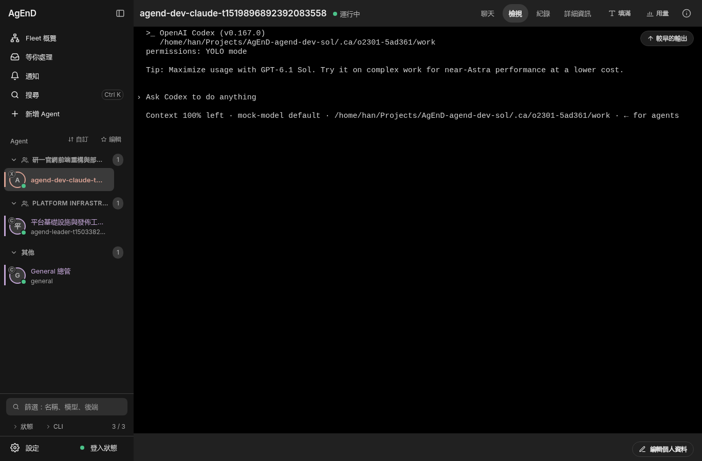
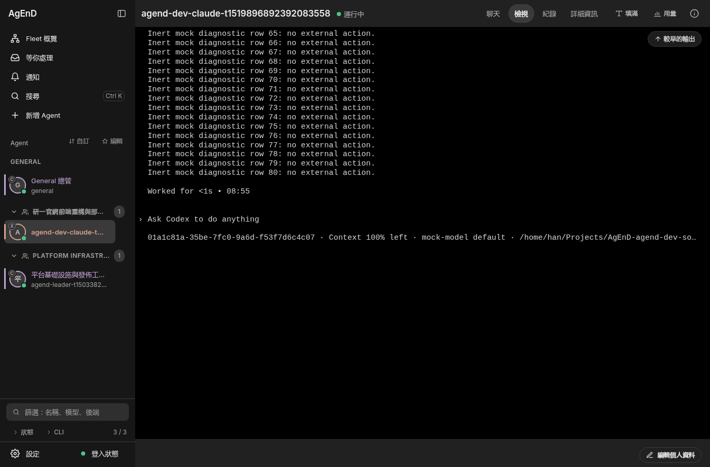
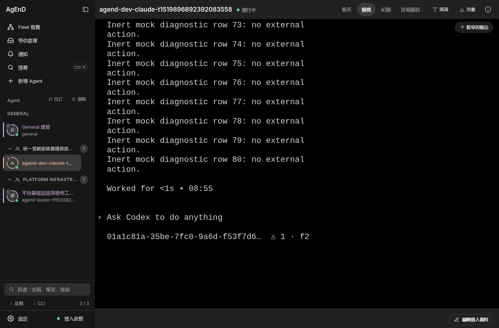
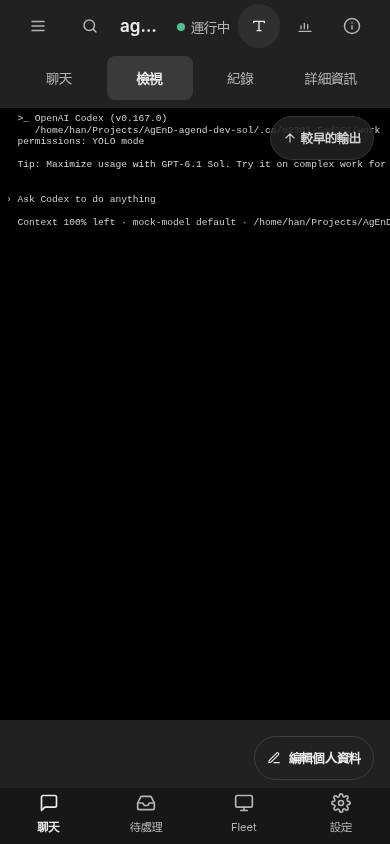
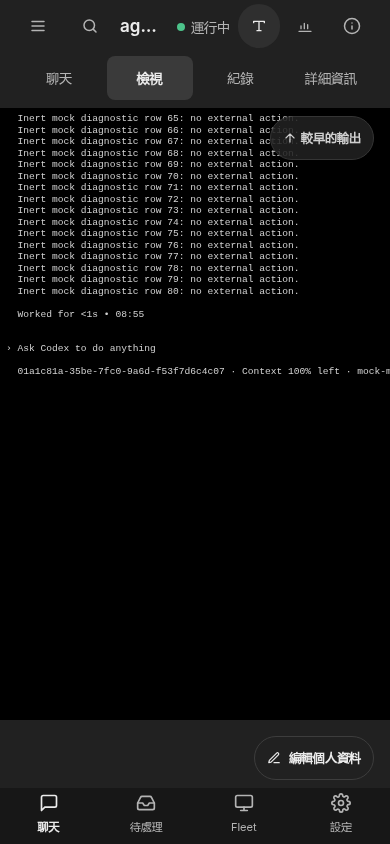
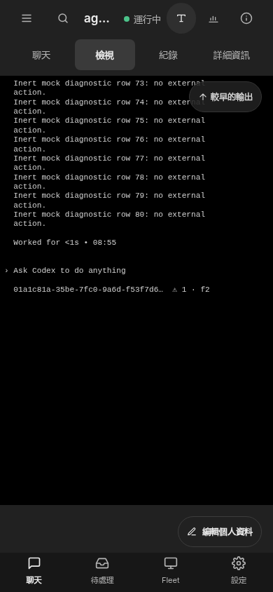

# #2301 acceptance — exact pane/session paste proof

Product source: `fe05648f0ce81986d4550a986fc57def80bd25f2`; the accompanying manifest binds the relevant product bytes and six PNGs. A later evidence-only commit does not change those bytes.

| Check | Result |
|---|---|
| Unmodified main `a3aefd9e4`, same fresh recorded0.167 stream | consumed raw text remains `uncertain`, about8.8s; one paste/Enter |
| Candidate, exact pre-write session/file/offset | `delivered` during normal confirmation, about0.67s; one paste/Enter |
| Switch UUID after Enter | `uncertain`; one paste/Enter, no resend |
| Replace rollout inode after Enter | `uncertain`; one paste/Enter, no resend |
| Narrow Context after Enter | `uncertain`; one paste/Enter, no resend |
| Unit boundaries | metadata id/cwd/root, ambiguous files, partial EOF, symlinks, opened-descriptor replacement race, deadline/single-flight retirement, owner/window/launch/dialog/capture losses and no revival pinned |
| Focused suites | 71 files;1466 pass,7 opt-in real-CLI tests skipped; no account execution |
| Type checks | source and tests native TypeScript checks pass |
| Semantic reversals |11/11 compile and fail assertions; direct-phase wiring additionally pinned with a fake-clock latency assertion |
| View | real shell/private tmux, zh-TW desktop+phone; six screenshots, no page overflow/CSP violation |
| Cleanup | each replay's private tmux and scratch HOME removed; web fixture/probe pool/browser/listeners closed |

Times describe this offline replay, not a latency SLA. The raw text/frames are from a pinned real Codex0.167.0 run against a loopback Responses mock in a network-isolated scratch rig. The replay uses an inert renderer, not a live backend CLI. Startup/idle IPC is inert; the actual binding, incremental reader and durable receipt settlement run. See [fixture provenance](../../../tests/fixtures/codex-pane-owner-2301/README.md), [design](../../design/codex-pane-ownership.md) and [repeatable recipes](../../../scripts/manual/codex-pane-owner-2301/README.md).

## View before / after

Desktop uses the normal120-column pane and View Fit. The complete UUID, Context and model remain visible; the long cwd is the lower-value truncated item. Phone uses the existing Aa control Fit→S to make the UUID and Context readable; the model/cwd can be reached by horizontal scrolling at that chosen zoom. No View code or CSS changes. Narrow screenshots show a45-column captured pane and cannot bind a UUID. CJK fonts are explicitly supplied to the scratch browser; synthetic fixture names only.

| | Before | After | Narrow / uncertain |
|---|---|---|---|
| Desktop |  |  |  |
| Phone |  |  |  |

Known limits: an unwritten/missing session, unsupported metadata or incomplete footer supplies no new transcript authority. Current cwd progress selection, resume policy and Codex `getSessionId() === null` stay unchanged. A lease is runtime-only, cannot be reconstructed after restart, and loss never revives. No native-Windows or real-account claim.

## Review: fallback ownership loss

The replacement test-only delta adds three real lease/recorded-stream cases after pane proof has failed: loss before the first transcript read, loss while an empty read completes (then the exact text arrives in the old rollout), and loss immediately before settlement after a positive read. Each preserves exactly one paste/Enter, records `codex-session-binding-lost`, and cannot settle delivered. The empty-read case holds the fake clock while filesystem work drains, proving retirement does not wait for another poll.

`fallback-review/` records 134/134 across eight focused files, source/test type checks, and three independent compiling semantic reversals: removing the pre-read fence admits a forbidden read; removing the post-read fence leaves the receipt pending until another poll; removing the final fence loses the binding-lost reason or falsely delivers. All three fail assertions; restored control passes. Product bytes and the six View PNGs are unchanged.
