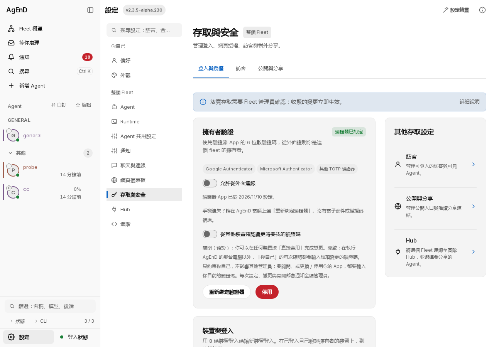
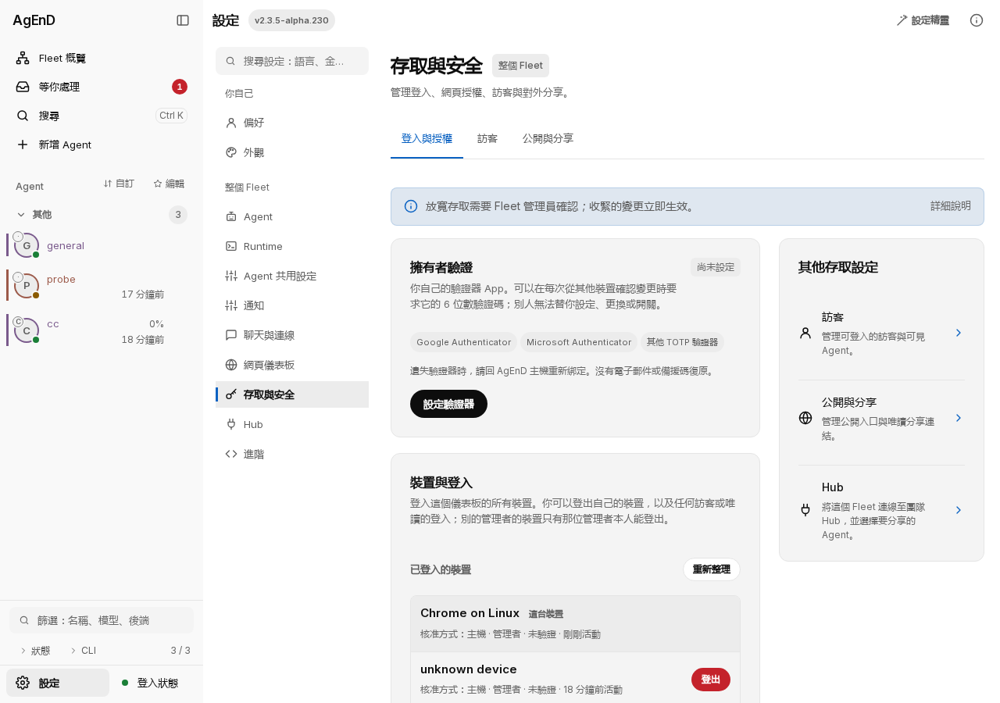
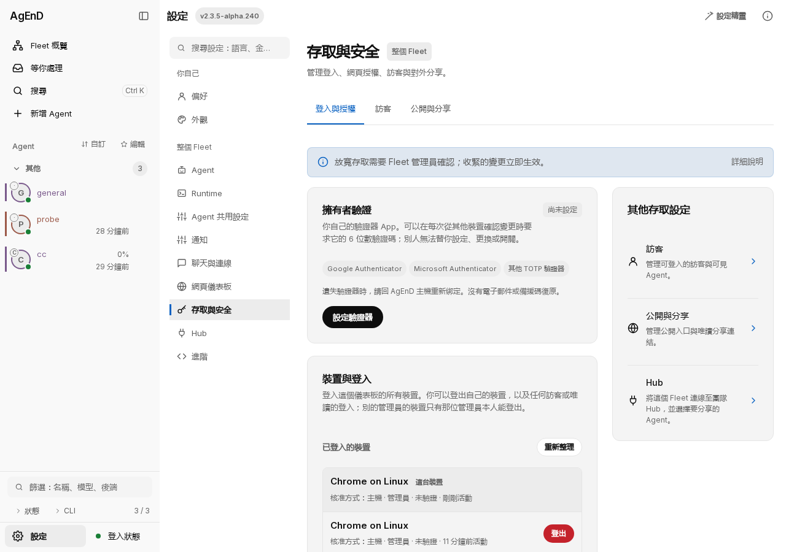

# M-2820: one zh-TW word for admin (管理員)

Real dashboards, zh-TW, light, 1280 px, Settings → 存取與安全 (full page). Rig: private SAFE_RUN containers (~/.cache/rh-a11),
no live fleet. Before = 2.3.5-alpha.230 (the alpha.11 candidate 636328df); after = this branch packed as 2.3.5-alpha.240.

| | Before | After |
|---|---|---|
| Web-only fleet: Devices & sign-in role words |  |  |
| Chat fleet: Devices & sign-in lead + roles, verified-authority hint |  |  |

Before: the role words, the Devices & sign-in lead and the verified-authority hint used the retired word, next to 「Fleet 管理員確認」 on the same page.
After: 管理員 throughout. Hub section (管理員 already) unchanged.
