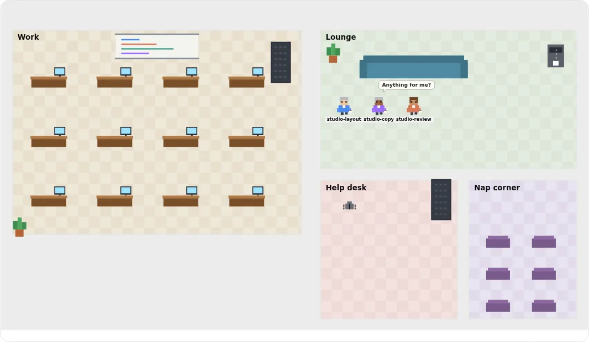
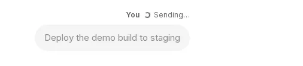
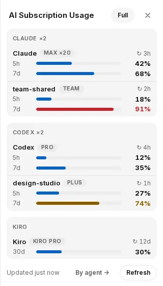

# What's new in AgEnD 2.3

2.3 is the stable release. This page is for people coming from 2.2.x. Most of what 2.2.5 brought during the 2.3 preview (web appearance, guest sign-in, web sign-in authority, the usage page and the org chart) is already in 2.2.5, so this page lists what 2.3 adds and what behaves differently after you upgrade.

## Before you upgrade

The steps, in order, are in [Upgrading from 2.2 to 2.3](upgrade-2.3.md). In short:

- **How to update.** Send `/update` in General, or run `agend update` on the host. The update runs the new version's own installer. If an install is interrupted, run the install command again to repair it.
- **Root and WSL-style hosts (#2369).** On 2.2.x, an `agend update` run from a shell without `XDG_RUNTIME_DIR` (a plain `wsl` shell, `docker exec`, cron, or root) cannot reach the systemd user service and falls back to 2.2.x. Use this instead:

  ```bash
  XDG_RUNTIME_DIR=/run/user/$(id -u) agend update
  ```

  Or rerun the official install command. You do not need this once you are on 2.3. Existing fleets are not affected.
- **Free space: about 235 MB more than a normal install.** Before it changes anything, the update keeps a copy of the installed version so it can roll back, and keeps it while npm installs the new one. On the disk where npm installs AgEnD, keep about 235 MB free for that copy, on top of what the install itself needs.
- **Rollback.** If the new service does not start, the update tries to put the previous version back: its package, its service settings and, if it was running, its service. It does so only where it can prove what was there before; otherwise it keeps the recovery copies and tells you what to check. Its message says whether the previous version is running again and that the update did not succeed; if the recovery was incomplete, follow the steps it prints. From 2.3 on, an update on macOS (launchd) counts as successful only once the fleet is actually running. Upgrading a Mac from 2.2.x is the exception: 2.2.x's updater can report success without 2.3 running and does not roll back, so check that the fleet came up ([how to recover](upgrade-2.3.md#on-a-mac-check-that-the-fleet-came-up-2481), #2481).
- **Two installs at once.** If another AgEnD install or update still holds the install lock, the new one stops before changing anything and says why. Let the other one finish, then run it again.
- **Service files are repaired on update.** On Linux, the unit gets `NotifyAccess=all`. Without it, systemd never receives the ready signal and the fleet restarts every 15 minutes. The update writes the setting and checks the value systemd actually loaded. It also checks the loaded `OOMPolicy`.
- **Dashboard sign-in carries over.** A browser signed in to the dashboard directly stays signed in after the upgrade. The exception: if another AgEnD on the same host replaced this browser's sign-in cookie before the upgrade, sign in once more. A public-link sign-in does not carry over: it lasts only as long as that link, and a restart opens a new one.

### Defaults that change after the upgrade

| What | 2.3 default | How to change it |
|---|---|---|
| Task board cards in chat ("Needs you") | Off | `needs_you.task_board: true` |
| Task board daily summary | Off | `defaults.task_board.summary_at: "09:00"` (a 24-hour time in the fleet's time zone) |
| A new `fleet.yaml` | Written with `defaults.dashboard.task_board: false` | Settings, or per agent with `dashboard` |
| An existing `fleet.yaml` | Not rewritten; the task board stays available | Same as above |
| Canvas Worker effects | Experimental, off | Settings → Web appearance → Experimental |
| CLI language | From `defaults.locale`. If unset: Chinese on a UTC+8 host, English otherwise | `defaults.locale: en` or `zh-TW` |
| ClassicBot rooms | Echo web chat (`🌐 web · <name>: …`) | `web_echo: false` in `classicBot.yaml`, or untick **Web echo** in the room's Settings |
| `agend fleet start` / `agend fleet stop` on a host with a service | Hand over to `agend start` / `agend stop` | `agend fleet start --direct`, from your own shell (not from an agent session) |

## Web dashboard

### Task board (Fleet › Tasks)

<p align="center"></p>

- The board has projects, main tasks (`M-n`) and subtasks (`S-n`). A main task follows its subtasks' progress. You can use dependencies, comments and history, drag cards, and filter. Public links are read-only.
- Agents are told when a card is assigned, sent back, answered, commented on, confirmed or cancelled. Changes made within 10 seconds are combined into one message.
- Each card records who handed it out. Only cards you handed out wait for your confirmation. A card an agent handed out is confirmed by that agent. If that agent is removed, the card goes back to you.
- With `needs_you.task_board: true`, cards waiting for you and blocked cards appear in General's **Needs you** list, where you can confirm, send back or reply. With `defaults.task_board.summary_at` set, you also get a daily summary.
- The Instance drawer lists each agent's cards, grouped by team.

### Global search

- Press **Search** in the sidebar, or **Ctrl+K** (**⌘K** on a Mac), anywhere in the app. In an agent's chat, **Ctrl+F** searches only that agent.
- It covers chat messages, messages between agents, and tasks. Results are grouped by agent; opening one jumps to the message.
- Filter by agent or team, by time, by source, or to only what you wrote yourself.
- Fleet admins signed in on the dashboard can search, here or over the temporary public link, on a phone too. Guests cannot. `web.search.public_link: false` keeps it off the public link.
- The index keeps 90 days by default. Change it with `web.search.retention_days`.

### Office view

<p align="center"></p>

- **Fleet → Org chart → Office** is a third view next to Canvas and List. It draws the fleet as a small pixel office: each team is a room and each agent has a desk.
- You can see what each agent is doing. Working agents type, idle agents drink tea, paused agents sleep, and agents that need you raise a hand. Messages travel along the corridors between desks.
- Two styles: **Desks** and **Studio**.
- Fleet admins can add, rename and delete offices, and choose their style and members. Read-only sessions and the public link can look but not edit; guests do not see the org chart or the Office view. If someone else saved the offices while you were editing, your save is refused and nothing is overwritten. You then choose: keep your edits (the next Save replaces what they saved) or load their version.

### Chat

<p align="center"></p>

- **Reply to a message.** Hover and press ↩, right-click, swipe left or long-press on a phone, or press **R**.
- **Native replies.** A reply sent from the web to a message that came from Discord or Telegram is posted there as a native reply to that message.
- **Reactions.** An agent can react to your web message with an emoji, for a reply that only needs an acknowledgement.
- **Sending.** Your message appears grey as soon as you send it and turns normal once the agent has it. If sending fails, you can retry, put the text back in the box, or delete it. Uploads show their progress. A retry within 10 minutes is recognised and not delivered twice; AgEnD keeps that record in memory only, so after a restart a retry may arrive again.
- **Images** in chat can be zoomed and dragged.
- **Undo and redo** work in every text field: Ctrl/⌘+Z to undo, Ctrl+Shift+Z (⌘⇧Z on a Mac) to redo.
- The message box is one line shorter on a desktop.

### Appearance

- An agent's theme can cover the whole page: sidebar, title bar and right panel. Override it in **⋯ → Page colours**.
- The identity card opens from one button in the chat title bar.
- **App icon.** Upload an image under **Settings → Web appearance → App icon**. Your image is used when you add the dashboard to your home screen.
- **Canvas Worker effects are experimental and off by default.** A local administrator can turn them on under **Settings → Web appearance → Experimental**. Effects run in an isolated Worker and cannot read the page's content or its input fields. Ambient effects, such as falling petals and click stars, are not affected.
- The tool set menu lists the profile each agent actually uses when it has none of its own.

### Usage panel

<p align="center"></p>

- A **Full / Compact** switch sits by the title. Compact groups rows by provider, a few lines per account: the account name, plan and reset time, then a bar and a percentage for its shorter and longer window where it has them (under two days, such as 5 hours, and two days or more, such as a week or a month). Antigravity gets a line per quota pool. Your choice syncs to all your devices.
- Each Claude sign-in has its own row: the default account and every credential profile. When a quota is used up, the row shows 100% and the reset time. When the account is rate-limited, it shows "Rate limited".
- If a figure cannot be read, the last known figure stays on screen and is marked as stale with the time it was cached, instead of showing "unavailable".
- Antigravity shows the plan name, the Gemini quota for paid plans, and a row for Gemini 4 Argon.

### Startup

- On a cold start or a full restart, the dashboard opens before the agents do, so you can watch each agent start in turn.

### Public links and sign-in

- **Your own domain.** Enter a Cloudflare named-tunnel hostname and token under **Settings → Web**. The public link then keeps the same address each time, so a home-screen shortcut keeps working. See [Named tunnel](named-tunnel.md).
- **The token** can only be set or cleared. It is never shown again or written to the log. A badly formatted token is rejected with a message.
- **Lifetime.** A quick tunnel's link lasts 1 to 480 minutes. A named link lasts 1 to 10080 minutes, or 0 for no expiry (`web.public_link.ttl_minutes`).
- **Reopen after a restart.** `web.public_link.auto_open` (off by default) reopens a named link after the fleet restarts, for the admin who last opened it. The sign-in code is still required.
- **Authorize this browser over your own domain.** `web.verified_authority.named_link` (off by default) lets a browser signed in over your named link be authorized. Quick tunnels never qualify.
- You can sign in to a backend from the dashboard: from **Settings → Agents**, the `/backend` menu, Needs you, or the banner on each page.
- Each fleet's sign-in cookie has its own name, so two AgEnD fleets in one browser no longer sign each other out.
- A fleet can run from the browser alone. The setup page can create the first agent without connecting a chat bot.

## Agents and settings

- **Per-agent dashboard switches.** Under `dashboard:`, on an agent or in `defaults:`, switch off `appearance`, `task_board` or `web_settings` for each agent. The tools for a switched-off feature are unavailable to that agent. Settings in the agent override the defaults key by key.

## Reliability and restarts

- **`agend restart` is the one full restart.** It restarts through whatever runs your fleet: systemd, launchd or a detached process. `agend restart <name>` restarts one agent right away. `agend stop` also stops the system unit.
- **Memory pressure does not cause a restart loop.** When startup of agents is held for memory, the fleet asks systemd for more time instead of being stopped at 15 minutes. Health checks start earlier, and batch stops are split by memory.
- **One agent that runs out of memory does not take the fleet down.** If the same Claude Code session runs out of memory twice in a row, the agent stops as `crashed` and notifies you, instead of restarting the same session again and again.
- **Creating an agent or changing a fleet-wide setting** no longer restarts every agent.
- **Faster startup.** `startup.concurrency` now really starts agents in parallel. Its default is derived from free memory and CPU cores, within 2 to 10. `startup.stagger_delay_ms` defaults to 500 ms. The one-at-a-time protection under memory pressure is unchanged.
- **`/login` failures stay contained.** If a sign-in pipeline fails, only that one sign-in ends. The fleet keeps running, and the failure is not reported as success.
- **Speed.** Status updates are about 4 times faster, and the dashboard with many tabs open about 7 times faster. tmux commands run through a small helper process, which brings each command from about 26 ms to about 0.4 ms on the event loop.

## Backends

- **Codex.** When a request hits a 429 (too many requests) and Codex gives up on that round, AgEnD asks it to continue after 30, 60 and 120 seconds, at most three times. "Quota exceeded" is recognised as a used-up quota, and the agent pauses.
- **Codex package check.** `agend doctor` has a **Codex package** row. It warns when the Codex install is missing a file that the official package ships.
- **Claude Code.** The idle cold-start prompt is answered automatically, so the agent no longer stops at it.
- **kiro-cli.** Under `--trust-all-tools`, the "Trust this workspace?" prompt of kiro's V3 engine is answered automatically. Without `--trust-all-tools`, the prompt waits in the instance's pane for you.
- **Grok.** Text that only mentions a quota or rate limit (in code or in chat) is no longer mistaken for a used-up quota. With a background watcher running, messages no longer pile up in the queue.

## Install and commands

- **Windows one-line installer.** Run this in PowerShell:

  ```powershell
  powershell -ExecutionPolicy ByPass -c "irm https://songsid.github.io/AgEnD/install.ps1 | iex"
  ```

  It sets up WSL 2 and Ubuntu, continues automatically after a restart, and lets you finish setup in the browser and sign in to each AI backend. It also creates desktop shortcuts. If an install is already broken, the same line repairs it.
- **`agend shortcuts`** (WSL) creates or refreshes the Windows desktop shortcuts for an install that predates them.
- **Command changes.**
  - `agend status` is now an alias of `agend ls`, and `agend fleet status` is an alias of `agend ls --resources`.
  - **Removed:** `agend schedule trigger`, `agend fleet logs` (use `agend logs`), the chat command `/install-cli` (use `/login`), and `agend install --activate`. Typing one of them shows the command to use instead.
  - **Deprecated:** `/dashboard` still works, but use `/web`. `agend fleet restart` now runs `agend restart`, and it will be removed in 2.4.
- **Report a bug.** The bug report tool creates a file with secrets removed, and a prefilled GitHub issue link. It does not submit anything for you.
- **Bundled Node** is now 22.23.4.

## Security

- `~/.agend` is always created with mode 0700. A directory created as group-writable by an earlier version is tightened on startup.
- Dependencies were refreshed for security.
- Two regular-expression denial-of-service issues are fixed.

## Known issues

- **WSL, after `/login`.** Occasionally the main program on WSL hangs after a `/login` and the watchdog restarts it (#1880). The cause is still under investigation.
- **Codex silent schedules.** A silent schedule on Codex may report "delivery could not be confirmed" even though the message arrived. It is not sent again (#2301).
- **Root or WSL-style hosts.** Upgrading from 2.2.x needs one extra step; see [Before you upgrade](#before-you-upgrade) (#2369).

## Full changelog

- [CHANGELOG.md](CHANGELOG.md)
- [CHANGELOG.zh-TW.md](CHANGELOG.zh-TW.md)
