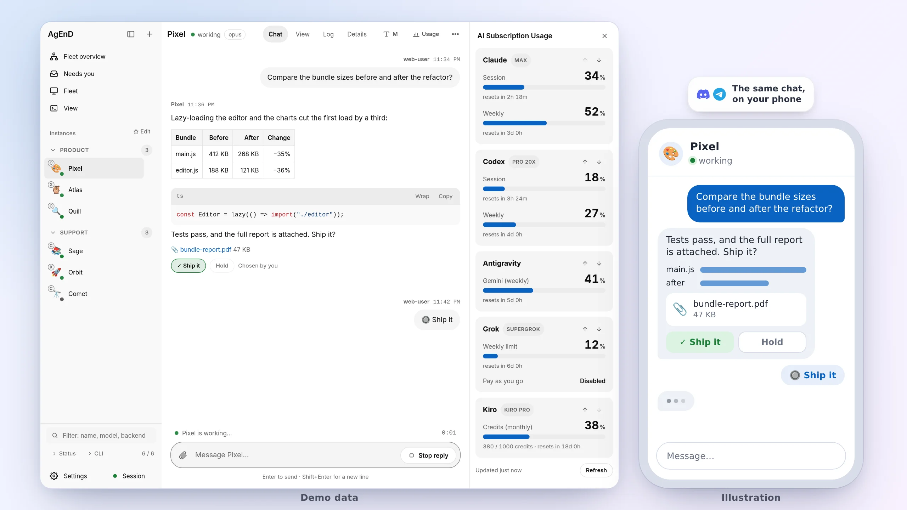
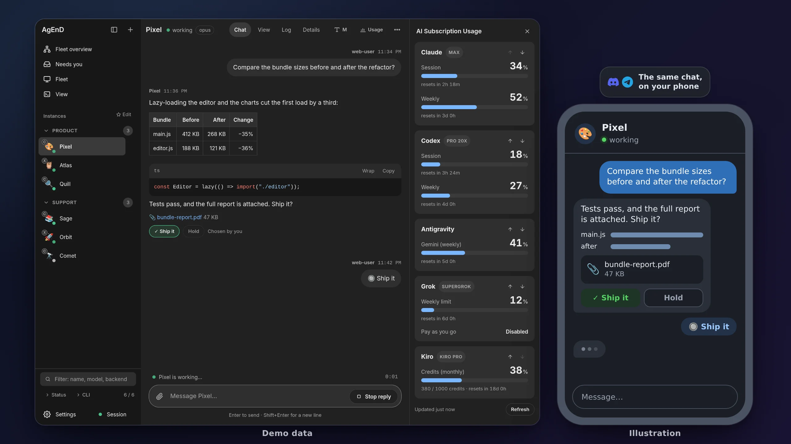

  
  

AgEnD 2.4 重點在於一起工作，同時把控制權留在自己手上。同事可以透過 AgEnD Hub 共用 Agent，Hub 是實驗性的預覽版，預設關閉。管理員也能核准 Agent 之間的聯絡；任務板可以叫醒 Agent，網頁為手機重新設計，更新改成一張卡片，並在更新前先做安全檢查。

## 重點

- **透過 Hub 共用 Agent（實驗性）。** 選擇誰可以提問，然後在房間裡用 `@Agent` 或 `@all` 和 Agent 對話。Hub 預設關閉。
- **管理員核准 Agent 之間的聯絡。** 在 ClassicBot 受限房間裡，要求把工作轉交給另一個 Agent 的請求會等待核准。長期允許可以讓重複的請求在 1、7 或 30 天內不必再逐次核准。
- **會叫醒 Agent 的任務板。** 留言或 `@Agent` 會叫醒對應的 Agent。卡片可以放 Markdown 和檔案，舊的「完成」卡會移到封存。
- **能好好使用的手機版面。** 有 ☰ 選單、一行的 Agent 標題、輸入框上方的狀態列，圖片也能左右滑動檢視。
- **更有用的辦公室。** 可以拖曳 Agent 換座位、拍拍和餵食，電視上可以輪播辦公室，也能使用自己的外觀包。
- **更新改成一張卡片。** General 會顯示一張更新卡片，可選「閒置時更新」、「今晚」或「先不要」。每次更新前都會先檢查能不能安全更新。
- **Windows Runtime。** WSL 裡的 Agent 可以使用這台 Windows 電腦上已登入的 Codex 與 Claude Code，也能配對其他 Windows 電腦。
- **更多連接方式。** 可以用 setup-token 或 API 金鑰連接 Claude 帳號，用 `agend connect` 連接自己的 App，並在同一頁管理所有 AI 帳號。

## 升級前

- **先停止 Fleet，再備份 `~/.agend`。** 這是 AgEnD 的主資料夾。`agend rollback` 會保留資料，但萬一出了問題，這份備份就是你的退路，所以要在升級前備份，不要等升級後才做。如果你有執行 Hub，請先停止 Hub 再備份。
- **從 2.3.5 升級。** 在網頁或聊天裡按「更新」，或在主機上執行 `agend update`。AgEnD 現在改用自己的 tmux 3.8，每個 Agent 會重新啟動一次，並接續原本的對話。
- **使用 npm 12 時。** 請用 `npm install -g --allow-scripts=@songsid/agend @songsid/agend` 安裝或更新。如果一般的 `npm install -g` 略過了 AgEnD 的安裝腳本，AgEnD 會說明原因並顯示這個指令。
- **Hub 與 Fleet。** 兩者不必同時升級。較舊的 Fleet 仍可以連新版 Hub，反之亦然。房間的檔案和由 Hub 執行的更新，則需要兩邊都是 2.4。
- **預設值有改變。** Hub、主機監測和 Windows 個人 Agent 預設關閉。任務板叫醒 Agent 預設開啟，包括你已經在跑的 Fleet；不想要的話，可以到「設定 → Agent 共用設定 → 進階」關閉。既有的 ClassicBot 房間會保留原本的模式。固定公開連結的「以你的身分發言」預設開啟，但升級會保留你先前關閉的選擇。
- **重新整理開著的分頁。** 升級前已經開著的網頁分頁，請重新整理一次。

## 新功能與改變

### AgEnD Hub（實驗性）

*Hub 是實驗性的預覽版，預設關閉。只有 Hub 主機的擁有者在「設定 → Hub」打開後才會啟動，之後的版本可能會有變動。*

- **加入。** 同事在「設定 → Hub」貼上 Hub 位址，再用 AD 帳號或加入碼登入。管理員決定哪些 AD 群組可以連接 Fleet。Hub 位址改變時，已連接的 Fleet 會自己跟上。預設無法加入使用自簽憑證的 Hub。試行時，Fleet 管理員可以在「設定 → Hub」打開「允許信任自簽憑證的 Hub（測試用）」，加入時就會出現「信任這個 Hub 並繼續」；Hub 換上受信任的憑證後請關掉。
- **分享。** 選擇誰可以向 Agent 提問（個人、AD 群組或團隊）以及到期日。在 Hub 頁面勾選 Agent 後按「分享 N 個 Agent」，General 會通知你，24 小時內可以復原。暫停分享會保留名單和到期日；停止分享則是永久的。Agent 回答 Hub 提問時，只在回答那一題的期間內不能聯絡其他 Agent；可以在「設定 → Hub → 共享的 Agent」關閉這個限制。如果變更共用 Agent 的 AI 工具或資料夾，它的分享會依設計結束；「等你處理」會提醒，按「重新分享」就會保留原本可以提問的人。
- **房間。** 開啟房間、加入共用的 Agent，用 `@Agent` 或 `@all` 提問，每個 Agent 只回答一次。房間可以放檔案、圖片和 HTML 預覽，也有表情回應、按鈕、投票、搜尋（Ctrl K，Mac 上是 ⌘K）與個人釘選。Agent 也能在房間裡發言，但有上限。別人的 Agent 要加入房間，必須經過擁有者同意；房間管理員找不到某個 Agent 時，可以請擁有者加入。桌面通知需要先開啟，會在有人 @ 你、你的問題有回答、收到邀請，或一對一有新訊息時提醒。
- **房間辦公室。** 每個房間有「聊天」和「辦公室」兩個分頁。房間裡的 Agent 會坐在辦公室裡，卡片上會顯示擁有者和它正在做什麼。
- **自我介紹。** 每個共用的 Agent 都有一句公開的自我介紹，最多 50 字，顯示在 @ 選單和成員面板裡。分享時擁有者會先看到，可以修改。房間管理員可以寫一句房間用途，顯示在房間名稱下方。
- **一對一對話。** 「對話」會直接打開你最近的對話。Agent 處理你的問題時，你會看到它的狀態。有人提問後，Agent 可以在那段一對一對話裡補充訊息，對方可以在對話的 ⋯ 選單關掉這類訊息。
- **團隊與角色。** 人可以組成團隊，每個團隊最多五位負責人。管理員可以把角色指派給人或 AD 群組、新增第二位管理員，並在稽核紀錄裡查看變更（可匯出 CSV）。最後一位管理員不能被移除。團隊和個人也可以加入聊天、分享 Agent 和連接 Fleet 的允許名單。
- **Hub 助理與自己的 AI App。** Hub 主機可以執行 Hub 自己的助理，目前只支援 Claude，而且不能使用工具。沒有 AgEnD 的同事，可以從 Hub 複製一段設定提示，讓自己的 Claude Code 或 Codex 以 AD 帳號連上 Hub；「我的 AI App」可以看到已連接的 App，並立即中斷。這項功能預設不開放。
- **Windows 個人 Agent。** 沒有 Fleet 的同事，可以用 Hub 頁面提供的一行 PowerShell 指令，把自己的 Windows 電腦連上 Hub（需要 Node.js 22.14 以上）。他的 Agent 會一次回答一個問題，而且只能以唯讀方式存取一個資料夾。預設關閉。
- **管理。** 「管理 → 總覽」只顯示數字，不會顯示誰問了什麼。管理員可以設定登入時間（1 小時到 7 天）與閒置多久後登出（15 分鐘到 24 小時），也可以建議 AgEnD 版本。Hub 只有在 Fleet 的擁有者同意後，才能更新那台 Fleet。「已連線的 Fleet」會顯示每台 Fleet 的 AgEnD 版本，並標示是否需要更新。

### 辦公室

- **拖曳與拍拍。** 把人拖到別的座位，放開後會走回原本的座位（手機上要長按才能拖曳）。每個人的卡片上都有「拍拍」和「餵食」。
- **在辦公室直接對話。** 在「顯示選項」的「對話方式」裡，可以選彈出視窗、側邊面板、視覺小說對話框，或頭上的泡泡。點一下泡泡就會打開那個 Agent 的聊天。
- **告訴 Agent。** 預設關閉。開啟後，你的訊息會附在 Agent 的下一則訊息裡，但不會叫醒它。
- **電視輪播。** 有兩個以上的辦公室時，「輪播…」會依序顯示它們，間隔可設 15 秒到 10 分鐘。可以暫停、切到下一個，也能用空白鍵和左右鍵操作。辦公室切換選單也可以選「所有辦公室」作為首頁。
- **交通工具與求救區。** 外觀包畫了軌道時，Agent 可以搭乘交通工具。需要你的 Agent 會立刻下車，走到「求救區」。
- **外觀包。** 外觀包可以使用最大 5120 px 的 WebP 圖片，一張圖裡可以排很多角色，每個角色有拍拍、左走、站立等動作，也能設定自己的畫布大小。還可以加上自訂點心：拖到角色身上就會餵食，放在空地則讓附近閒著的角色去搶。名片可以用預設、RPG、精簡或檔案夾樣式。
- **顯示選項。** 可以隱藏名字、等級或小地圖，也能替某個 Agent 設定一個只有你看得到的名字。在「編輯辦公室」裡可以打開「待命只在自己的區域走動」（預設關閉）。
- **手機。** 辦公室的工具收在一個 ⋯ 面板裡，區域按鈕可以一鍵移到該區域。離線的成員會變暗，並加上關機標記。

### 任務板

- **卡片開成整頁。** 點卡片會開成一整頁：左邊是內容與動態，右邊是屬性，每個選擇都會即時儲存。可以在「看板」與「清單」之間切換；搜尋和篩選共用一條工具列，並記住你在這台裝置上的設定。主任務只要打標題就能建立。
- **叫醒 Agent。** 卡片上的留言會叫醒負責的 Agent，`@Agent` 會叫醒被提到的 Agent。卡片完成、退回、卡住或換人時，會通知派工的人、關注者（每張卡最多 10 位）和看板負責人。兩個開關在「設定 → Agent 共用設定 → 進階 → 任務板何時叫醒 Agent」，預設開啟，包括你已經在跑的 Fleet。叫醒仍然要經過聯絡權限；一則留言最多叫醒 5 個 Agent，Agent 之間互相回覆最多 4 輪。在網頁聊天裡輸入 `#` 可以選卡片，送出後會變成可以點的卡片標籤。
- **卡片上的成果。** Agent 可以把完成的成果（Markdown 或檔案）附在卡片上，看板上可以直接看或下載。HTML 附件在隔離的預覽裡執行，無法使用你的登入。
- **完成與封存。** 「完成」欄只顯示最新 20 張，其餘按「顯示更多」。完成時間超過設定天數的卡會移到「封存」頁，可以搜尋、篩選和重新打開。
- **專案。** 專案可以指定看板負責人。建立主任務時沒有指定專案，會放進唯一的專案或 Agent 負責的專案；否則 Agent 會先問你。沒有專案的卡會列在「未分類」，直到歸檔為止。
- **手機與狀態。** 手機上一次只顯示一個狀態，卡片的 ⋯ 選單裡有「移到…」。Agent 正在處理某張卡時，卡片會標示「進行中」。

### 更新

- **一張更新卡片。** General 不再每天貼「Run: /update」，改成一張更新卡片，可選「閒置時更新」、「今晚」或「先不要」。「先不要」會隱藏 7 天。進度會更新在同一則訊息裡。只有 Fleet 管理員的選擇才算數，其他人會私下收到說明。`/update now` 仍會立即更新。
- **更新前先檢查。** 從網頁、聊天的 `/update` 或 Hub 更新前，AgEnD 會先確認：正在執行的是 npm 會更新的那一份安裝；PATH 上的 `agend` 是同一個檔案；安裝位置可以寫入，空間也夠；新版能在這台電腦的 Node 上執行；更新來源連得上；沒有其他 Fleet 共用這份安裝或 home，也沒有其他更新正在進行。任何一項不符，更新會停下、說明原因和解法，而且不做任何變更。
- **建議版本。** 連上的 Hub 建議較新的 AgEnD 版本時，「立即更新」會安裝那個版本。General 會通知一次；只要還沒更新，每 7 天提醒一次。

### 聯絡核准與權限

- **ClassicBot 受限模式。** 當不是 Fleet 管理員的人，要求房間裡的 Agent 把工作轉交給另一個 Agent 時，什麼都不會送出，而是變成一張聯絡申請，等目標 Agent 的管理員選「核准這一次」或「拒絕」。聊天中會顯示這份申請，核准後會顯示已轉交。
- **建立房間時選模式。** 用 `/start` 建立房間時，要選「受限模式」或「自由模式」。只有 Fleet 管理員能選自由模式，對管理員來說自由模式排在最前面。既有的房間會保留原本的模式；「等你處理」可能會建議切換，由你決定。
- **長期允許。** 在申請卡上可以選「允許這個人聯絡此 Agent…」，期限 1、7 或 30 天，或自訂日期。期限內，同一個人在同一個房間提出同類申請就不用再逐次核准。長期允許列在目標 Agent 的「設定 → 權限」，可以調整或移除。
- **權限分頁與紀錄。** 每個 Agent 都有「權限」分頁，顯示房間模式、防護涵蓋的工具、核准人、常用轉交和紀錄。「Fleet → 授權」列出所有申請。
- **保留的來源。** 只有受限的 ClassicBot 房間會記錄在裡面說話的人。Fleet 的 Agent 只有接手這種房間的工作，或接手已經帶有來源的 Agent 的工作，才會帶上保留的來源，之後往外轉交都需要核准。管理員可以按「清除保留的來源」，接受目前的對話作為自己的工作。先前的文字不會刪除，每次清除都會留紀錄，之後這個 Agent 自己的話題也不會再重新觸發核准。管理員核准的聯絡，不會把來源傳給接收的 Agent。
- **從各處核准。** 已驗證的管理員可以在手機或固定公開連結上，於「授權」或「等你處理」核准申請。在 General 說出「核准」加上畫面上的短編號，General 會貼一張確認卡給管理員。General 也可以提出權限變更，但要管理員按「確認變更」才會生效。申請被核准並送達、被拒絕或到期時，發出申請的 Agent 都會收到通知。
- **防護的範圍。** 受限模式的工具防護目前只涵蓋 Claude Code。在驗證過的 Claude Code 版本上，受限房間會擋下原生的 Shell、檔案、子 Agent 和未勾選的 MCP 工具，同時保留公開的網路搜尋和網頁閱讀。其他 AI 工具（例如 Codex）會標示「未涵蓋」，以原本的權限執行，只有聯絡申請需要核准。

### 網頁儀表板

- **手機版面。** 在手機上，☰ 打開 Agent 清單，← 回到上一層，✕ 關閉清單。Agent 頁面的標題只有一行：「← 名稱 ● ⋯」。⋯ 裡有其他頁面、搜尋、「檔案與變更」、用量、模型與 effort、文字大小和外觀。輸入框上方的一行狀態會顯示模型、effort 和上下文用量，點一下就能換模型。手機橫拿時也使用手機版面；平板和電腦不變。灰色的次要文字更清楚，手機上的小字放大一號，電腦上不變。
- **圖片與預覽。** 在手機上可以左右滑動，依序看聊天裡的圖片，往上或往下拉就會關閉。圖片可以先標註再引用給 Agent。HTML 預覽可以彈出成獨立視窗；電腦上可以並排兩個對話。
- **聊天工具。** 在訊息上按右鍵（手機上長按）選「釘選」，📌 會列出這個 Agent 的釘選。往上捲會載入較舊的訊息。沒有送達的訊息會顯示「沒有送到 · 重新傳送」。Agent 回覆中的「預覽」按鈕會在旁邊打開改過的檔案（只限管理員）。Agent 的回覆可以引用某則訊息，點一下引用就會跳到原訊息。電腦上可以按住拖曳選取表格的一欄或一塊，用 Ctrl／Cmd+C 複製，貼到試算表就會一格一格。
- **活動步驟。** Agent 工作時，對話裡會出現一個可以收合的步驟區塊，顯示步驟和工具呼叫（只有管理員看得到）。Codex 的步驟和背景子 Agent 也會顯示。
- **封存。** Agent 的訊息超過 500 則時，較舊的會移到封存；捲到最上面時會再載入 100 則。封存的圖片和檔案也會保留，整個 Fleet 預設最多 5 GB，可以在「設定 → 網頁儀表板 → 封存的聊天檔案」調整。
- **公開連結。** 管理員從臨時或固定公開連結進來，功能和在本機一樣，包括設定、排程、任務板、AI 帳號與更新。固定連結會即時更新。若要讓 HTML 預覽在固定連結上可用，請在「設定 → 存取與安全 → 公開與分享」填寫「預覽網址」。
- **登入與訪客。** 要從外面連線，請在「設定 → 存取與安全」設定驗證器 App，再打開「允許從外面連線」。之後新裝置只要輸入 6 位數驗證碼。只有擁有者能登出其他裝置。用 Discord 或 Telegram 私下收到的 /web 登入碼登入，瀏覽器會直接顯示為已驗證、以你的身分發言。訪客可以用自己的私人登入碼登入，但仍是訪客，不會變成管理員；管理員可以設定訪客的登入時間和閒置登出時間。訪客也有篩選、「自訂」和排序功能，設定會存在他們自己的偏好裡。
- **Fleet 頁面。** 「Fleet → 主機狀態」（只有管理員看得到）會顯示執行 AgEnD 這台電腦的 CPU、記憶體和硬碟，以及 1 小時到 30 天的趨勢。在「設定 → 通知 → 主機監測」打開「監測這台電腦」才會啟用，預設關閉。支援 WSL、macOS 和 Ubuntu。警示會出現在「等你處理」，可以確認或暫停提醒 1 小時。
- **檔案。** 「檔案」頁一定會列出 `soul.md`，即使 git 忽略它，並有「顯示 git 忽略的檔案」選項。看起來像機密的檔案仍會隱藏。「檔案與變更」會以唯讀方式顯示 Agent 正在讀取或修改的檔案；`.env` 和金鑰類檔案會隱藏。
- **安裝成應用程式。** 在「等你處理 → 這台裝置 → 安裝成應用程式」，Chrome 或 Edge 會把儀表板安裝成在自己的視窗開啟，可從開始選單、Dock 或主畫面啟動；Hub 在鈴鐺旁也有同樣的按鈕。iPhone 請用「分享 → 加入主畫面」。內容不會被存下來離線使用。
- **外觀與側欄。** 主題選單的「其他…」多了四組內建配色：晴空、青草、夜紫和薄荷，每組都有淺色和深色。側欄的「詳細」與「精簡」在電腦和手機上分開記錄。在側欄的 Agent 上按右鍵，會出現和聊天 ⋯ 相同的選單，並可以「加到我的最愛」。

### Agent 與 CLI

- **帳號集中管理。** 「設定 → AI 帳號與金鑰」列出所有 AI 帳號，包括登入狀態、用量和預設帳號，並可以替 Agent 換帳號。移除帳號前會列出還在用它的 Agent。Codex、Kiro 和 Antigravity 的具名帳號都能從網頁登入；每天自動維持登入是可選的。Agent 的模型清單會在登入完成後自動重新讀取。
- **用 token 或 API 金鑰連接 Claude。** 在「設定 → AI 帳號與金鑰」貼上 `claude setup-token` 產生的 token 或 Anthropic API 金鑰，也可以按「幫我取得 Token」，讓 AgEnD 在背景完成登入。憑證會加密保存，只有本機已驗證的管理員能設定，儲存時不會發出模型請求。在同一個電腦使用者身分下執行的 Agent 仍可能取得這個憑證；不支援組織管理的 Claude 設定。金鑰登入會依實際請求顯示「已驗證」、「需要替換憑證」或「未知」。
- **對話中切換模型與 effort。** Codex 0.164 以上、Muse、Antigravity、Grok 和 Kiro 換模型或 effort 時，會直接套用在正在進行的對話，AgEnD 也會確認切換成功。無法套用或確認時，Agent 會照舊重新啟動。模型選單也能用鍵盤操作。對話上方會顯示思考強度，設定頁的模型旁有「推理強度」選單。預設模型只會套用到同一種 AI 工具的 Agent，而且可以選擇何時套用。
- **切換 Claude 帳號。** 切換 Agent 的 Claude 帳號（profile）時，對話和 Agent 自己裝的 MCP 伺服器會一起帶過去。仍然缺少的會通知 Agent，並列在「等你處理」。
- **Agent 建立 Agent。** Agent 可以為它建立的新 Agent 指定工具集，上限是它自己的等級，不能給 full。修改既有 Agent 的工具集仍只有 General 能做。
- **範本與網頁指令。** Agent 範本可以匯出和載入，但一定不會帶上帳號、金鑰或路徑。網頁聊天也能用 `/sysinfo` 和 `/status`，權限和 Discord、Telegram 相同。`/status` 的表格不再有「花費」欄。
- **連接自己的 App。** 在「設定 → 聊天與連線 → 連接你的 App」複製給 Claude Code、Codex 或其他 MCP App 的設定提示詞。App 可以列出你的 Agent、傳送一般訊息、讀取回答和任務板。它沒有管理或核准的工具，提示詞裡也沒有 token，來自 App 的訊息會標示為「本機 App」。
- **安裝 CLI。** AI CLI 可以在「設定」裡一鍵安裝，並更新到 AgEnD 已檢查過的版本。npm 版的 Claude Code 可以按「改用原生安裝」切換，但只有按下才會執行。AgEnD 也會處理 Antigravity 的首次設定，遇到不認得的畫面會送到「等你處理」。
- **用量。** 同一供應商有多個帳號時，可以用 −／+ 按鈕收合。沒有 Agent 使用的帳號仍會列出。
- **已稽核的版本。** 目前最新的已稽核版本：Claude Code 2.1.331、Codex 0.172.0、Antigravity 1.5.18、Kiro CLI 3.6.2、Grok 1.0.92 和 Muse 1.4.25。

### 安裝與平台

- **Windows Runtime。** 在 WSL 裡執行 AgEnD 時，Agent 可以直接使用這台 Windows 電腦上已登入的 Codex 與 Claude Code。也可以配對其他 Windows 電腦（使用 HTTPS，雙方比對指紋，配對可以撤銷）。Windows 上的 Agent 可以在持續執行的終端機裡運作，電腦重新開機後會接續原本的對話。「設定」裡有一行 PowerShell 安裝指令；Windows Runtime 會從配對的 AgEnD 自動更新，更新失敗時退回上一版。每台 Windows 電腦可以有多個具名的 Claude 帳號。
- **自帶 tmux。** AgEnD 改用自己的 tmux 3.8，不再依賴系統的 tmux。
- **npm 12。** 安裝程式、`agend update`、Hub 更新和 install.sh 都會允許 AgEnD 自己的安裝腳本，因此在 npm 12 上也能安裝和更新。
- **不需要聊天平台。** 純網頁 Fleet 不必接 Discord 或 Telegram，可以指定其中一個 Agent 當 General。

## 修正

- 傳給忙碌中的 Claude Code 或 Codex 的訊息，只有 Agent 真的接手時才會顯示已送達。不再誤顯示「請再傳一次」，重新啟動後也不會重複貼上。
- 回覆沒有送出時，Agent 會拿回它最後的草稿直接送出，不必重寫。
- 關機期間收到的 Telegram 訊息，只有在線上時本來會送給 Agent 的，才會列在「等你處理」。
- Telegram 的 /login 帳號按鈕改成每排兩個，並顯示完整名稱。
- Claude 登入不再誤報「已到期」。
- `agend rollback` 會找到安裝 AgEnD 的那個 npm；安裝程式也不會再被系統套件的提問卡住。
- `agend update` 和一行安裝指令，不再執行你所在資料夾裡專案自帶的 `node`。
- 電腦上有其他 npm 正在安裝時，`agend update` 會最多等 3 分鐘才安裝，避免 Claude 被裝壞。網頁上的 Claude「安裝／更新」在 Claude 自己更新時也不會硬跑。
- Agent 需要的程式（例如 `claude`）不見時，通知和「等你處理」會寫出是哪一個、怎麼裝回來；裝回來後 Agent 會自己啟動。
- 貼進聊天的 /login 一次性 token 會在被記錄前遮掉並作廢，然後私下發一個新的。
- Codex 跳出安全審查暫停時，AgEnD 會停住並發卡片給你（看結果、知道了並繼續、返回），不會自己按，也不會讓 Agent 卡住而沒人知道。
- Codex 換帳號後登入失效時，Agent 會被暫停，「等你處理」會提示你重新啟動它。
- Claude Code 詢問是否改用用量點數（usage credits）時，AgEnD 會停下來，把選項放到「等你處理」，不會被下一則訊息的 Enter 自動換成其他模型。
- 新版 Claude Code 的登入畫面和恢復對話選單都能辨認；遇到無法辨認的選單，會等人處理，不會亂按。
- 用量報表不再重複計算 Codex 子 Agent 複製過去的紀錄。
- Kiro 的 Amazon Q Developer Pro 用量改顯示「每月上限」，不再顯示「無限」。
- Antigravity：對話裡的「quota」字樣不再被當成額度用完；意見調查和首次設定也能正確處理；讀不到版本時顯示「無法讀取」，不再顯示「已安裝」。
- 有自動開啟的固定公開連結，重新啟動後仍會保持開啟；透過固定連結的登入，在 Fleet 重新啟動或更新後仍然有效。
- 同一個 Discord 或 Telegram 帳號，不論從哪個 bot 進來都算同一個人。管理員透過第二個 bot 送出的訊息，不會再被當成非管理員。
- AgEnD 重新啟動後，網頁聊天裡的 Discord 提及會保留名稱，不會再顯示成 @user。
- 網頁聊天的表情符號在 Windows 上以彩色顯示，不再是灰色線框。
- 任務板的「一小時沒動靜」提醒，不會因為 Claude 閒置時自己壓縮對話而延後。

## 回退到 2.3.5

請使用 `agend rollback`，不要用一般的「更新到較舊版本」。2.3.5 會因為 2.4 的 tmux 還在執行而拒絕啟動 Agent。

1. 升級前先停止 Fleet，並備份 `~/.agend`（見「升級前」）。
2. 先暫停受限的 Agent 和受限的房間。
3. 執行 `agend rollback 2.3.5 --yes`。所有資料和設定都會保留。
4. 在 2.3.5 上，2.4 專屬的功能會進入休眠：Hub 連線、封存檢視、WebP 外觀包和聯絡閘門。
5. 執行 `agend update` 就能回到 2.4。所有東西都會還原，Hub 連線也會自己重新連上。
6. Hub 主機無法在 2.3.5 上執行。請讓它維持在 2.4，或還原它的備份。

## 已知問題

- **iPhone 打字。** 已包含 iPhone 上用輸入法（例如注音）打字時畫面閃爍的修正，但還沒在實機 iPhone 上確認。
- **幫我取得 Token。** 「AI 帳號與金鑰」裡的 Claude 登入小幫手，停在「正在等候 Claude 登入頁面…」的問題已有修正，但還沒在實際裝置上確認。直接貼上 `claude setup-token` 產生的 Token 不受影響。

2.3 新增的內容請見[2.3 更新重點](/AgEnD/zh-tw/docs/whats-new-2-3/)。完整的變更清單請見[發佈說明](https://github.com/songsid/AgEnD/releases)。
